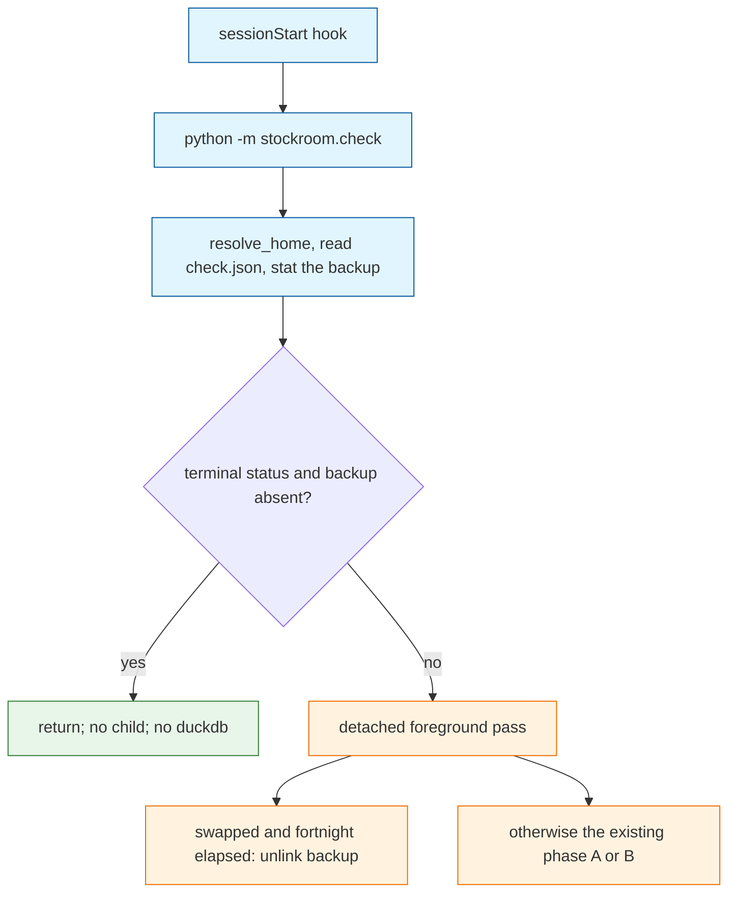

# Architecture Decision: Check Machinery Lifetime

## Requirements & Constraints

Ranked quality attributes:

1. **No leftover footguns.** A finished machine must not keep an unexplained copy of the old warehouse, and a later storage migration must not trip over this one's record.
2. **Quiet hooks.** Session start must not keep doing migration work after the machine is finished.
3. **Maintainability.** One owner for the check. No second record file. No framework for migrations that do not exist yet.
4. **Reversibility.** The fortnight in which a person can put the original back stays intact. Removal of the machinery waits until that reclaim has had a long time to run.

Functional requirements:

- The fortnight backup reclaim ships on its own and is not this decision.
- While the check still exists, a finished home does not spawn the detached check child and does not import DuckDB to learn that it is finished.
- In-progress homes (`skip`, `rehearsed`, `started`, `linked`, or no record) still run the check.
- A finished home whose backup file is still present still runs the check, so the fortnight reclaim can unlink it.
- About a year from now, the next major version removes the check from the hook and deletes this machinery.
- A second storage migration before that removal does not add `check-2.json`.

Technical constraints:

- `python -m stockroom.check` imports `duckdb` at module import, then `launch()` always spawns a detached `--foreground` child. The child is what reads `check.json`. A terminal record still pays for the import and the child (`skills/sr-search/src/stockroom/check.py`).
- `next_action` returns `stop` for `swapped`, `mismatch`, and `already-new` of `CHECK_VERSION`. Any other `check_version` returns `phase-a`. A second file is not how a new run starts.
- `stockroom.home.resolve_home` is stdlib-only and is the one home resolver. A shell copy of that logic would be a second owner.
- The hook runs the check from the plugin root it loaded. The nightly job does not run the check.
- The operator set the removal horizon at about a year. That horizon does not change the fortnight reclaim.

Out of scope: the unlink predicate, deleting `check.json` as a disk-saving measure, and designing the next storage format.

## Components

The hook, the parent interpreter, and the detached child are three process steps. Today the parent always imports DuckDB and always starts the child. The record and the backup file are the only shared state. Doctor reads them and does not write them.

Terminal status means `swapped`, `already-new`, or `mismatch` at `CHECK_VERSION` 1.

## Options Evaluated

- **Permanent framework**: Keep the check on the hook. A future migration bumps `CHECK_VERSION` or adds `check-2.json` and reuses phase A and B.
- **Time-boxed check**: Short-circuit a finished home inside the parent process. Remove the hook line and the check module in the next major version, about a year out. A second migration before that removal bumps `CHECK_VERSION` and replaces the readiness predicate. It does not add a file.
- **Remove now**: Delete the hook line and the check in the same change as the fortnight reclaim.

## Analysis

| Criterion | Permanent framework | Time-boxed check | Remove now |
|-----------|---------------------|------------------|------------|
| Fitness | The hook stays noisy after every machine is done. `check.json` with status `swapped` blocks a same-version rerun, which invites a second file. | A finished home with no backup stops before the child. The reclaim still runs while the backup exists. The year-out removal ends the hook work. | Stragglers who have not swapped, and backups younger than a fortnight, lose the only pass that finishes them. |
| Simplicity | A framework for one migration. | One gate in front of `launch()`, then a deletion later. | The smallest end state, reached too early. |
| Maintainability | Phase A and B stay forever, plus a version rule that already exists and is easy to misuse into a second filename. | The check keeps one owner until the major that deletes it. `check.json` is not reused after that. | Nothing left to maintain, and no path for a machine still on `rehearsed` or `linked`. |
| Scalability | Every future format change inherits the hook cost and this record. | The realistic horizon is one more year of this code, not a series of migrations. | No further load. |
| Risk | Low blast radius, permanent hook cost. Reversible. | A wrong short-circuit can skip the reclaim. Reversible until the major. The major can slip. | High blast radius. An in-progress swap or a wanted backup is stranded. Hard to undo once machines upgrade. |

Key insights:

- `CHECK_VERSION` is already the second-run switch. A record whose version is not the current one takes phase A. `check-2.json` would be a second latch the hook would also have to know about. Do not add it.
- Status `swapped` at the current version is what stops a rerun. That is the footgun for a later migration that reused this file without bumping the version. Bumping the version clears it. After the module is gone, the leftover file is inert only if the next migration does not read it.
- Short-circuiting on `swapped` alone never unlinks the backup, because the unlink lives in the child and the parent would never start it. The backup has to be absent before the parent returns.
- Skipping the child from the shell would avoid the parent process too, and it would reimplement `resolve_home`. The parent process is the stdlib gate. The cost that leaves is one short-lived interpreter. The child and the DuckDB import are the hook work this removes. The major version removes the interpreter as well, by deleting the hook line.
- `check.json` stays on disk. It is the fortnight clock and the stop latch. Deleting it while this code is installed makes the next session take phase A. On an already-new warehouse that pass writes `already-new` and does not copy. The file is not the disk problem.

## Decision

### Choice Pre-Mortem

- The year is too short, and machines that never started a session still need the check: checked. The operator set the horizon. The removal is a major version, so it can move. Until that release, the check stays for homes that are not finished.
- The short-circuit skips the backup unlink: checked. The parent returns only when the backup name is absent. A present backup still launches the child.
- A shell test of `check.json` drifts from `resolve_home`: checked by putting the gate in the parent, which calls `resolve_home`, and by refusing a second path implementation.

**Selected**: Time-boxed check
**Rationale**: Quiet hooks and no leftover latch win over keeping a migration framework. The parent process is the place that can see a finished record without DuckDB and without a child. The next major version, about a year out, deletes the hook line and the module. A second migration before that bumps `CHECK_VERSION` in this module instead of adding a file.
**Tradeoff**: Until that major, session start still starts one short-lived Python for the gate. A machine that never starts a session in the year keeps both the check's absence and any backup the fortnight pass never saw. That is the same session-start dependency the swap already has.

## Implementation Notes

- The module the hook executes must not import `duckdb` at import time. Read the record with the stdlib, call `resolve_home`, and return before `launch()` when `check_version` is 1, status is `swapped`, `already-new`, or `mismatch`, and `warehouse.issue147-swap.duckdb` is not a file.
- Any other record, a missing record, an unreadable record, or a present backup still calls `launch()`.
- Do not delete or rename `check.json` in this gate.
- The fortnight unlink stays in the child, on the `swapped` stop path. This gate must not take that over.
- The removal release deletes the check invocation in both hook files, the check module, the swap backup constant, and the restore procedure that depends on them. It does not read `check.json`. A later migration chooses a new record name.
- If a second storage migration is required before that removal, bump `CHECK_VERSION` and replace the readiness predicate. Leave phase A and B as the one state machine. Do not add `check-2.json`.
