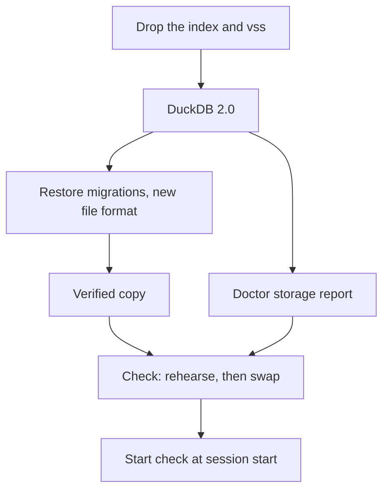

# Milestones: warehouse-file-growth

## Cross-milestone invariants & constraints

Spec: [issue 147](https://github.com/Texarkanine/stockroom/issues/147), as amended by the operator decisions in `memory-bank/active/projectbrief.md`. The 2026-10-21 decision to drop the HNSW index replaces the issue's "keep HNSW" and every requirement built on it. The 2026-10-22 decision merges the swap into the check: each machine first records a verified rehearsal and swaps at a later session start. [Issue 146](https://github.com/Texarkanine/stockroom/issues/146) is out of scope. The 2026-10-22 rulings on migrations replace every earlier statement that edits a released migration or treats the copy chain as short-lived: released migrations are immutable, one chain plus a frozen schema file creates new warehouses, a warehouse migrates or stops, and the copy-and-swap is durable.

No vector index (operator, 2026-10-21): the HNSW index and the `vss` extension leave the engine. After the first milestone, nothing in the engine loads or installs `vss`, creates a vector index, or sets an HNSW setting. Semantic search ranks every embedding exactly. Migration `0009` drops the index where one exists. The released `0003`, which creates the index and needs `vss`, keeps its released SQL (operator, 2026-10-22). New warehouses are created from the schema file and never run it, and a warehouse that would have to run it stops with an error (see "Migrate or stop"). No milestone adds a vector index back. That door stays open to a later project, which would bring the index back with a rebuild routine. Measured 2026-10-21 on copies of this machine's warehouse (133,793 vectors), where the index returned 37 to 65 rows for a top-100 search in 34 ms:
- Exact search that keeps the nearest chunk per message owner and cuts to the limit before it joins `messages` takes 153 ms (median) on DuckDB 2.0.0 and 205 ms on 1.5.4, and always returns the full limit. Today's scoped SQL, which joins first and dedups with `QUALIFY row_number()`, takes 1,321 ms and 1,745 ms run with no scope.
- Dropping the index and checkpointing took 0.8 s and cut used blocks from 161,453 to 6,846 (256 KiB each), freeing 37.4 GiB inside the 39.5 GiB file.

DuckDB 2.0.0's replay bug lives in `vss`: replaying a `.wal` that holds inserts into an HNSW-indexed table breaks the index. With `vss` never loaded, it cannot reach a stockroom warehouse. Measured on DuckDB 1.5.4 and 2.0.0, both with extension autoload off and with DuckDB's default autoload and autoinstall settings: DuckDB never loads `vss` by itself for a file that has the index. Such a file, with or without a leftover `.wal` from a killed 1.5.4 embed, opens read-only and read-write and keeps every row. It answers an exact cosine query, drops the index inside a transaction, accepts an insert, and checkpoints with no `.wal` left. On 2.0.0 without `vss`, `COPY FROM DATABASE` from a file that still has the index fails ("unknown index type 'HNSW'"), so nothing copies a file before it has migrated.

Migrations (operator, 2026-10-22): a migration that shipped in a release never has its SQL changed to do something materially different. Comments may be added or changed; #128 added `@rel` lines to the released `0001` and `0007`, and later ERD edges can go into migrations the same way. A gate in `make ci` and CI fails when a migration file in the latest release tag has different SQL in the working tree, compared with comments and whitespace removed. Milestone 3 adds it, and the CI checkout fetches tags. One chain runs forever. New warehouses are created from a frozen schema file pinned to one chain version, version 9 in this project. It holds that version's tables, columns, keys, and the `session_token_usage` view, no index, and zstd on `messages.text` and `tool_calls.tool_input`. A new warehouse records one `schema_version` row naming the schema file, then migrates forward through any later migrations. A schema file is frozen like a migration; a newer one would be a new file at a later version. A test keeps a warehouse built from the schema file equal to one built by the chain at that version, apart from compression. No runner rule may record a version without running it. The format boundary is a named schema version next to the storage version: 9 in this project, where it equals the head. The check's precondition is "at the format boundary", not "at the head". This project adds no migration after `0009`. A later release that adds one must also make the runner stop an old-format warehouse at the boundary with an error until the copy-and-swap has converted it, because old-format warehouses run the chain only up to that boundary. That release also decides how long phase B's wait may hold such a warehouse.

Migrate or stop (operator, 2026-10-22): a warehouse that cannot reach the head stops in an error state that names the file and the remedy, which users discover and must resolve. Code after the DuckDB 2.0 point never detects an older, unmigrated state and copes with it, so it has no degraded modes.

Durability (operator, 2026-10-22, replacing the 2026-10-21 lifetime rule): old-format warehouses may not persist. A warehouse runs the chain to the format boundary, and the copy-and-swap then moves it to the new format. So milestones 5 to 7 (the verified copy, the check with its swap, and the session-start launch) are the v1-to-v2 step of the chain and durable code with normal care, even with about five installs today. In this project the head and the boundary are both 9, so nothing forces a conversion yet: a skip retries at the next session start and has no error state of its own (operator, 2026-10-22). Take the simpler option whenever it cannot lose a warehouse. The data-safety rules below do not relax. Keep the chain in its own module, touching shared code only at its entry point, the hook command, and doctor's check line.

DuckDB (operator, 2026-10-21): the engine moves to DuckDB 2.0, a long-term support line supported until at least October 2027 (the 1.5 line ends in March 2027). New files and the copy use storage `v2.0.0`. The operator chose it over `v1.5.0`, which DuckDB 1.5.4 could still open. DuckDB before 2.0 cannot open a file that 2.0 creates. Later milestones stay on the 2.0 line; a 2.0 patch bump is fine. DuckDB behaviour stated below was measured on 2.0.0 on 2026-10-21 unless it says otherwise.

Releases (operator, 2026-10-21, "time to ship something"; amended 2026-10-22): milestones 1, 2, and 3 make the first release. Restoring the released `0003` breaks new installs until milestone 3's schema-file path exists, so they ship together, and milestone 1 no longer ships alone. Later milestones ship in later releases. The swap reaches users with the session-start launch in milestone 7. No release carries the 2.0 lock with a vector index or `vss`. Before a release that carries the 2.0 lock, the operator runs the shadow test from a clone of the branch on the personal Mac, not the work Mac. It passed on 2026-10-22 against `ce16489` (milestones 1 and 2). It passed again on Puck on 2026-10-23 against `09ea4ae`, after milestone 3 had landed: exit 0 in 43s, and the copy stayed `v1.0.0+`. Figures are in `progress.md`. The milestone 1 to 3 pull request opens only after milestone 3 restores the released migrations. A branch clone runs only that test there, never `make shim`, so the branch does not become the live engine on a Mac. This machine is different. Its live `stockroom` shim runs this checkout, the 03:30 nightly job uses that shim, and the commit hook syncs this checkout's environment to its working-tree lock on every commit. So any commit on this branch is live here at the next run. The first commit that contains milestone 1's migration drops the index on this machine's warehouse, and the 2.0 lock is the last change milestone 2 brings into this checkout.

Skipped releases (operator, 2026-10-21): users skip releases, so every release must stand alone. A user who arrives from any earlier stockroom release, with no release in between, gets a warehouse that opens, migrates forward, and works, or that stops with an error saying what to do when it cannot reach the head (see "Migrate or stop"). No milestone may assume that a user ran an earlier milestone's release or the check. Every tagged release so far (v0.1.0 to v2.1.3) pinned DuckDB 1.5.4. v0.1.0 shipped `0001` to `0004` together, and every release loaded `vss` before migrating. So a release must handle each of these arrivals:
- a `v1.0.0+` file at schema 3 to 8, with the HNSW index. Every warehouse with rows is at schema 4 or higher. It migrates to the head without `vss`, and `0009` drops the index;
- such a file with a `.wal` left by a 1.5.4 embed that was killed before the user updated;
- a `v1.0.0+` file below schema 3: the empty file a failed first open left behind (for example, when `ensure_vss` could not reach the network), or a crash partway through a first open. It holds no rows. It would need the released `0003`, and so `vss`, so it stops with an error that names the file and tells the user to move it aside;
- a `v2.0.0+` file that a release of this project created. Milestones 1 to 3 ship together, so a release always builds one from the schema file, with zstd. A `v2.0.0+` file without zstd comes only from branch testing;
- no warehouse at all.

Tests that need an old file create it at storage `v1.0.0` with the packaged chain, which is the released chain, loading `vss` for `0003` in a separate process. A test that needs the index creates it with `vss` loaded only in a separate process, or closes every such connection before the engine opens the file. Connections to the same path in one Python process share one DuckDB database and the extensions loaded in it. Nothing outside tests loads `vss`.

"Zstd on a column" is read from that column's data segments in `pragma_storage_info`: `VARCHAR` for `messages.text` and `JSON` for `tool_calls.tool_input`. Validity segments under the same column name show `Uncompressed` or `Constant` even when zstd is on, so they do not count. A table with no rows has no data segments; each check that reads zstd states what it does with an empty table.

No milestone deletes the original warehouse file or a backup. A rewrite attaches the original `READ_ONLY` and never opens it for writing. The only replace of the live path is phase B of the check pass. It replaces the file only with a copy that the same run built and verified, and only after a verified rehearsal of the same check version on that machine at least one day earlier.

The storage upgrade stays outside `schema_version`. No milestone adds a migration that rebuilds populated `messages` or `tool_calls`. The index-drop migration drops an index and rebuilds no table. A skipped or absent rewrite must not make `open_current()` treat the warehouse as behind head.

This project does not quantize vectors, tier history out, add a `compact` subcommand, or chase the primary-key leak in code.

Doctor (operator, 2026-10-21): a user can run any discoverable doctor command with full confidence that nothing is written. `probe` and `smoke` never write. Any doctor action that writes sits behind `stockroom doctor fix <name>` and runs only when the user names it. This project adds no doctor fix. Readers and doctor never start a rewrite.

The check pass (operator, 2026-10-22) runs in two phases recorded in one check record per machine. Phase A, the rehearsal, builds a copy, verifies it, records `rehearsed` with its measurements, deletes the copy, and does not swap. Phase B runs at a later session start, at least one day after a `rehearsed` record of the same check version. It copies the warehouse again as it is that day, verifies again, hard-links the original to the backup name, and replaces the live file. The session-start hook starts the pass detached, through an internal engine entry point that the user guide does not list, and session start does not wait for it. "No new CLI command" means no new user-facing command. Nothing else starts the pass: not Cursor's `beforeSubmitPrompt` hook, ingest, embed, `migrate`, `backfill`, or any other writer open, not readers or the dashboard, not `doctor`, and not the nightly job.

Swapped, verification mismatch, already new, a crash, and a time-limit overrun are final for a check version, and later session starts do nothing. `rehearsed` is not final; it waits for phase B. A crash or an overrun stays in the record for doctor to show, and deleting the record file runs the check again from phase A. Skips build nothing and are not final, so the next session start tries again. The skip reasons are low disk, a wal, a busy flock, a read-only filesystem, no warehouse yet, and a warehouse below the format boundary. A filesystem that refuses hard links is out of scope (operator, 2026-10-22): APFS, Mac OS Extended (Journaled), ext4, and NTFS all support them. The record names the check version, so a later release that changes the check runs it again. A release that changes the check version and keeps phase B off is the kill switch.

Shared artifacts:

- The index-drop milestone owns the drop migration, the removal of `vss` and the index from the engine, and the removal of the index-only parts of `scripts/shadow_duckdb_20.py` and its tests. After it, nothing in the engine, its tests, its docs, or `memory-bank` system patterns and tech context describes a vector index as present. Milestone 3 restores the released SQL and name of `0003`, and the golden snapshots and schema tests that follow from it. Milestone 1's comment edits to `0001` are allowed and stay.
- The DuckDB 2.0 milestone owns the DuckDB pin, its dependency range, the rest of `scripts/shadow_duckdb_20.py`, and the user-facing statement of which DuckDB versions can open the warehouse. The range stays below 2.1, so a Dependabot bump cannot move the engine off the 2.0 line.
- The new-file milestone owns:
  - the restoration of released migrations and the immutability gate;
  - the explicit storage setting and the format-boundary constant;
  - the frozen schema file, with its ZSTD clauses on `messages.text` and `tool_calls.tool_input`;
  - the new-warehouse creation path, which builds a warehouse file under a temp name and renames it into place when complete.

  The copy milestone extends that same builder to copy rows from an original, and does not restate the schema.
- The doctor milestone owns the storage section of the doctor report, the live-size estimate, and the backup filename. The check milestone owns the check record, adds one line for it to that section, uses the live-size estimate for its low-disk test, and writes the backup under that filename. It does not add a second report. The record is a sidecar file under the stockroom home. Nothing writes the check result into the warehouse.
- The copy milestone owns equality and catalog verification, and the measurements the builder returns. The check milestone calls that builder in both phases and stores those measurements in its record. The swap is phase B of the check pass, with the same lock, skip rules, temp naming, and cleanup, not a second pipeline.
- The hook milestone owns the session-start launch in `hooks/*.json`, the detached launch in front of the check's entry point, and the user-facing hook description. It does not change the pass.

## Execution Order

- [x] Drop the HNSW index with a migration and remove the vss extension and everything else about the index from the engine
- [x] Move the engine to DuckDB 2.0 and prove it on a copy of a real warehouse
- [x] Restore every released migration as it shipped and create new warehouses from a frozen schema file in DuckDB 2.0's storage format with ZSTD on messages.text and tool_calls.tool_input
- [x] Report warehouse file size, block use, reclaimable space, storage format, free disk, and an existing backup from stockroom doctor
- [x] Build a verified newer-format copy of a warehouse without modifying the original
- [x] Run that copy under the writer flock with a time limit, first as a recorded rehearsal and later as a hard-link swap, and skip when the file is not ready
- [x] Start the check from the Claude Code and Cursor session-start hooks

## Per-milestone done and risks

### Drop the HNSW index with a migration and remove the vss extension and everything else about the index from the engine
- Done: A new migration, the next number after `0008`, runs `DROP INDEX IF EXISTS embeddings_vector_hnsw`. Migration `0003` no longer creates an index, so a new warehouse never has one. No engine path loads or installs `vss` or sets `hnsw_enable_experimental_persistence`, and `ensure_vss` is gone. Semantic search has one exact ranking path for unscoped and scoped searches. It keeps the nearest chunk per message owner and cuts to the limit before it joins `messages`, so the text join touches only the winners. A `--role` scope, which needs `messages.role`, still dedups and cuts before it reads message text. `--harness` and `--role` stay equality scopes, and the index path and `OVERFETCH` are gone. Tests prove these behaviours:
    - A warehouse at schema 8 opens through `warehouse.open()`, migrates to head, keeps every row, has no index, and answers semantic search. It has the index and a `.wal` left by a writer killed after an `embeddings` insert. Separate processes build the index and run the killed writer, and the test asserts that `vss` is not loaded on the engine's connection.
    - A new warehouse has no index.
    - An unscoped search returns its full limit when enough messages have embeddings.

  Tests, golden schema snapshots, the generated warehouse-schema ERD, the architecture docs, `skills/sr-search/references/system-model.md`, and `memory-bank` system patterns and tech context no longer describe an index or `vss`. The index-only parts of this branch's first DuckDB 2.0 attempt also go: the unscoped-HNSW plan test, the HNSW rationale of the scoped starvation test, and the kill protocol, `classify`, `reproduce`, the patch repeat, and the index measurements in `scripts/shadow_duckdb_20.py` and its tests. Before the first commit that contains the migration, the migration runs on a copy of this machine's warehouse: every table equals the copy before it in both directions, no index remains, and used blocks drop. `make ci` passes on DuckDB 1.5.4. Amended 2026-10-22: making `0003` comment-only under a new name changed a released migration's SQL, which the operator ruled out. The `0003` to `0008` golden snapshots and schema tests changed with it. Milestone 3 restores them. The comment edits to `0001` are allowed and stay.
- Risks: The first commit that contains the migration is live on this machine. The next writer open (the 03:30 job or any command) drops the index on the real warehouse, so the copy proof comes first. Measured on the live copy: the drop takes under a second. An older plugin copy still on an earlier release, such as the Claude Code stockroom 0.16.0 on this machine, loads `vss`. It runs its own search SQL as an exact scan on a warehouse at the new head, and it does not migrate a warehouse that is ahead of it. If it creates a new warehouse, its own `0003` creates the index, and the next open by this release drops it. A migration file that holds only comments runs inside the runner's transaction on both versions, so `0003` can stay as a no-op file. Whether it keeps its filename is a plan decision. The runner keys on the version number, and `schema_version` rows keep the old filename as a record. Search is exact, so its time grows with the row count. With the dedup-first shape that is about 1 s at a million vectors if linear. With today's scoped SQL it would be about 10 s. The 962 vectors embedded on 2026-10-21 would take about 900 nights to reach a million.

### Move the engine to DuckDB 2.0 and prove it on a copy of a real warehouse
- Done: The engine lock pins DuckDB 2.0 (2.0.0 or a later 2.0 patch), and the engine's dependency range is `>=2.0,<2.1`. `.github/dependabot.yaml` ignores duckdb `>= 2.1.0` in the engine block, and `make ci` passes. `scripts/shadow_duckdb_20.py` runs from a clone of the branch under a DuckDB 2.0 overlay against a copy of a real warehouse, under a scratch `STOCKROOM_HOME` that may sit on another disk. It never opens the original with DuckDB. It copies the original under the writer flock, only when no `.wal` exists. Under 2.0 the copy checkpoints, and every table equals the baseline in both directions (`EXCEPT ALL`). Then ingest, `embed --verbose`, and a checkpoint run under 2.0. Afterwards the copy is at the schema head with no index and keeps its `v1.0.0+` tag. `sessions`, `messages`, and `tool_calls` have no fewer rows, `embeddings` loses only the orphans embed reports, and `stockroom semantic` answers. A DuckDB 1.5.4 writer then writes to the copy and answers the same query, as another harness's older plugin copy can, and 2.0 answers it after that. The script exits 0 on this machine's warehouse before the 2.0 lock lands in this checkout, and the operator runs it on his Macs before the release. The schema-1 storage-tag test already on the branch, and milestone 1's leftover-`.wal` test, pass on 2.0. `docs/advanced/duckdb.md` says a new warehouse uses DuckDB 2.0's format, that DuckDB before 2.0 cannot open it, and that the DuckDB CLI must be 2.0 or newer. Under 2.0, `stockroom embed` and `stockroom semantic` print no nanobind leaked-instance warnings at exit, or the operator has accepted them after the cause was found. The 2.0 lock is the last change this milestone brings into this checkout.
- Risks: The commit hook and every `make` target that syncs install the working-tree lock here. `make ci` is the sync that moves `.venv` before the commit. If it fails, restore the 1.5.4 lock and run `make sync` before the 03:30 job. Ingest, embed, and semantic in the overlay need torch, installed from the hashed freeze into the overlay environment only. A new file under 2.0 is `v2.0.0+`, so a stockroom copy still on 1.5.4 on the same machine cannot open a warehouse that 2.0 created. Such a copy can be another harness's plugin cache or a dev checkout. Existing warehouses keep their tag until the swap. Measured on 2.0.0: the engine suite passed unchanged on an overlay, and 2.0.0 rejects the deprecated SQL lambda arrow (`x -> ...`), which the engine does not use. Under 2.0.0, `stockroom embed` and `stockroom semantic` print nanobind leaked-instance warnings to stderr at exit, and `stockroom ingest` does not. The cause is not yet known. DuckDB 1.5.4's package is built with pybind11, which has no such check. Dependabot on `main` may propose duckdb 2.0 on its own after its 7-day cooldown, and the operator closes that pull request until this milestone ships.

### Restore every released migration as it shipped and create new warehouses from a frozen schema file in DuckDB 2.0's storage format with ZSTD on messages.text and tool_calls.tool_input
- Done:
    - **Restored history:** every migration file that shipped in a release (`0001` to `0008`) has the same SQL as its copy on `main`, which is the latest release. `0003_embeddings_hnsw_index.sql` is back under its own name with its released SQL. It may gain a comment saying that `0009` drops the index and that new warehouses come from the schema file. `0003_retired.sql` is gone. A gate in `make ci` and CI fails when a released migration's SQL differs from the latest release tag, comments and whitespace removed. The `0003` to `0008` golden snapshots and the schema tests that milestone 1 changed are back to their released form. Their index checks load `vss` only in a separate process. A `0009` snapshot with no index becomes the head golden, so the generated warehouse-schema ERD still shows no index. `0009` stays.
    - **Schema file:** a frozen schema file at version 9 lives outside the migrations folder. Neither migration discovery nor the ERD generator, which reads `@rel` lines from every `.sql` file in that folder, reads it. It creates the five tables with their version-9 columns and keys, the `session_token_usage` view, no index, and `USING COMPRESSION zstd` on `messages.text` and `tool_calls.tool_input`. A test proves that a warehouse built from it equals one built by the released chain to version 9 (tables, columns, types, nullability, keys, and the view), apart from compression.
    - **New warehouse:** `warehouse.open()` creates a missing warehouse at an explicit storage version (`v2.0.0`, one engine constant). It builds the warehouse from the schema file in one transaction with one `schema_version` row naming that file, then migrates it forward through any later migrations. A new warehouse never runs `0001` to `0009`, and nothing in the engine loads or installs `vss`. The builder makes the file under a temp name in the stockroom home, fsyncs it, and renames it into place under the writer flock. So a crash while a warehouse is being created never leaves a half-made file at the warehouse path, and a leftover temp file is deleted under the flock. A test that changes the constant proves the tag is set explicitly. The two columns' data segments show zstd after a write (see invariants).
    - **Existing warehouses:** one at schema 3 to 8 migrates to the head through the released chain without `vss`. It keeps every row and its storage tag, and ends with no index. One below schema 3 holds no rows. It stops with an error that names the file and says to move it aside, and nothing renames or deletes it. Milestone 2's schema-1 migrate test (`test_schema_one_v1_file_migrates_to_head_and_keeps_storage_tag`) becomes this stop test. The proof that an old file keeps its storage tag moves to a schema 3 to 8 file.
    - **Builders and docs:** the old-file test builders and the shadow script's `--synthetic` mode build their old warehouses with the released chain, loading `vss` in a separate process. The architecture page's Migrations section, `systemPatterns`, and `techContext` describe the schema file, the new-warehouse path, and the immutability rule. The `systemPatterns` sentence about a retired comment-only migration is deleted.
    - **Gates:** `make ci` passes, including the immutability gate.
        - **Real-data run of the new-warehouse path** (operator, 2026-10-22: "a new install must still work"). With `STOCKROOM_HOME` on a scratch home and this machine's real transcript roots, ingest builds a `v2.0.0+` warehouse whose two columns show zstd. A bounded embed and a semantic query then answer. Size and run time are recorded, and the scratch home is deleted. Row counts are not compared with the live warehouse, which keeps rows whose transcripts are gone.
        - **Shadow test:** re-ran on Puck 2026-10-23 at `09ea4ae`. Exit 0 in 43s. The copy stayed `v1.0.0+`, at the schema head, with no index. DuckDB 1.5.4 wrote the copy and DuckDB 2.0.0 answered after that. Figures are in `progress.md`.
- Risks:
    - The released `0003` needs the schema-file path in place first, because a restore without it breaks new installs: the released `0003` needs `vss`, which the engine no longer loads. Land the schema-file path first or in the same commit as the restore, and both before the pull request.
    - This checkout is the live engine. Its warehouse is at schema 9, runs no migration, and keeps its file; only the connect setting reaches it. Back up before live work.
    - The shared in-memory fixtures (`schema_con`, `migrated_con`) ran the chain. With the released `0003` they need the schema file or `vss`, and the plan decides which. The schema file duplicates the chain at version 9 by design, so the equality test is what keeps the two from drifting.
    - Measured on DuckDB 2.0.0 (2026-10-22, the withdrawn first plan for this milestone):
        - **Storage setting:** the default is already `'latest'` (`v2.0.0+`), so only a test that changes the constant proves the explicit setting. Any explicit storage setting makes a plain connection to the same path in the same process raise `ConnectionException`, read-only or read-write, in either order.
        - **Compression:** in-memory databases accept the zstd clause and store `Uncompressed`. The clause raises `BinderException` on `v1.0.0` and `v1.1.0` files and works from `v1.2.0`. DuckDB has no `ALTER` for compression. `duckdb_tables().sql` shows `USING COMPRESSION ZSTD`.
        - **Released `0003`:** it needs an explicit `INSTALL`/`LOAD vss`, with no autoload. A process killed after `0003` commits leaves a wal; a reopen without `vss` opens with the index present, and `0009`'s drop runs.
        - **Size and speed:** on this machine's tables, a zstd `v2.0.0` copy is 290 MiB against 489 MiB without zstd, and a full-text `ILIKE` takes 196 ms against 142 ms.

### Report warehouse file size, block use, reclaimable space, storage format, free disk, and an existing backup from stockroom doctor
- Done: `stockroom doctor` probe prints file size, used blocks, free blocks, a reclaimable estimate, the storage format, free disk, and, when the backup file is present, its path and size. The reclaimable estimate is the file size minus a read-only live-size estimate, such as the distinct data blocks the tables use, not free blocks alone. The command does not create, modify, or delete any warehouse file, and it does not create the stockroom home folder: it checks that the warehouse file exists before opening anything. When the warehouse is missing, below the schema head, or busy, doctor still prints the facts that need no database connection. The user-facing doctor description lists these facts.
- Risks: `probe` and `smoke` stay read-only, and this milestone adds no doctor fix. It defines the backup filename the check's swap must use. Measured on a copy of this machine's warehouse after the index drop: 160,038 blocks of 256 KiB, 6,846 used and 153,192 free, while a fresh copy of the same data is 506 MB. Used blocks still overstate live data, so the estimate counts live data, not used blocks. The check milestone reuses this estimate for its low-disk test. `open_current()` creates the stockroom home through `home_dir()`, so doctor must not reach the warehouse through it.

### Build a verified newer-format copy of a warehouse without modifying the original
- Done: The builder from milestone 3, extended to take an original, attaches the original read-only and writes a sibling temp file on the same filesystem. The temp file is in the newer format with ZSTD applied. It closes the temp file with no temp wal. A fresh read-only connection then proves multiset equality in both directions and catalog equality. The builder creates the copy in the new format from milestone 3's schema file, the same path a new warehouse takes. It migrates the copy forward to the original's schema version, replaces the copy's `schema_version` rows with the original's, and inserts the rows. The data segments of `messages.text` and `tool_calls.tool_input` on the copy show zstd (see invariants). The builder returns the original's size, the copy's size, and the build and verification times. An old-format fixture with rows written at `0001` and again after migrating to head is copied and passes those checks. One `v1.0.0+` fixture at the format boundary is enough, because the check copies only a warehouse at the format boundary and skips one below it. A user who skipped releases reaches the head through the usual lazy migration on the next writer or migrating reader open. The original bytes are unchanged. The builder does not replace the live file and does not delete a backup.
- Risks: Any mismatch aborts. The builder never opens the original for writing. This milestone does not wire the builder to any trigger. After the new-file milestone, every file `warehouse.open()` creates is already new, so tests make old-format fixtures on purpose. Measured on 2.0.0: `COPY FROM DATABASE` into a new `v2.0.0+` file stores `messages.text` as `DICT_FSST`, not zstd, so it does not replace the table-by-table copy. It also fails on a file that still has the index. On this machine's data after the index drop, a table-by-table copy with zstd is 288 MiB and builds in 5.7 s. Building the copy writes its own `schema_version` row, the schema file's, so the rows must be replaced or equality fails. A migration that seeds any other rows would also fail equality. Catalog equality must allow for the compression clause: on DuckDB 2.0.0, `duckdb_tables().sql` shows `USING COMPRESSION ZSTD` on the copy and not on the original. On a `v1.0.0+` file the zstd clause raises `BinderException`, so the copy must be attached in the new format before its tables are created. An original at the schema head has no index.

### Run that copy under the writer flock with a time limit, first as a recorded rehearsal and later as a hard-link swap, and skip when the file is not ready
- Done: An internal engine entry point, which the user guide does not list, runs one pass in its own process under the writer flock. Each run records its outcome in one check record under the stockroom home and fsyncs it. Every run starts only when the file is old, checkpointed, and has no wal.
    - **Phase A** runs when the record holds no result for this check version. It builds and verifies a temp file and deletes it. It records `rehearsed` with the builder's measurements, free disk at the start, how long the pass held the lock, and the check version.
    - **Phase B** runs at a later session start, at least one day after a `rehearsed` record of the same check version. It builds and verifies a new temp file from the warehouse as it is that day, then hard-links the original to the backup name doctor reports. It fsyncs the new file and its directory, replaces the live path with that verified temp file, and records `swapped`. The original's SHA-256 before the swap equals the backup's SHA-256 after it.

  Swapped, mismatch, already new, a crash, and an overrun are final, and later runs do nothing; `rehearsed` is not final. Before it builds, the pass writes a started entry with its phase, start time, and time limit, so a crash or an overrun leaves that entry for doctor to show. Every pass takes the lock, without waiting, before it reads the record or deletes anything. A pass that cannot take the lock reads nothing, deletes nothing, and writes nothing, so it never overwrites a final result or deletes a running pass's temp file. Only the pass that holds the lock writes the record, by writing a temp file and renaming it into place. Each of these skips and leaves the original untouched: low disk, a wal, a busy flock, a read-only filesystem, no warehouse yet, and a warehouse below the format boundary (milestone 3's constant). There is no copy-then-delete fallback. A filesystem that refuses hard links is out of scope (see invariants), and because the link comes before the replace, a failed link never replaces the file. The low-disk test uses doctor's live-size estimate, not the original's file size. At the time limit the process ends itself, for example with `signal.alarm` and its default action, so the OS releases the flock and a waiting writer waits no longer than the limit. A test proves the limit ends a stuck pass and frees the lock. Under the lock, a leftover temp file is deleted even when the record is final. Cleanup never touches the original or a backup, and no code path deletes either. A skipped check does not make `open_current()` readers see the schema as behind head. Doctor shows the record's last outcome, including a skip reason, its measurements, and the record's path as one line in the storage section. Deleting that file runs the check again from phase A. Doctor shows a started entry that is still inside its time limit as running, not as a crash. Fault injection keeps `warehouse.duckdb` openable as either the original or the verified new file, with no data file lost, at each of these points: during create, build, and verification, after the hard link, and after the replace. "Already new" means the newest storage tag and zstd on both columns, read from the data segments in the file (see invariants), not the tag alone. Docs say how to roll back by renaming the backup, and that stockroom will not delete it. Tests use warehouses made in the old storage format on purpose. No hook or other shipped code starts the pass yet. A skip retries at the next session start and has no error state of its own (operator, 2026-10-22). If this milestone is classified larger than Level 3, split it into a rehearsal milestone and a swap milestone. Each stays dormant until milestone 7.
- Risks: Readers, the dashboard, doctor, ingest, embed, and the nightly job never start this. Phase B must copy the warehouse as it is that day, not replay the rehearsal's deleted temp file, because rows written since the rehearsal exist only in the old file. Readers that already have the old file open keep that inode until they reopen. Writers take the flock with a blocking call, so the time limit is the only bound on how long the nightly job, ingest, embed, or a migrating reader waits behind the pass. An interrupt may take effect only when the running statement ends (measured for `CREATE INDEX` on 1.5.4 and 2.0.0), so the limit must end the process, not interrupt the query. Nothing in the process may install a handler that stops the alarm from ending it. Only the entry point's own process sets the alarm, so a test that runs the pass in-process cannot leave an alarm that kills a `pytest-xdist` worker. The work machine's original is 88 GB without 88 GB free, so a low-disk test on the original's size would skip there forever. Several session starts at once are normal, for example when Cursor restores windows at login, so several passes can start together. A `v2.0.0+` file without zstd, from branch testing or from a release made before the new-file milestone shipped, is still copied. The kill switch is a release that changes the check version and keeps phase B off.

### Start the check from the Claude Code and Cursor session-start hooks
- Done: Both session-start hooks start the check, and session start does not wait. The launch detaches the way `stockroom dashboard` does, in a new session that keeps none of the hook's output streams, so the hook command returns at once. Cursor's `beforeSubmitPrompt` hook does not launch it. A test runs the launched entry point against a final record and proves it does not build; comparing hook command strings alone does not prove this. The hook tests cover both harness files. The user-facing hook description says session start also runs this check. The check first rehearses a copy of the warehouse, then at a later session start replaces the file with a verified copy and keeps the original under a backup name. A new install still works once this ships (operator, 2026-10-22; brief acceptance 12). On a stockroom home with no warehouse, ingest builds one from the schema file, embed and semantic answer, and the launched check records it as already new and builds nothing.
- Risks: Shipping this milestone turns the rehearsal and the swap on for every install that updates. The launch must not block or fail session start, and the existing `shim rectify` and dashboard steps stay. Cursor's session-start command redirects stdout but not stderr, so a child started with a bare `&` that keeps stderr open can hold session start up to Cursor's 300-second hook timeout. Cursor runs plugin hooks only with its third-party plugins setting on, which the stockroom install already requires. Hooks reach a machine with the plugin update, so nothing needs re-installing.
