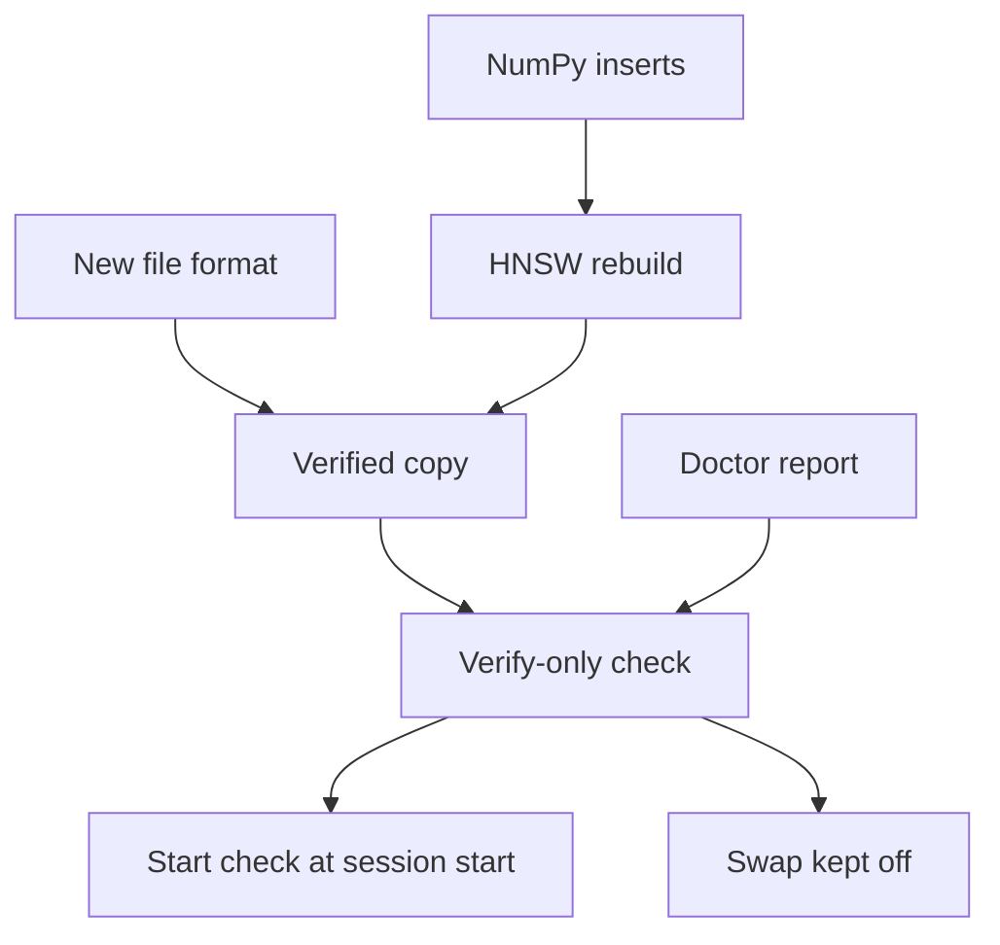

# Milestones: warehouse-file-growth

## Cross-milestone invariants & constraints

The spec is [issue 147](https://github.com/Texarkanine/stockroom/issues/147). [Issue 146](https://github.com/Texarkanine/stockroom/issues/146) is out of scope.

No milestone deletes the original warehouse file or a backup. A rewrite attaches the original `READ_ONLY` and never opens it for writing. The only replace of the live path is the swap in the last milestone, and no shipped trigger turns that swap on.

The storage upgrade stays outside `schema_version`. No milestone adds a migration that rebuilds populated `messages` or `tool_calls`. A skipped or absent rewrite must not make `open_current()` treat the warehouse as behind head.

The HNSW index stays. No milestone drops approximate search, adds a `compact` subcommand, quantizes vectors, tiers history out, or chases the primary-key leak in code.

`stockroom doctor` never writes. Readers and doctor never start a rewrite.

Until a later explicit enable, one background pass is verify-only: build, verify, record, delete the temp file, and do not swap. The session-start hook starts it detached, through an internal engine entry point that the user guide does not list, and session start does not wait for it. "No new CLI command" means no new user-facing command. Nothing else starts the pass: not Cursor's `beforeSubmitPrompt` hook, ingest, embed, `migrate`, `backfill`, or any other writer open, not readers or the dashboard, not `doctor`, and not the nightly job.

The pass runs once per check version. Verified, verification mismatch, and already new are final results, and later session starts do nothing. Each skip reason and a crash are not final: the pass runs again at the next session start and decides there whether to build. After an overrun or a crash it rebuilds only under a condition the check milestone's plan chooses, so a warehouse that always overruns or always crashes does not rebuild at every session start. The skip reasons include no warehouse yet, a warehouse below the schema head, and a lock hold that runs past the pass's time limit. The record names the check version, so a later release that changes the check, or enables the swap, runs once more. The swap, when enabled, copies the warehouse again that day.

Shared artifacts:

- The new-file milestone owns the new-file storage setting and the ZSTD clauses on `messages.text` and `tool_calls.tool_input`. Later milestones use that definition and do not restate it in `0001`.
- The NumPy milestone owns how vectors are bound. The HNSW milestone wraps the write and does not change that binding.
- The HNSW milestone owns the index definition used outside migration `0003`. The copy milestone builds the index on the copy with that definition.
- The doctor milestone owns the storage section of the doctor report, the live-size estimate, and the backup filename. The check milestone owns the check record, adds one line for it to that section, and uses the live-size estimate for its low-disk test. The record is a sidecar file under the stockroom home. Nothing writes the check result into the warehouse. The swap milestone writes the backup filename and does not add a second report.
- The copy milestone owns equality, catalog, and HNSW verification, and the measurements the builder returns. The check milestone calls that builder and stores those measurements in its record. The swap is a mode of the check milestone's pass, with the same lock, skip rules, temp naming, and cleanup, not a second pipeline. It replaces the live path only with a file that verification accepted.
- The hook milestone owns the session-start launch in `hooks/*.json` and the user-facing hook description. It does not change the pass.

## Execution Order

- [ ] Create new warehouses in DuckDB storage version v1.5.0+ with ZSTD on messages.text and tool_calls.tool_input
- [ ] Insert embedding vectors through one NumPy scan per statement
- [ ] Drop and recreate the HNSW index around embedding writes, and skip both when the run writes nothing
- [ ] Report warehouse file size, block use, reclaimable space, storage format, free disk, and an existing backup from read-only stockroom doctor
- [ ] Build a verified newer-format copy of a warehouse without modifying the original
- [ ] Run that copy in verify-only mode under the writer flock with a time limit, record the result, and skip when the file is not ready
- [ ] Start the verify-only check from the Claude Code and Cursor session-start hooks
- [ ] Add the hard-link swap and its proof, and leave that swap off

## Per-milestone done and risks

### Create new warehouses in DuckDB storage version v1.5.0+ with ZSTD on messages.text and tool_calls.tool_input
- Done: A brand-new warehouse file is storage tag v1.5.0+. `messages.text` and `tool_calls.tool_input` use zstd, shown by `pragma_storage_info` after a write. Existing populated files are not rebuilt. `docs/advanced/duckdb.md` says a new file uses the current format and that DuckDB 1.4.5 cannot read it.
- Risks: Changing migration `0001` must not become a rewrite of populated tables. See invariants.

### Insert embedding vectors through one NumPy scan per statement
- Done: The embed writer inserts a batch with one `INSERT ... SELECT` over a NumPy array. Arrays from the encoder and lists from the test fake both store the same values. A test asserts that path against a fixture and does not assert a timing.
- Risks: See invariants. This milestone does not drop or rebuild the index.

### Drop and recreate the HNSW index around embedding writes, and skip both when the run writes nothing
- Done: A run that modifies `embeddings` drops the index, writes, recreates it, and checkpoints without growing the file by another index copy. Several write-and-checkpoint cycles stay inside a bound. A run that writes nothing does not rebuild. Semantic search still answers through the index. The architecture notes no longer say the index is only migration-owned.
- Risks: A failed recreate must not leave semantic search without the index. A night that writes nothing must not pay the rebuild. Ingest's `write_session` also deletes embeddings for removed or changed messages. The milestone plan chooses one of two options: ingest's delete path drops and recreates the index too, or the next embed run that writes reclaims that copy.

### Report warehouse file size, block use, reclaimable space, storage format, free disk, and an existing backup from read-only stockroom doctor
- Done: `stockroom doctor` probe prints file size, used blocks, free blocks, a reclaimable estimate, the storage format, free disk, and, when the backup file is present, its path and size. The reclaimable estimate comes from a read-only count of live data, such as the distinct data blocks per table plus the index size DuckDB reports, not from free blocks alone. The command does not create, modify, or delete any warehouse file. The user-facing doctor description lists these facts.
- Risks: Doctor stays read-only. This milestone does not start a rewrite and does not add a subcommand. It defines the backup filename the swap milestone must use. Leaked index copies sit in blocks DuckDB counts as used: the 39 GiB file has about 92 MiB free, while its copy should be about 0.4 GiB. Free blocks alone understate reclaimable space by a large factor. The check milestone reuses this estimate for its low-disk test.

### Build a verified newer-format copy of a warehouse without modifying the original
- Done: A builder attaches the original read-only, writes a sibling temp file on the same filesystem in the newer format with ZSTD applied on the copy, closes it with no temp wal, and a fresh read-only connection proves multiset equality both directions, catalog equality, and an HNSW query. The builder attaches the copy in the new format, runs the migration chain on the empty copy so its tables carry the new-file milestone's definition, replaces the copy's `schema_version` rows with the original's, drops the index, inserts the rows, and rebuilds the index from the definition the HNSW milestone owns. `pragma_storage_info` on the copy shows zstd on `messages.text` and `tool_calls.tool_input`. The builder returns measured facts: the original's size, the copy's size, the build and verification times, the lowest free disk seen during the run, and the share of sampled vectors whose index top 10 matches an exact scan. Fixtures at every schema version from `0001` through head are migrated, then copied, then pass those checks. The original bytes are unchanged. The builder does not replace the live file and does not delete a backup.
- Risks: Any mismatch aborts. The builder never opens the original for writing. This milestone does not wire the builder to any trigger. After the new-file milestone, every file `warehouse.open()` creates is already new, so tests make old-format fixtures on purpose. On DuckDB 1.5.4, `COPY FROM DATABASE` alone keeps the index but stores text without zstd, and session-wide zstd compresses every text column, so neither replaces the table-by-table copy. Running migrations on the copy writes new `schema_version` timestamps, so those rows must be replaced or equality fails. A migration that seeds any other rows would also fail equality. On an old-format file the zstd clause stores text uncompressed without an error. The index match share is a recorded fact, not a pass condition, and its exact scan must not use the index (for example, `+ 0` on the distance in the sort avoids it).

### Run that copy in verify-only mode under the writer flock with a time limit, record the result, and skip when the file is not ready
- Done: An internal engine entry point, which the user guide does not list, runs one pass. The pass holds the writer flock and runs the builder in a child process. When the file is old, checkpointed, and has no wal, the child builds and verifies a temp file. The pass then deletes the temp file, writes the result to a check record under the stockroom home, and fsyncs it. The record stores the builder's measurements and how long the pass held the lock. Verified, mismatch, and already new are final, and later runs do nothing. A skip or a crash is not final: the next run decides whether to build. After an overrun or a crash, it rebuilds only under a condition this milestone's plan chooses. A crash leaves a record that doctor shows. The record names the check version. The pass does not swap. Low disk, a wal, a busy flock, a read-only filesystem, no warehouse yet, a warehouse below the schema head, and a lock hold past the time limit each skip and leave the original untouched. The low-disk test uses doctor's live-size estimate, not the original's file size. On a time-limit overrun the parent kills the child, deletes the temp file, and releases the lock, so a writer waiting on the lock waits no longer than the limit. A crash leftover temp is deleted on the next run, and cleanup never touches the original or a backup. A skipped check does not make `open_current()` readers see the schema as behind head. Doctor shows the record's last outcome, including a skip reason, and its measurements as one line in the storage section. Fault injection during create, build, and verification leaves `warehouse.duckdb` openable with its original content. Tests use warehouses made in the old storage format on purpose. No hook or other shipped code starts the pass yet.
- Risks: Verify-only must not hard-link or replace. Readers, the dashboard, doctor, ingest, embed, and the nightly job never start this. Writers take the flock with a blocking call, so the time limit is the only bound on how long the nightly job, ingest, embed, or a migrating reader waits behind the pass. On DuckDB 1.5.4 an interrupt during the index build takes effect only after the build ends, so an in-process watchdog cannot enforce the limit. A warehouse that always overruns or always crashes must not rebuild at every run. The work machine's original is 88 GB without 88 GB free, so a low-disk test on the original's size would skip there forever.

### Start the verify-only check from the Claude Code and Cursor session-start hooks
- Done: Both session-start hooks launch the check's entry point detached, and session start does not wait. Cursor's `beforeSubmitPrompt` hook does not launch it. A session start after a final result does not build. The hook tests cover both harness files. The user-facing hook description says session start also runs this check.
- Risks: The launch must not block or fail session start, and the existing `shim rectify` and dashboard steps stay. Cursor runs plugin hooks only with its third-party plugins setting on, which the stockroom install already requires. Hooks reach a machine with the plugin update, so nothing needs re-installing.

### Add the hard-link swap and its proof, and leave that swap off
- Done: A swap mode of the check pass, which no shipped code turns on, hard-links the original to the backup name doctor already reports, fsyncs the new file and its directory, and replaces the live path with the temp file that the same run built and verified. The original SHA-256 equals the backup SHA-256. Hard-link refusal skips, with no copy-then-delete fallback. Faults after the link and after the replace leave `warehouse.duckdb` openable as either the original or the verified new file, and no data file is lost. No code path deletes the original or the backup. With the mode off, the pass still deletes its temp and does not swap. Docs say how to roll back by renaming the backup, and that stockroom will not delete it.
- Risks: Shipping this milestone must not enable the swap. The swap must copy the warehouse as it is that day, not replay an earlier deleted temp file. A final verify-only record must not stop a later enabled swap, so the swap runs under a new check version.
