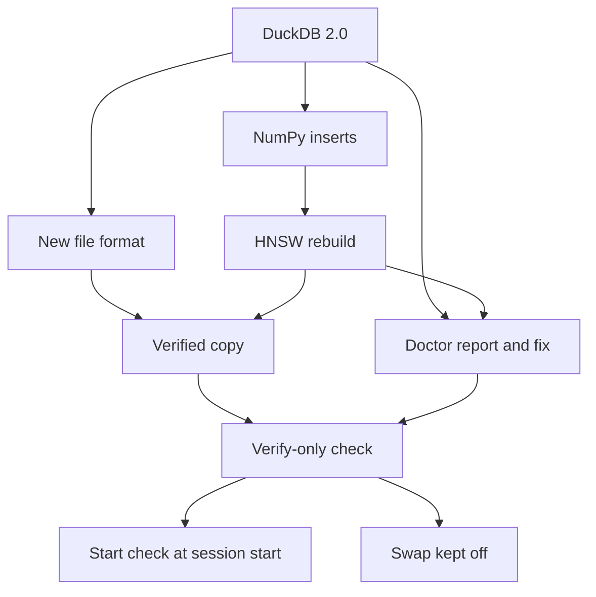

# Milestones: warehouse-file-growth

## Cross-milestone invariants & constraints

Lifetime: milestones 6 to 9 (the verified copy, the check, its session-start launch, and the swap) are a short-lived migration utility for about five installs, optimistically six: the operator's four machines and the few people he has told about stockroom. It ships within hours, stays in the plugin for a month or two while every install picks it up through Cursor's update cycle, and is then removed. Build it to be reliable for those installs over that period, not long-term durable or bulletproof. Take the simpler option whenever it cannot lose a warehouse. The data-safety rules below do not relax. Keep the chain in its own module, touching shared code only at its entry point, the hook command, and doctor's check line, so that removing it is deleting that module and those lines. Doctor's backup line stays after the removal, because a 39 to 88 GB backup can stay on disk after the chain is gone. Milestones 1 to 5 are durable product changes and get normal care.

The spec is [issue 147](https://github.com/Texarkanine/stockroom/issues/147). [Issue 146](https://github.com/Texarkanine/stockroom/issues/146) is out of scope.

DuckDB (operator, 2026-10-21): the engine moves to DuckDB 2.0 first, before any format work. 2.0 is a long-term support line, supported until at least October 2027; the 1.5 line ends in March 2027. The one-time rewrite then targets the format stockroom keeps. New files and the copy use storage `v2.0.0`. The operator chose it over `v1.5.0`, which DuckDB 1.5.4 could still open. Later milestones stay on the 2.0 line; a 2.0 patch bump is fine.

Release grouping (operator, 2026-10-21): there is no 2.0-only release. The milestones land in order on this branch. Milestones 1 to 8 ship together in one release; the swap milestone may join that release, switched off either way. No release carries the 2.0 lock without the new-file format and the HNSW rebuild. Before that release, the operator runs the DuckDB 2.0 milestone's shadow test from a clone of the branch on his Macs. A branch clone runs only that test there, never `make shim`, so the branch does not become the live engine on a Mac. This machine is different: its live `stockroom` shim runs this checkout, the 03:30 nightly job uses that shim, and the commit hook syncs this checkout's environment to its working-tree lock on every commit. So this checkout's environment stays on DuckDB 1.5.4 until the shadow test passes on this machine. Then the 2.0 lock lands here, and this machine's real warehouse runs the branch from that night on.

Operator permission (2026-10-21): the DuckDB 2.0 sub-run may rewrite the sentences that state DuckDB behaviour in later milestones' Done and Risks lines, logging each change in `progress.md`. It may not change any milestone's scope, order, or ownership. A premise that no longer holds still stops for the operator. DuckDB before 2.0 cannot open a file that 2.0 creates. Facts about DuckDB behaviour in the Done and Risks lines below were measured on 1.5.4 unless they say 2.0. The DuckDB 2.0 milestone re-measures them and rewrites each line where 2.0 differs. If a premise of a later milestone no longer holds on 2.0 (for example, if checkpoints no longer leave a copy of the HNSW index), that milestone stops for the operator before its scope changes.

Skipped releases (operator, 2026-10-21): this project ships in one release, then a later release turns the swap on, and users skip releases. Every release this project makes must stand alone. A user who arrives at it from any earlier stockroom release, with no release in between, gets a warehouse that opens, migrates forward, and works. No milestone may assume that a user ran an earlier milestone's release, the check, or the swap. Every tagged release so far (v0.1.0 to v2.1.2) pinned DuckDB 1.5.4, and every DuckDB pin in the repo's history is 1.5.4. So a release must handle each of these arrivals:
- a `v1.0.0+` file at any schema version from 0 to 8, where schema 0 is an empty file that a failed first open left behind (for example, when `ensure_vss` could not reach the network);
- a `v1.0.0+` file with a `.wal` left by a 1.5.4 embed that was killed before the user updated. DuckDB 2.0.0 replays such a log and leaves the HNSW index broken (see the DuckDB 2.0.0 replay bug below);
- a `v2.0.0+` file that this project's release created, which already has the zstd columns and the HNSW rebuild;
- no warehouse at all.

DuckDB 2.0.0 replay bug (measured 2026-10-21): a `.wal` holding inserts into `embeddings` while its HNSW index exists, written by a killed 1.5.4 or 2.0.0 writer, leaves the index broken after 2.0.0 replays it. Every row is still there. While that `.wal` remains:
- semantic search hangs on real-sized vectors, and raises `InternalException` ("Operation requires a flat or constant vector") on small ones;
- deletes from and inserts into `embeddings` fail or hang, including a `DELETE` that matches no rows;
- an explicit `CHECKPOINT` fails fatally;
- a writer that does not touch `embeddings` exits 0, and the `.wal` grows. Ingest does this on a night that removes no message and changes no message text;
- plain SQL through `stockroom query`, and the dashboard, keep working.

Once that `.wal` passes `checkpoint_threshold` (16 MiB by default; stockroom does not change it), an automatic checkpoint at a commit that does not touch `embeddings` succeeds and deletes the `.wal`. The index then lacks every replayed row. After that fold, queries, deletes, and inserts work, and nothing reports an error. Unscoped semantic search skips the missing rows. `pragma_hnsw_index_info` count is lower than `count(*)`. The explicit `CHECKPOINT` failure happens only while the `.wal` is still present.

`DROP INDEX`, `CREATE INDEX`, then `CHECKPOINT` repairs both the leftover-`.wal` state and the folded state. A `.wal` holding only deletes, or only inserts made after `DROP INDEX`, replays without harm. Loading vss before the replay does not help.

Operator decision (2026-10-21): no automatic repair. About five installs run embed nightly, and this rollout is a couple of days, so the case to build for is a nightly embed that finishes. A power loss during that embed is the exceptional case: the user looks up the troubleshooting page. That same power loss must not empty the warehouse or delete its rows. The doctor milestone detects a leftover `.wal` and, when no `.wal` is present, an index whose `pragma_hnsw_index_info` count differs from `count(*)` or an index that is missing. It names `stockroom doctor fix hnsw-rebuild`, a user-run command that rebuilds the index under the writer flock. A troubleshooting page documents both states and that command. The HNSW milestone drops the index before a process adds or removes `embeddings` rows, recreates it, and checkpoints before that process exits, so a finished run does not insert while the index exists and a removal night does not keep a leaked copy. A process that does not change `embeddings` does not rebuild, and a delete that matches nothing is not a change. The operator files the bug upstream on duckdb-vss.

This machine's live warehouse is `v1.0.0+` at schema version 8. A `v2.0.0+` file without zstd columns can exist only from branch testing, never from a release. Tests that need an old file create it at storage `v1.0.0`, with the migration SQL as v2.1.2 shipped it. DuckDB 2.0 creates `v2.0.0+` files by default, and it rejects the zstd clause at `v1.0.0`.

No milestone deletes the original warehouse file or a backup. A rewrite attaches the original `READ_ONLY` and never opens it for writing. The only replace of the live path is the swap in the last milestone, and no shipped trigger turns that swap on.

The storage upgrade stays outside `schema_version`. No milestone adds a migration that rebuilds populated `messages` or `tool_calls`. A skipped or absent rewrite must not make `open_current()` treat the warehouse as behind head.

The HNSW index stays. No milestone drops approximate search, adds a `compact` subcommand, quantizes vectors, tiers history out, or chases the primary-key leak in code.

Doctor (operator, 2026-10-21): a user can run any discoverable doctor command with full confidence that nothing is written. `probe` and `smoke` never write. Every doctor action that writes sits behind `stockroom doctor fix <name>`, for example `stockroom doctor fix hnsw-rebuild`, and runs only when the user names it. Readers and doctor never start a rewrite.

Until a later explicit enable, one background pass is verify-only: build, verify, record, delete the temp file, and do not swap. The session-start hook starts it detached, through an internal engine entry point that the user guide does not list, and session start does not wait for it. "No new CLI command" means no new user-facing command. Nothing else starts the pass: not Cursor's `beforeSubmitPrompt` hook, ingest, embed, `migrate`, `backfill`, or any other writer open, not readers or the dashboard, not `doctor`, and not the nightly job.

The pass runs once per check version. Verified, verification mismatch, already new, a crash, and a time-limit overrun are final, and later session starts do nothing. A crash or an overrun stays in the record for doctor to show, and deleting the record file runs the check again. Skips build nothing and are not final, so the next session start tries again. The skip reasons are low disk, a wal, a busy flock, a read-only filesystem, no warehouse yet, and a warehouse below the schema head. The record names the check version, so a later release that changes the check, or enables the swap, runs once more. The swap, when enabled, copies the warehouse again that day.

Shared artifacts:

- The DuckDB 2.0 milestone owns the DuckDB pin, its dependency range, the shadow-test script, and the user-facing statement of which DuckDB versions can open the warehouse. The range stays below 2.1, so a dependabot bump cannot move the engine off the 2.0 line. Later milestones do not move the pin off that line.
- The new-file milestone owns the new-file storage setting and the ZSTD clauses on `messages.text` and `tool_calls.tool_input`. Later milestones use that definition and do not restate it in `0001`.
- The NumPy milestone owns how vectors are bound. The HNSW milestone wraps the write and does not change that binding.
- The HNSW milestone owns the index definition used outside migration `0003`. The copy milestone builds the index on the copy with that definition, and the doctor milestone's `stockroom doctor fix hnsw-rebuild` rebuilds with it.
- The doctor milestone owns the storage section of the doctor report, the live-size estimate, and the backup filename. It also owns the leftover-`.wal` line, the index-coverage line, the `stockroom doctor fix` group with its first fix `hnsw-rebuild`, and the troubleshooting page for the DuckDB 2.0.0 replay bug. The check milestone owns the check record, adds one line for it to that section, and uses the live-size estimate for its low-disk test. The record is a sidecar file under the stockroom home. Nothing writes the check result into the warehouse. The swap milestone writes the backup filename and does not add a second report.
- The copy milestone owns equality, catalog, and HNSW verification, and the measurements the builder returns. The check milestone calls that builder and stores those measurements in its record. The swap is a mode of the check milestone's pass, with the same lock, skip rules, temp naming, and cleanup, not a second pipeline. It replaces the live path only with a file that verification accepted.
- The hook milestone owns the session-start launch in `hooks/*.json`, the detached launch in front of the check's entry point, and the user-facing hook description. It does not change the pass.

## Execution Order

- [ ] Move the engine to DuckDB 2.0 and prove it on a copy of a real warehouse
- [ ] Create new warehouses in the newest DuckDB storage format with ZSTD on messages.text and tool_calls.tool_input
- [ ] Insert embedding vectors through one NumPy scan per statement
- [ ] Drop and recreate the HNSW index when a process adds or removes embedding rows, and skip both when that process changes nothing
- [ ] Report warehouse file size, block use, reclaimable space, storage format, free disk, an existing backup, a leftover wal, and an HNSW index that is missing rows from stockroom doctor, and add stockroom doctor fix hnsw-rebuild
- [ ] Build a verified newer-format copy of a warehouse without modifying the original
- [ ] Run that copy in verify-only mode under the writer flock with a time limit, record the result, and skip when the file is not ready
- [ ] Start the verify-only check from the Claude Code and Cursor session-start hooks
- [ ] Add the hard-link swap and its proof, and leave that swap off

## Per-milestone done and risks

### Move the engine to DuckDB 2.0 and prove it on a copy of a real warehouse
- Done: The engine lock pins DuckDB 2.0 (2.0.0 or a later 2.0 patch), the engine's dependency range is at least 2.0 and below 2.1, and `make ci` passes. A committed shadow-test script runs from a clone of the branch against a copy of a real warehouse, under a scratch `STOCKROOM_HOME` that may sit on another disk, and never writes the live warehouse. It takes the copy under the writer flock with no `.wal`, so the baseline is the warehouse as copied, and it never opens the original for writing. First, a 2.0 writer opens the copy, checkpoints, and closes, and every table still equals the baseline in both directions (`EXCEPT ALL`). Then `stockroom ingest`, `stockroom embed`, and a checkpoint run under 2.0. Afterwards the copy keeps its `v1.0.0+` tag, no table has fewer rows, and `stockroom semantic` answers through the HNSW index under 2.0. Next, a DuckDB 1.5.4 writer with its own vss writes to the copy, as another harness's older plugin copy can after a dead-shim takeover, and answers the same query. 2.0 then opens the copy again and answers it too. Last, a 2.0 writer is killed while it inserts into `embeddings` with the index present, as today's embed does. The script records what 2.0 does on replay, then opens the copy with a writer that does not touch `embeddings` and crosses `checkpoint_threshold`, and compares `pragma_hnsw_index_info` count with the row count. It proves that `DROP INDEX`, `CREATE INDEX`, and `CHECKPOINT` restore semantic search, ingest, and embed from both the leftover-`.wal` state and the folded state, and that neither state has fewer rows than before the kill. It repeats that step on the newest 2.0 patch available at build time. The script passes on this machine's warehouse (39 GiB, `v1.0.0+`) before the 2.0 lock lands in this checkout, and the operator runs it on his Macs. The 2.0 lock is the last change this milestone brings into this checkout, because the commit hook and every `make` target sync this checkout's environment to the lock. `.github/dependabot.yaml` ignores duckdb updates beyond the 2.0 line. A test proves that a `v1.0.0+` warehouse stopped at schema version 1, as an older release could leave it, migrates to head under 2.0 and keeps its `v1.0.0+` tag. A lasting test proves that the unscoped `stockroom semantic` query plans through the HNSW index. `docs/advanced/duckdb.md` says a new warehouse uses DuckDB 2.0's format, that DuckDB before 2.0 cannot open it, and that the DuckDB CLI must be 2.0 or newer. Every DuckDB behaviour stated in a later milestone's Done or Risks line, or in `docs/architecture/embeddings.md`, is re-measured on 2.0, and each line is rewritten where 2.0 differs. That covers the storage setting on new and existing files, the zstd clause after `ALTER TABLE ... ADD COLUMN`, the HNSW index copy left at checkpoint after embedding writes, the automatic checkpoint that folds a replayed HNSW `.wal`, `pragma_hnsw_index_info` count against `count(*)`, and VSS applying `WHERE` after the HNSW pick. It also covers leaked index copies counted as used blocks, the read-only live-size estimate, `COPY FROM DATABASE` codecs and index, the zstd clause on an old-format file, and an interrupt during an index build. Those changes follow the operator permission in the invariants.
- Risks: 2.0.0 came out on 2026-10-21. DuckDB advises testing on a shadow system first and expects a first patch in November. A new file under 2.0 is `v2.0.0+`, so a stockroom copy still on 1.5.4 on the same machine cannot open a warehouse that 2.0 created. Such a copy can be another harness's plugin cache, like the Claude Code stockroom 0.16.0 on this machine, or a dev checkout. Existing warehouses keep their tag until the swap. Measured on synthetic data (2026-10-21): 1.5.4 opens a `v1.0.0+` file that a killed 2.0.0 writer left with a wal, as a plain table or with an HNSW index, read-only and read-write, and replays every row. 1.5.4 and 2.0.0 can take turns writing one `v1.0.0+` file with an HNSW index, and its tag stays `v1.0.0+`. The torch freeze has no duckdb line, so the session-start heal cannot put 1.5.4 back. Today's embed, which inserts with the index present, lasts until the HNSW milestone. The fix command arrives at the doctor milestone. The operator accepts that window: about five installs, embed runs nightly to completion, and the rollout is a couple of days, so a killed embed is not the case to build for. If a nightly embed is killed anyway, the rows stay in the table. While the `.wal` exists, one read-write open with DuckDB 1.5.4 replays it and keeps the index whole. After the automatic checkpoint folds the log, that 1.5.4 open no longer sees a `.wal`, and the index stays short of rows until the doctor fix. No path deletes the warehouse or its rows. Dependabot on `main` may propose duckdb 2.0 once its 7-day cooldown passes. The operator closes that pull request, because merging it would ship 2.0 alone. The first open after the update runs `INSTALL vss` for 2.0 over the network (`ensure_vss`). A machine that cannot reach the extension repository then cannot open the warehouse, and the plan says how that machine recovers. EXPLAIN on 2.0 prints `Hnsw Index Scan`, not `HNSW_INDEX_SCAN`. Measured on 2.0.0 (2026-10-21): the engine suite passes unchanged, vss installs, HNSW top-k recall matches 1.5.6 on random vectors, `USING COMPRESSION zstd` gives ZSTD, and 2.0 reads `v1.0.0+` and `v1.5.0+` files. This milestone does not change the storage setting or `0001`.

### Create new warehouses in the newest DuckDB storage format with ZSTD on messages.text and tool_calls.tool_input
- Done: A brand-new warehouse file carries the newest storage tag the pinned DuckDB writes (`v2.0.0+` on 2.0), set explicitly when the file is created, not left to DuckDB's default. `messages.text` and `tool_calls.tool_input` use zstd, shown by `pragma_storage_info` after a write. Existing populated files are not rebuilt, and a stockroom writer that opens one leaves its storage tag unchanged. A `v1.0.0+` file at schema 0, the empty file a failed first open left behind, still opens and migrates to head without being deleted.
- Risks: Changing migration `0001` must not become a rewrite of populated tables. See invariants. Measured on 2.0.0 (2026-10-21): `USING COMPRESSION zstd` raises `BinderException` on a `v1.0.0+` file, where 1.5.4 stored the column uncompressed, and works at `v1.2.0` and newer. With the clause in `0001`, every writer open of a schema-0 `v1.0.0+` file would fail, so the plan says how `0001` runs on such a file. Tests that build an old file from the current `0001` hit the same error. Measured on 1.5.4: connecting an existing `v1.0.0+` file with `storage_compatibility_version = 'latest'` leaves its tag and codecs unchanged, and two read-write connections to one file in one process must carry the same config, or the second one fails. The plan decides between `'latest'` and an explicit 2.0 storage version, because `'latest'` moves with the next DuckDB bump.

### Insert embedding vectors through one NumPy scan per statement
- Done: The embed writer inserts a batch with one `INSERT ... SELECT` over a NumPy array. Arrays from the encoder and lists from the test fake both store the same values. A test asserts that path against a fixture and does not assert a timing.
- Risks: See invariants. This milestone does not drop or rebuild the index.

### Drop and recreate the HNSW index when a process adds or removes embedding rows, and skip both when that process changes nothing
- Done: A process that adds or removes `embeddings` rows drops the index before those statements, makes the changes, recreates the index, and checkpoints once after the recreate, before it exits. It does not checkpoint while the index is down. Used blocks do not gain another index copy. Across several cycles the file may sit one index above the start and return to the start on the next cycle, because that copy is on the free list and the next cycle reclaims it. The growth test asserts every cycle, by used blocks or by a high-water file size of one index over the start. It does not require a cycle's file to be no larger than the previous cycle. A process that does not change `embeddings` does not rebuild, and a delete that matches nothing is not a change. Ingest keeps the index down from the first embedding delete in the process until the last one, then recreates once before it closes the connection. A message rewrite that does not change embeddings is not a reason to keep the index down. A second embedding delete after the recreate leaves one used index copy. The growth test includes two embedding deletes and one recreate, and that recreate comes after both deletes. Embed drops once around its inserts and an orphan delete that removes rows, and that orphan delete does not run after the recreate. The growth test includes a process that deletes rows and exits without inserting. Semantic search still answers through the index. The architecture notes no longer say the index is only migration-owned. A crash during the run leaves every committed `embeddings` row in the table.
- Risks: On DuckDB 2.0.0, a log holding inserts into `embeddings` while the index exists breaks the index on replay, and past `checkpoint_threshold` that log can fold into a silent partial index (see the replay bug in the invariants). So no stockroom path may insert into `embeddings` while the index exists. Measured on 1.5.4 and 2.0.0 (2026-10-21): a delete that removes rows, with the index left in place, leaks one full index copy at checkpoint and at process close. A delete that matches nothing does not. The same measurement: drop, delete, create, then one checkpoint keeps used blocks flat, and the file alternates by one index on the free list (on a 1,500-row fixture, 8,138,752 bytes, then 5,255,168). Operator decision (2026-10-21): that alternation is inside the bound. Do not checkpoint while the index is down to flatten it. The next cycle reclaims those blocks. Measured on both versions: drop, delete, create, then a second delete, then checkpoint leaves used blocks at 30 on every later cycle. Both deletes, then one create, stays at 20. The recreate comes after every embedding delete in the process. Deletes after `DROP INDEX` replay without harm. A process that changes nothing must not pay the rebuild. A process that only deletes rows pays it once, before it exits. A crash mid-run, including a power loss, must leave the committed `embeddings` rows in the table. The index may be missing until the user runs the doctor fix. A later process that changes `embeddings` recreates the index from every row.

### Report warehouse file size, block use, reclaimable space, storage format, free disk, an existing backup, a leftover wal, and an HNSW index that is missing rows from stockroom doctor, and add stockroom doctor fix hnsw-rebuild
- Done: `stockroom doctor` probe prints file size, used blocks, free blocks, a reclaimable estimate, the storage format, free disk, and, when the backup file is present, its path and size. The reclaimable estimate comes from a read-only count of live data, such as the distinct data blocks per table plus the index size DuckDB reports, not from free blocks alone. The command does not create, modify, or delete any warehouse file, and it does not create the stockroom home folder: it checks that the warehouse file exists before opening anything. When the warehouse is missing, below the schema head, or busy, doctor still prints the facts that need no database connection. Sometimes a `.wal` sits beside the warehouse while no writer holds the flock (the probe tries the flock without waiting). Then the probe says so, names `stockroom doctor fix hnsw-rebuild` and the troubleshooting page, and runs no statement that touches the HNSW index. When no `.wal` is present, the probe compares `pragma_hnsw_index_info` count with `count(*)` from `embeddings`, and treats a missing index the same way. A mismatch or a missing index names the same fix and the same page. `stockroom doctor fix` with no name, and `--help`, list the fixes and write nothing. `stockroom doctor fix hnsw-rebuild` takes the writer flock, opens the warehouse read-write, drops the HNSW index when one exists, creates it from the HNSW milestone's definition, and checkpoints. A missing index is created, not dropped. Afterwards the `.wal` is gone if one was present, the index count equals the row count, and semantic search, ingest's deletes, and embed's inserts work again. A test reproduces the leftover-`.wal` state and the folded state on a small fixture, using a low `checkpoint_threshold` for the fold, and proves the fix repairs both. On a healthy warehouse the fix changes no rows. A troubleshooting page under `docs/user-guide/troubleshooting/` lists both states and the fix command. In the loud state, semantic search hangs or raises the `InternalException`, embed fails, ingest can exit 0 while the `.wal` grows, `stockroom query` and the dashboard still work, and a `.wal` stays. In the folded state there is no `.wal` and no error, and unscoped semantic search skips the rows the index lacks. The page says a power loss during embed does not empty the warehouse. The user-facing doctor description lists these facts and the `fix` group.
- Risks: `probe` and `smoke` stay read-only, and the `fix` group is doctor's only writer. This milestone does not start a rewrite. A read-only open replays a leftover `.wal` in memory, and on 2.0.0 a statement that touches the broken index can hang. So with a leftover `.wal`, the probe reports the index-size fact (`pragma_hnsw_index_info`) and any other index-touching fact as skipped. The coverage comparison runs only when no `.wal` is present, because `pragma_hnsw_index_info` raises `InternalException` while the broken log is there. A hung embed can hold the writer flock, so the fix must not wait on it forever, and the page says to stop a hung stockroom process first. It defines the backup filename the swap milestone must use. Leaked index copies sit in blocks DuckDB counts as used: the 39 GiB file has about 92 MiB free, while its copy should be about 0.4 GiB. Free blocks alone understate reclaimable space by a large factor. The check milestone reuses this estimate for its low-disk test. `open_current()` creates the stockroom home through `home_dir()`, so doctor must not reach the warehouse through it.

### Build a verified newer-format copy of a warehouse without modifying the original
- Done: A builder attaches the original read-only, writes a sibling temp file on the same filesystem in the newer format with ZSTD applied on the copy, closes it with no temp wal, and a fresh read-only connection proves multiset equality both directions, catalog equality, and an HNSW query. The builder attaches the copy in the new format, runs the migration chain on the empty copy so its tables carry the new-file milestone's definition, replaces the copy's `schema_version` rows with the original's, drops the index, inserts the rows, and rebuilds the index from the definition the HNSW milestone owns. `pragma_storage_info` on the copy shows zstd on `messages.text` and `tool_calls.tool_input`. The builder returns the original's size, the copy's size, and the build and verification times. An old-format fixture with rows written at `0001` and again after migrating to head is copied and passes those checks. One `v1.0.0+` fixture at the schema head is enough, because the check copies only a warehouse at the schema head and skips one below it. A user who skipped releases reaches the head through the usual lazy migration on the next writer or migrating reader open. The original bytes are unchanged. The builder does not replace the live file and does not delete a backup.
- Risks: Any mismatch aborts. The builder never opens the original for writing. This milestone does not wire the builder to any trigger. After the new-file milestone, every file `warehouse.open()` creates is already new, so tests make old-format fixtures on purpose. On DuckDB 1.5.4, `COPY FROM DATABASE` alone keeps the index but stores text without zstd, and session-wide zstd compresses every text column, so neither replaces the table-by-table copy. Running migrations on the copy writes new `schema_version` timestamps, so those rows must be replaced or equality fails. A migration that seeds any other rows would also fail equality. On a `v1.0.0+` file the zstd clause stores text uncompressed without an error on 1.5.4, and raises `BinderException` on 2.0.0, so the copy must be attached in the new format before its tables are created.

### Run that copy in verify-only mode under the writer flock with a time limit, record the result, and skip when the file is not ready
- Done: An internal engine entry point, which the user guide does not list, runs one pass in its own process. The pass holds the writer flock. When the file is old, checkpointed, and has no wal, it builds and verifies a temp file, deletes the temp file, writes the result to a check record under the stockroom home, and fsyncs it. The record stores the builder's measurements, free disk at the start, and how long the pass held the lock. The record names the check version. Verified, mismatch, already new, a crash, and an overrun are final, and later runs do nothing. The pass writes a started entry, with its start time and time limit, before it builds, so a crash or an overrun leaves that entry for doctor to show. Every pass takes the lock, without waiting, before it reads the record or deletes anything. A pass that cannot take the lock reads nothing, deletes nothing, and writes nothing, so it never overwrites a final result or deletes a running pass's temp file. Only the pass that holds the lock writes the record, by writing a temp file and renaming it into place. The pass does not swap. Low disk, a wal, a busy flock, a read-only filesystem, no warehouse yet, and a warehouse below the schema head each skip and leave the original untouched. The low-disk test uses doctor's live-size estimate, not the original's file size. At the time limit the process ends itself, for example with `signal.alarm` and its default action, so the OS releases the flock and a waiting writer waits no longer than the limit. A test proves the limit ends a stuck pass and frees the lock. Under the lock, a leftover temp file is deleted even when the record is final, and cleanup never touches the original or a backup. A skipped check does not make `open_current()` readers see the schema as behind head. Doctor shows the record's last outcome, including a skip reason, its measurements, and the record's path as one line in the storage section. Deleting that file is how to run the check again. Doctor shows a started entry that is still inside its time limit as running, not as a crash. Fault injection during create, build, and verification leaves `warehouse.duckdb` openable with its original content. Tests use warehouses made in the old storage format on purpose. No hook or other shipped code starts the pass yet.
- Risks: A `.wal` left by the DuckDB 2.0.0 replay bug keeps the check skipping until the user runs `stockroom doctor fix hnsw-rebuild`, and doctor's `.wal` line names that command. A folded index has no `.wal`, so the check does not skip for it. The copy's rebuilt index is complete, and verify-only deletes that copy, so the live index stays partial until the user runs the fix. Verify-only must not hard-link or replace. Readers, the dashboard, doctor, ingest, embed, and the nightly job never start this. Writers take the flock with a blocking call, so the time limit is the only bound on how long the nightly job, ingest, embed, or a migrating reader waits behind the pass. On DuckDB 1.5.4 an interrupt during the index build takes effect only after the build ends, so the limit must end the process, not interrupt the query. Nothing in the process may install a handler that stops the alarm from ending it. Only the entry point's own process sets the alarm, so a test that runs the pass in-process cannot leave an alarm that kills a `pytest-xdist` worker. The work machine's original is 88 GB without 88 GB free, so a low-disk test on the original's size would skip there forever. Several session starts at once are normal, for example when Cursor restores windows at login, so several passes can start together. "Already new" means the newest storage tag and zstd on both columns, both read from the file, not the tag alone. A released `v2.0.0+` file has both, because no release carries the 2.0 lock without the new-file format. A `v2.0.0+` file from branch testing may lack zstd and is still copied.

### Start the verify-only check from the Claude Code and Cursor session-start hooks
- Done: Both session-start hooks start the check, and session start does not wait. The launch detaches the way `stockroom dashboard` does, in a new session that keeps none of the hook's output streams, so the hook command returns at once. Cursor's `beforeSubmitPrompt` hook does not launch it. A test runs the launched entry point against a final record and proves it does not build; comparing hook command strings alone does not prove this. The hook tests cover both harness files. The user-facing hook description says session start also runs this check.
- Risks: The launch must not block or fail session start, and the existing `shim rectify` and dashboard steps stay. Cursor's session-start command redirects stdout but not stderr, so a child started with a bare `&` that keeps stderr open can hold session start up to Cursor's 300-second hook timeout. Cursor runs plugin hooks only with its third-party plugins setting on, which the stockroom install already requires. Hooks reach a machine with the plugin update, so nothing needs re-installing.

### Add the hard-link swap and its proof, and leave that swap off
- Done: A swap mode of the check pass, which no shipped code turns on, hard-links the original to the backup name doctor already reports, fsyncs the new file and its directory, and replaces the live path with the temp file that the same run built and verified. The original SHA-256 equals the backup SHA-256. Hard-link refusal skips, with no copy-then-delete fallback. Faults after the link and after the replace leave `warehouse.duckdb` openable as either the original or the verified new file, and no data file is lost. No code path deletes the original or the backup. With the mode off, the pass still deletes its temp and does not swap. Docs say how to roll back by renaming the backup, and that stockroom will not delete it.
- Risks: Shipping this milestone must not enable the swap. The swap must copy the warehouse as it is that day, not replay an earlier deleted temp file. A final verify-only record must not stop a later enabled swap, so the swap runs under a new check version.
