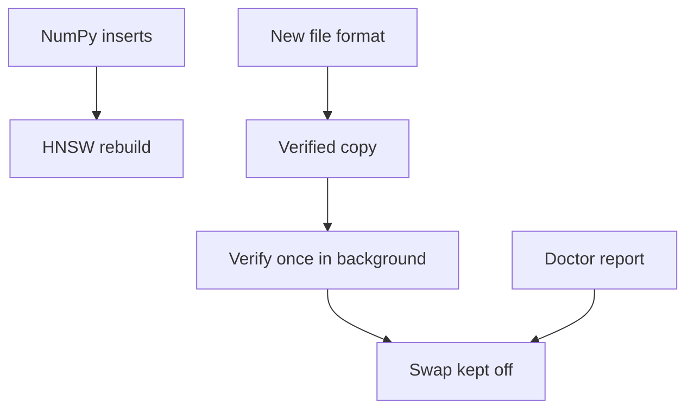

# Milestones: warehouse-file-growth

## Cross-milestone invariants & constraints

The spec is [issue 147](https://github.com/Texarkanine/stockroom/issues/147). [Issue 146](https://github.com/Texarkanine/stockroom/issues/146) is out of scope.

No milestone deletes the original warehouse file or a backup. A rewrite attaches the original `READ_ONLY` and never opens it for writing. The only replace of the live path is the swap in the last milestone, and the default writer path does not call that swap.

The storage upgrade stays outside `schema_version`. No milestone adds a migration that rebuilds populated `messages` or `tool_calls`. A skipped or absent rewrite must not make `open_current()` treat the warehouse as behind head.

The HNSW index stays. No milestone drops approximate search, adds a `compact` subcommand, quantizes vectors, tiers history out, or chases the primary-key leak in code.

`stockroom doctor` never writes. Readers and doctor never start a rewrite.

Until a later explicit enable, one background pass is verify-only: build, verify, record, delete the temp file, and do not swap. It runs once, not on later writer opens. Ingest and embed do not start it. The swap, when enabled, copies the warehouse again that day.

Shared artifacts:

- The new-file milestone owns the new-file storage setting and the ZSTD clauses on `messages.text` and `tool_calls.tool_input`. Later milestones use that definition and do not restate it in `0001`.
- The NumPy milestone owns how vectors are bound. The HNSW milestone wraps the write and does not change that binding.
- The doctor milestone owns the reported facts and the backup filename. The swap milestone writes that filename and does not add a second report.
- The copy milestone owns equality, catalog, and HNSW verification. The verify-only milestone calls that builder. The swap milestone replaces the live path only with a file that verification accepted.

## Execution Order

- [ ] Create new warehouses in DuckDB storage version v1.5.0+ with ZSTD on messages.text and tool_calls.tool_input
- [ ] Insert embedding vectors through one NumPy scan per statement
- [ ] Drop and recreate the HNSW index around embedding writes, and skip both when the run writes nothing
- [ ] Report warehouse file size, block use, reclaimable space, storage format, free disk, and an existing backup from read-only stockroom doctor
- [ ] Build a verified newer-format copy of a warehouse without modifying the original
- [ ] Run that copy once in the background in verify-only mode, and skip when the file is not ready
- [ ] Add the hard-link swap and its proof, and leave that swap off

## Per-milestone done and risks

### Create new warehouses in DuckDB storage version v1.5.0+ with ZSTD on messages.text and tool_calls.tool_input
- Done: A brand-new warehouse file is storage tag v1.5.0+. `messages.text` and `tool_calls.tool_input` use zstd, shown by `pragma_storage_info` after a write. Existing populated files are not rebuilt. `docs/advanced/duckdb.md` says a new file uses the current format and that DuckDB 1.4.5 cannot read it.
- Risks: Changing migration `0001` must not become a rewrite of populated tables. See invariants.

### Insert embedding vectors through one NumPy scan per statement
- Done: The embed writer inserts a batch with one `INSERT ... SELECT` over a NumPy array. Arrays from the encoder and lists from the test fake both store the same values. A test asserts that path against a fixture and does not assert a timing.
- Risks: See invariants. This milestone does not drop or rebuild the index.

### Drop and recreate the HNSW index around embedding writes, and skip both when the run writes nothing
- Done: A run that modifies `embeddings` drops the index, writes, recreates it, and checkpoints without growing the file by another index copy. Several write-and-checkpoint cycles stay inside a bound. A run that writes nothing does not rebuild. Semantic search still answers through the index. The architecture notes no longer say the index is only migration-owned.
- Risks: A failed recreate must not leave semantic search without the index. A night that writes nothing must not pay the rebuild.

### Report warehouse file size, block use, reclaimable space, storage format, free disk, and an existing backup from read-only stockroom doctor
- Done: `stockroom doctor` probe prints file size, used blocks, free blocks, a reclaimable estimate, the storage format, free disk, and, when the backup file is present, its path and size. The command does not create, modify, or delete any warehouse file. The user-facing doctor description lists these facts.
- Risks: Doctor stays read-only. This milestone does not start a rewrite and does not add a subcommand. It defines the backup filename the swap milestone must use.

### Build a verified newer-format copy of a warehouse without modifying the original
- Done: A builder attaches the original read-only, writes a sibling temp file on the same filesystem in the newer format with ZSTD applied on the copy, closes it with no temp wal, and a fresh read-only connection proves multiset equality both directions, catalog equality, and an HNSW query. Fixtures at every schema version from `0001` through head are migrated, then copied, then pass those checks. The original bytes are unchanged. The builder does not replace the live file and does not delete a backup.
- Risks: Any mismatch aborts. The builder never opens the original for writing. This milestone does not wire the builder into the writer path.

### Run that copy once in the background in verify-only mode, and skip when the file is not ready
- Done: One background pass, not ingest or embed, holds the writer flock and, when the file is old, checkpointed, and has no wal, builds and verifies a temp file, records the result where doctor can show it, fsyncs, and deletes the temp file. It does not run again while that result stands. It does not swap. Low disk, a wal, a busy flock, and a read-only filesystem skip and leave the original untouched. A crash leftover temp is deleted on the next run, and cleanup never touches the original or a backup. An already-new file is a no-op. A skipped check does not make `open_current()` readers see the schema as behind head. Doctor reports a skip. Fault injection during create, build, and verification leaves `warehouse.duckdb` openable with its original content.
- Risks: Verify-only must not hard-link or replace. Readers and doctor never start this. A later writer open must not build the compact file again.

### Add the hard-link swap and its proof, and leave that swap off
- Done: An explicit swap, not the background check, hard-links the original to the backup name doctor already reports, fsyncs the new file and its directory, and replaces the live path with a temp file verified that day. The original SHA-256 equals the backup SHA-256. Hard-link refusal skips, with no copy-then-delete fallback. Faults after the link and after the replace leave `warehouse.duckdb` openable as either the original or the verified new file, and no data file is lost. No code path deletes the original or the backup. The background pass still deletes its temp and does not swap. Docs say how to roll back by renaming the backup, and that stockroom will not delete it.
- Risks: Shipping this milestone must not enable the swap. The swap must copy the warehouse as it is that day, not replay an earlier deleted temp file.
