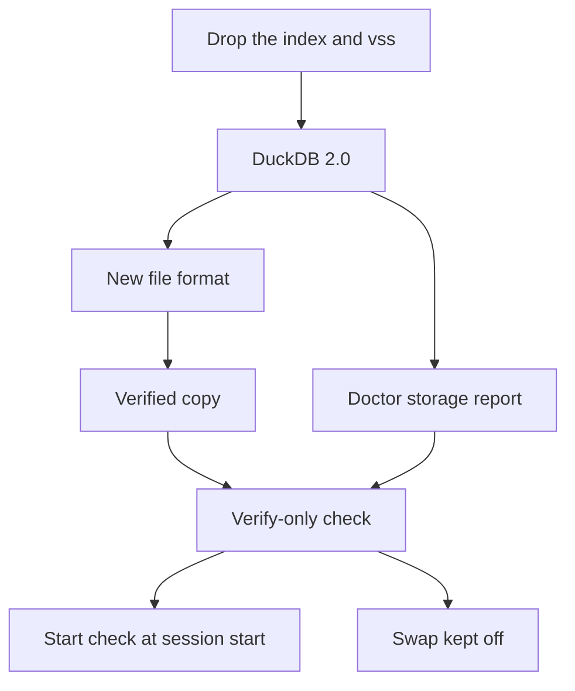

# Milestones: warehouse-file-growth

## Cross-milestone invariants & constraints

Spec: [issue 147](https://github.com/Texarkanine/stockroom/issues/147), as amended by the operator decisions in `memory-bank/active/projectbrief.md`. The 2026-10-21 decision to drop the HNSW index replaces the issue's "keep HNSW" and every requirement built on it. [Issue 146](https://github.com/Texarkanine/stockroom/issues/146) is out of scope.

No vector index (operator, 2026-10-21): the HNSW index and the `vss` extension leave the engine. After the first milestone, nothing in the engine loads or installs `vss`, creates a vector index, or sets an HNSW setting. Semantic search ranks every embedding exactly. A migration drops the index where one exists, and migration `0003` no longer creates one. No milestone adds a vector index back. That door stays open to a later project, which would bring the index back with a rebuild routine. Measured 2026-10-21 on copies of this machine's warehouse (133,793 vectors): exact top-100 search takes 130 ms (median) on DuckDB 2.0.0 and 164 ms on 1.5.4, and always returns 100 rows. Through the index it took 34 ms and returned 37 to 65 rows. Dropping the index and checkpointing took 0.8 s and cut used blocks from 161,453 to 6,846 (256 KiB each), freeing 37.4 GiB inside the 39.5 GiB file.

DuckDB 2.0.0's replay bug lives in `vss`: replaying a `.wal` that holds inserts into an HNSW-indexed table breaks the index. With `vss` never loaded, it cannot reach a stockroom warehouse. Measured on DuckDB 1.5.4 and 2.0.0 (2026-10-21), extension autoload off: a file that has the index, with or without a leftover `.wal` from a killed 1.5.4 embed, opens without `vss`, keeps every row, answers an exact cosine query, drops the index inside a transaction, accepts an insert, and checkpoints with no `.wal` left.

Lifetime: milestones 5 to 8 (the verified copy, the check, its session-start launch, and the swap) are a short-lived migration utility for about five installs, optimistically six: the operator's four machines and the few people he has told about stockroom. It stays in the plugin for a month or two while every install picks it up through Cursor's update cycle, and is then removed. Build it to be reliable for those installs over that period, not long-term durable or bulletproof. Take the simpler option whenever it cannot lose a warehouse. The data-safety rules below do not relax. Keep the chain in its own module, touching shared code only at its entry point, the hook command, and doctor's check line, so that removing it is deleting that module and those lines. Doctor's backup line stays after the removal. Milestones 1 to 4 are durable product changes and get normal care.

DuckDB (operator, 2026-10-21): the engine moves to DuckDB 2.0, a long-term support line supported until at least October 2027 (the 1.5 line ends in March 2027). New files and the copy use storage `v2.0.0`. The operator chose it over `v1.5.0`, which DuckDB 1.5.4 could still open. DuckDB before 2.0 cannot open a file that 2.0 creates. Later milestones stay on the 2.0 line; a 2.0 patch bump is fine. DuckDB behaviour stated below was measured on 2.0.0 on 2026-10-21 unless it says otherwise.

Releases (operator, 2026-10-21, "time to ship something"): milestones 1 and 2 make the first release. Milestone 1 may ship alone before it. Later milestones ship in later releases, and the swap milestone ships switched off. No release carries the 2.0 lock with a vector index or `vss`. Before a release that carries the 2.0 lock, the operator runs the shadow test from a clone of the branch on his Macs. A branch clone runs only that test there, never `make shim`, so the branch does not become the live engine on a Mac. This machine is different. Its live `stockroom` shim runs this checkout, the 03:30 nightly job uses that shim, and the commit hook syncs this checkout's environment to its working-tree lock on every commit. So any commit on this branch is live here at the next run. The first commit that contains milestone 1's migration drops the index on this machine's warehouse, and the 2.0 lock is the last change milestone 2 brings into this checkout.

Skipped releases (operator, 2026-10-21): users skip releases, so every release must stand alone. A user who arrives from any earlier stockroom release, with no release in between, gets a warehouse that opens, migrates forward, and works. No milestone may assume that a user ran an earlier milestone's release, the check, or the swap. Every tagged release so far (v0.1.0 to v2.1.2) pinned DuckDB 1.5.4. So a release must handle each of these arrivals:
- a `v1.0.0+` file at any schema version from 0 to 8, with the HNSW index from schema 3 on. Schema 0 is an empty file that a failed first open left behind (for example, when `ensure_vss` could not reach the network);
- such a file with a `.wal` left by a 1.5.4 embed that was killed before the user updated;
- a `v2.0.0+` file that a release of this project created, with or without the zstd columns depending on whether the new-file milestone had shipped;
- no warehouse at all.

Tests that need an old file create it at storage `v1.0.0`, with the migration SQL as v2.1.2 shipped it when the test needs that shape. A test that needs the index creates it with `vss` loaded inside the test. Nothing outside tests loads `vss`.

No milestone deletes the original warehouse file or a backup. A rewrite attaches the original `READ_ONLY` and never opens it for writing. The only replace of the live path is the swap in the last milestone, and no shipped trigger turns that swap on.

The storage upgrade stays outside `schema_version`. No milestone adds a migration that rebuilds populated `messages` or `tool_calls`. The index-drop migration drops an index and rebuilds no table. A skipped or absent rewrite must not make `open_current()` treat the warehouse as behind head.

This project does not quantize vectors, tier history out, add a `compact` subcommand, or chase the primary-key leak in code.

Doctor (operator, 2026-10-21): a user can run any discoverable doctor command with full confidence that nothing is written. `probe` and `smoke` never write. Any doctor action that writes sits behind `stockroom doctor fix <name>` and runs only when the user names it. This project adds no doctor fix. Readers and doctor never start a rewrite.

Until a later explicit enable, one background pass is verify-only: build, verify, record, delete the temp file, and do not swap. The session-start hook starts it detached, through an internal engine entry point that the user guide does not list, and session start does not wait for it. "No new CLI command" means no new user-facing command. Nothing else starts the pass: not Cursor's `beforeSubmitPrompt` hook, ingest, embed, `migrate`, `backfill`, or any other writer open, not readers or the dashboard, not `doctor`, and not the nightly job.

The pass runs once per check version. Verified, verification mismatch, already new, a crash, and a time-limit overrun are final, and later session starts do nothing. A crash or an overrun stays in the record for doctor to show, and deleting the record file runs the check again. Skips build nothing and are not final, so the next session start tries again. The skip reasons are low disk, a wal, a busy flock, a read-only filesystem, no warehouse yet, and a warehouse below the schema head. The record names the check version, so a later release that changes the check, or enables the swap, runs once more. The swap, when enabled, copies the warehouse again that day.

Shared artifacts:

- The index-drop milestone owns the drop migration, the removal of `vss` and the index from the engine, and the removal of the index-only parts of `scripts/shadow_duckdb_20.py` and its tests. After it, nothing in the engine, its tests, its docs, or `memory-bank` system patterns and tech context describes a vector index as present.
- The DuckDB 2.0 milestone owns the DuckDB pin, its dependency range, the rest of `scripts/shadow_duckdb_20.py`, and the user-facing statement of which DuckDB versions can open the warehouse. The range stays below 2.1, so a Dependabot bump cannot move the engine off the 2.0 line.
- The new-file milestone owns the new-file storage setting and the ZSTD clauses on `messages.text` and `tool_calls.tool_input`. Later milestones use that definition and do not restate it in `0001`.
- The doctor milestone owns the storage section of the doctor report, the live-size estimate, and the backup filename. The check milestone owns the check record, adds one line for it to that section, and uses the live-size estimate for its low-disk test. The record is a sidecar file under the stockroom home. Nothing writes the check result into the warehouse. The swap milestone writes the backup filename and does not add a second report.
- The copy milestone owns equality and catalog verification, and the measurements the builder returns. The check milestone calls that builder and stores those measurements in its record. The swap is a mode of the check milestone's pass, with the same lock, skip rules, temp naming, and cleanup, not a second pipeline. It replaces the live path only with a file that verification accepted.
- The hook milestone owns the session-start launch in `hooks/*.json`, the detached launch in front of the check's entry point, and the user-facing hook description. It does not change the pass.

## Execution Order

- [ ] Drop the HNSW index with a migration and remove the vss extension and everything else about the index from the engine
- [ ] Move the engine to DuckDB 2.0 and prove it on a copy of a real warehouse
- [ ] Create new warehouses in the newest DuckDB storage format with ZSTD on messages.text and tool_calls.tool_input
- [ ] Report warehouse file size, block use, reclaimable space, storage format, free disk, and an existing backup from stockroom doctor
- [ ] Build a verified newer-format copy of a warehouse without modifying the original
- [ ] Run that copy in verify-only mode under the writer flock with a time limit, record the result, and skip when the file is not ready
- [ ] Start the verify-only check from the Claude Code and Cursor session-start hooks
- [ ] Add the hard-link swap and its proof, and leave that swap off

## Per-milestone done and risks

### Drop the HNSW index with a migration and remove the vss extension and everything else about the index from the engine
- Done: A new migration, the next number after `0008`, runs `DROP INDEX IF EXISTS embeddings_vector_hnsw`. Migration `0003` no longer creates an index, so a new warehouse never has one. No engine path loads or installs `vss` or sets `hnsw_enable_experimental_persistence`, and `ensure_vss` is gone. Semantic search has one exact ranking path, with max-sim dedup to one row per owner message. `--harness` and `--role` stay equality scopes on that path. The index path and `OVERFETCH` are gone. Tests prove these behaviours. A warehouse at schema 8 that has the index, and a `.wal` left by a writer killed after an `embeddings` insert, opens through `warehouse.open()`, migrates to head, keeps every row, has no index, and answers semantic search. A new warehouse has no index. An unscoped search returns its full limit when enough messages have embeddings. Tests, golden schema snapshots, the generated warehouse-schema ERD, the architecture docs, `skills/sr-search/references/system-model.md`, and `memory-bank` system patterns and tech context no longer describe an index or `vss`. The index-only parts of this branch's first DuckDB 2.0 attempt also go: the unscoped-HNSW plan test, the HNSW rationale of the scoped starvation test, and the kill protocol, `classify`, `reproduce`, the patch repeat, and the index measurements in `scripts/shadow_duckdb_20.py` and its tests. Before the first commit that contains the migration, the migration runs on a copy of this machine's warehouse: every table equals the copy before it in both directions, no index remains, and used blocks drop. `make ci` passes on DuckDB 1.5.4.
- Risks: The first commit that contains the migration is live on this machine. The next writer open (the 03:30 job or any command) drops the index on the real warehouse, so the copy proof comes first. Measured on the live copy: the drop takes under a second. An older plugin copy still on an earlier release, such as the Claude Code stockroom 0.16.0 on this machine, loads `vss`. It runs the same search SQL as an exact scan on a warehouse at the new head, and it does not migrate a warehouse that is ahead of it. If it creates a new warehouse, its own `0003` creates the index, and the next open by this release drops it. Whether `0003` keeps its filename once it no longer creates the index is a plan decision. The runner keys on the version number, and `schema_version` rows keep the old filename as a record. Search is exact, so its time grows with the row count: about 1 s at a million vectors if linear, which the 962 vectors embedded on 2026-10-21 would take about 900 nights to reach.

### Move the engine to DuckDB 2.0 and prove it on a copy of a real warehouse
- Done: The engine lock pins DuckDB 2.0 (2.0.0 or a later 2.0 patch), and the engine's dependency range is `>=2.0,<2.1`. `.github/dependabot.yaml` ignores duckdb `>= 2.1.0` in the engine block, and `make ci` passes. `scripts/shadow_duckdb_20.py` runs from a clone of the branch under a DuckDB 2.0 overlay against a copy of a real warehouse, under a scratch `STOCKROOM_HOME` that may sit on another disk. It never opens the original with DuckDB. It copies the original under the writer flock, only when no `.wal` exists. Under 2.0 the copy checkpoints, and every table equals the baseline in both directions (`EXCEPT ALL`). Then ingest, `embed --verbose`, and a checkpoint run under 2.0. Afterwards the copy is at the schema head with no index and keeps its `v1.0.0+` tag. `sessions`, `messages`, and `tool_calls` have no fewer rows, `embeddings` loses only the orphans embed reports, and `stockroom semantic` answers. A DuckDB 1.5.4 writer then writes to the copy and answers the same query, as another harness's older plugin copy can, and 2.0 answers it after that. The script exits 0 on this machine's warehouse before the 2.0 lock lands in this checkout, and the operator runs it on his Macs before the release. The schema-1 storage-tag test already on the branch, and milestone 1's leftover-`.wal` test, pass on 2.0. `docs/advanced/duckdb.md` says a new warehouse uses DuckDB 2.0's format, that DuckDB before 2.0 cannot open it, and that the DuckDB CLI must be 2.0 or newer. Under 2.0, `stockroom embed` and `stockroom semantic` print no nanobind leaked-instance warnings at exit, or the operator has accepted them after the cause was found. The 2.0 lock is the last change this milestone brings into this checkout.
- Risks: The commit hook and every `make` target that syncs install the working-tree lock here. `make ci` is the sync that moves `.venv` before the commit. If it fails, restore the 1.5.4 lock and run `make sync` before the 03:30 job. Ingest, embed, and semantic in the overlay need torch, installed from the hashed freeze into the overlay environment only. A new file under 2.0 is `v2.0.0+`, so a stockroom copy still on 1.5.4 on the same machine cannot open a warehouse that 2.0 created. Such a copy can be another harness's plugin cache or a dev checkout. Existing warehouses keep their tag until the swap. Measured on 2.0.0: the engine suite passed unchanged on an overlay, and 2.0.0 rejects the deprecated SQL lambda arrow (`x -> ...`), which the engine does not use. Under 2.0.0, `stockroom embed` and `stockroom semantic` print nanobind leaked-instance warnings to stderr at exit, and `stockroom ingest` does not. The cause is not yet known. DuckDB 1.5.4's package is built with pybind11, which has no such check. Dependabot on `main` may propose duckdb 2.0 on its own after its 7-day cooldown, and the operator closes that pull request until this milestone ships.

### Create new warehouses in the newest DuckDB storage format with ZSTD on messages.text and tool_calls.tool_input
- Done: A brand-new warehouse file carries the newest storage tag the pinned DuckDB writes (`v2.0.0+` on 2.0), set explicitly when the file is created, not left to DuckDB's default. `messages.text` and `tool_calls.tool_input` use zstd, shown by `pragma_storage_info` after a write. Existing populated files are not rebuilt, and a stockroom writer that opens one leaves its storage tag unchanged. A `v1.0.0+` file at schema 0, the empty file a failed first open left behind, still opens and migrates to head without being deleted.
- Risks: Changing migration `0001` must not become a rewrite of populated tables. See invariants. Measured on 2.0.0: `USING COMPRESSION zstd` raises `BinderException` on a `v1.0.0+` file, where 1.5.4 stored the column uncompressed, and works at `v1.2.0` and newer. With the clause in `0001`, every writer open of a schema-0 `v1.0.0+` file would fail, so the plan says how `0001` runs on such a file. Tests that build an old file from the current `0001` hit the same error. A zstd column created on a `v2.0.0+` file stays zstd after `ALTER TABLE ... ADD COLUMN`. Connecting an existing `v1.0.0+` file with `storage_compatibility_version = 'latest'` leaves its tag `v1.0.0+`. A second read-write connection to the same file in one process with another storage setting raises `ConnectionException`. The plan decides between `'latest'` and an explicit 2.0 storage version, because `'latest'` moves with the next DuckDB bump. A `v2.0.0+` file without zstd exists wherever a release of milestones 1 and 2 created a new warehouse before this milestone shipped. It keeps working, and the copy later applies zstd.

### Report warehouse file size, block use, reclaimable space, storage format, free disk, and an existing backup from stockroom doctor
- Done: `stockroom doctor` probe prints file size, used blocks, free blocks, a reclaimable estimate, the storage format, free disk, and, when the backup file is present, its path and size. The reclaimable estimate is the file size minus a read-only live-size estimate, such as the distinct data blocks the tables use, not free blocks alone. The command does not create, modify, or delete any warehouse file, and it does not create the stockroom home folder: it checks that the warehouse file exists before opening anything. When the warehouse is missing, below the schema head, or busy, doctor still prints the facts that need no database connection. The user-facing doctor description lists these facts.
- Risks: `probe` and `smoke` stay read-only, and this milestone adds no doctor fix. It defines the backup filename the swap milestone must use. Measured on a copy of this machine's warehouse after the index drop: 160,038 blocks of 256 KiB, 6,846 used and 153,192 free, while a fresh copy of the same data is 506 MB. Used blocks still overstate live data, so the estimate counts live data, not used blocks. The check milestone reuses this estimate for its low-disk test. `open_current()` creates the stockroom home through `home_dir()`, so doctor must not reach the warehouse through it.

### Build a verified newer-format copy of a warehouse without modifying the original
- Done: A builder attaches the original read-only and writes a sibling temp file on the same filesystem, in the newer format with ZSTD applied on the copy. It closes the temp file with no temp wal. A fresh read-only connection then proves multiset equality in both directions and catalog equality. The builder attaches the copy in the new format, runs the migration chain on the empty copy so its tables carry the new-file milestone's definition, replaces the copy's `schema_version` rows with the original's, and inserts the rows. `pragma_storage_info` on the copy shows zstd on `messages.text` and `tool_calls.tool_input`. The builder returns the original's size, the copy's size, and the build and verification times. An old-format fixture with rows written at `0001` and again after migrating to head is copied and passes those checks. One `v1.0.0+` fixture at the schema head is enough, because the check copies only a warehouse at the schema head and skips one below it. A user who skipped releases reaches the head through the usual lazy migration on the next writer or migrating reader open. The original bytes are unchanged. The builder does not replace the live file and does not delete a backup.
- Risks: Any mismatch aborts. The builder never opens the original for writing. This milestone does not wire the builder to any trigger. After the new-file milestone, every file `warehouse.open()` creates is already new, so tests make old-format fixtures on purpose. Measured on 2.0.0: `COPY FROM DATABASE` into a new `v2.0.0+` file stores `messages.text` as `DICT_FSST`, not zstd, so it does not replace the table-by-table copy. On this machine's warehouse after the index drop, it took 5.2 s and wrote 506 MB. Running migrations on the copy writes new `schema_version` timestamps, so those rows must be replaced or equality fails. A migration that seeds any other rows would also fail equality. On a `v1.0.0+` file the zstd clause raises `BinderException`, so the copy must be attached in the new format before its tables are created. An original at the schema head has no index.

### Run that copy in verify-only mode under the writer flock with a time limit, record the result, and skip when the file is not ready
- Done: An internal engine entry point, which the user guide does not list, runs one pass in its own process. The pass holds the writer flock. When the file is old, checkpointed, and has no wal, it builds and verifies a temp file, deletes it, writes the result to a check record under the stockroom home, and fsyncs the record. The record stores the builder's measurements, free disk at the start, how long the pass held the lock, and the check version. Verified, mismatch, already new, a crash, and an overrun are final, and later runs do nothing. Before it builds, the pass writes a started entry with its start time and time limit, so a crash or an overrun leaves that entry for doctor to show. Every pass takes the lock, without waiting, before it reads the record or deletes anything. A pass that cannot take the lock reads nothing, deletes nothing, and writes nothing, so it never overwrites a final result or deletes a running pass's temp file. Only the pass that holds the lock writes the record, by writing a temp file and renaming it into place. The pass does not swap. Low disk, a wal, a busy flock, a read-only filesystem, no warehouse yet, and a warehouse below the schema head each skip and leave the original untouched. The low-disk test uses doctor's live-size estimate, not the original's file size. At the time limit the process ends itself, for example with `signal.alarm` and its default action, so the OS releases the flock and a waiting writer waits no longer than the limit. A test proves the limit ends a stuck pass and frees the lock. Under the lock, a leftover temp file is deleted even when the record is final, and cleanup never touches the original or a backup. A skipped check does not make `open_current()` readers see the schema as behind head. Doctor shows the record's last outcome, including a skip reason, its measurements, and the record's path as one line in the storage section. Deleting that file is how to run the check again. Doctor shows a started entry that is still inside its time limit as running, not as a crash. Fault injection during create, build, and verification leaves `warehouse.duckdb` openable with its original content. Tests use warehouses made in the old storage format on purpose. No hook or other shipped code starts the pass yet.
- Risks: Verify-only must not hard-link or replace. Readers, the dashboard, doctor, ingest, embed, and the nightly job never start this. Writers take the flock with a blocking call, so the time limit is the only bound on how long the nightly job, ingest, embed, or a migrating reader waits behind the pass. An interrupt may take effect only when the running statement ends (measured for `CREATE INDEX` on 1.5.4 and 2.0.0), so the limit must end the process, not interrupt the query. Nothing in the process may install a handler that stops the alarm from ending it. Only the entry point's own process sets the alarm, so a test that runs the pass in-process cannot leave an alarm that kills a `pytest-xdist` worker. The work machine's original is 88 GB without 88 GB free, so a low-disk test on the original's size would skip there forever. Several session starts at once are normal, for example when Cursor restores windows at login, so several passes can start together. "Already new" means the newest storage tag and zstd on both columns, both read from the file, not the tag alone. A `v2.0.0+` file without zstd, from branch testing or from a release made before the new-file milestone shipped, is still copied.

### Start the verify-only check from the Claude Code and Cursor session-start hooks
- Done: Both session-start hooks start the check, and session start does not wait. The launch detaches the way `stockroom dashboard` does, in a new session that keeps none of the hook's output streams, so the hook command returns at once. Cursor's `beforeSubmitPrompt` hook does not launch it. A test runs the launched entry point against a final record and proves it does not build; comparing hook command strings alone does not prove this. The hook tests cover both harness files. The user-facing hook description says session start also runs this check.
- Risks: The launch must not block or fail session start, and the existing `shim rectify` and dashboard steps stay. Cursor's session-start command redirects stdout but not stderr, so a child started with a bare `&` that keeps stderr open can hold session start up to Cursor's 300-second hook timeout. Cursor runs plugin hooks only with its third-party plugins setting on, which the stockroom install already requires. Hooks reach a machine with the plugin update, so nothing needs re-installing.

### Add the hard-link swap and its proof, and leave that swap off
- Done: A swap mode of the check pass, which no shipped code turns on, hard-links the original to the backup name doctor already reports, fsyncs the new file and its directory, and replaces the live path with the temp file that the same run built and verified. The original SHA-256 equals the backup SHA-256. Hard-link refusal skips, with no copy-then-delete fallback. Faults after the link and after the replace leave `warehouse.duckdb` openable as either the original or the verified new file, and no data file is lost. No code path deletes the original or the backup. With the mode off, the pass still deletes its temp and does not swap. Docs say how to roll back by renaming the backup, and that stockroom will not delete it.
- Risks: Shipping this milestone must not enable the swap. The swap must copy the warehouse as it is that day, not replay an earlier deleted temp file. A final verify-only record must not stop a later enabled swap, so the swap runs under a new check version.
