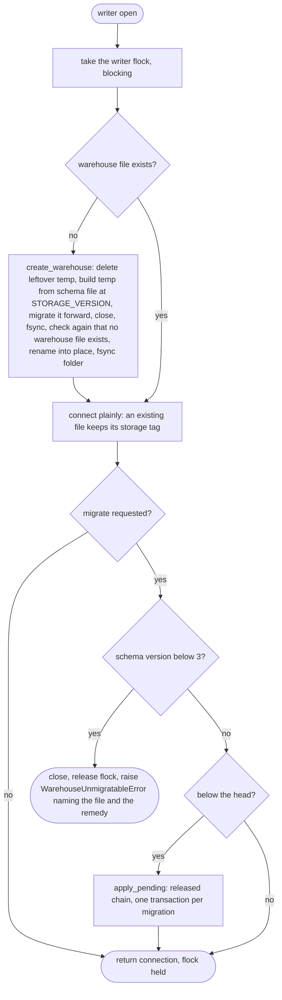

# Task: Restore released migrations; create new warehouses from a frozen schema file (milestone 3)

* Task ID: warehouse-file-growth (L4 milestone 3 of 7)
* Complexity: Level 3
* Type: feature (plus restoration of released files)

Every migration that shipped in a release (`0001` to `0008`) gets its released SQL back, and a gate in `make ci` and CI keeps it that way. `0003_embeddings_hnsw_index.sql` returns under its own name; `0009` stays. New warehouses no longer run the chain from `0001`. `warehouse.open()` builds a missing warehouse from a frozen version-9 schema file (`USING COMPRESSION zstd` on `messages.text` and `tool_calls.tool_input`, no index), at the explicit storage version `v2.0.0`. It builds under a temp name, migrates it forward through any later migrations, and renames the finished file into place under the writer flock after checking that no warehouse file exists. A warehouse at schema 3 to 8 still migrates to the head through the released chain without `vss`. One below schema 3 stops with an error that names the file and says to move it aside. Tests that need the released chain build it in a child process that loads `vss`; the pytest process never loads it.

## Pinned Info

### Writer `open()` after this milestone

Pinned because steps 2, 3, and 5 each change one branch of it, and the tests in the plan follow these branches.

A reader `open(read_only=True)` that finds the file behind the head becomes the migrator through `_migrate_under_lock`, which runs the same floor check. A reader never creates a missing warehouse; that behaviour is unchanged.

### What each arriving warehouse gets (brief "Skipped releases")

| Arriving file | Outcome after this milestone |
| --- | --- |
| No warehouse | Built from `schema_0009.sql`: tag `v2.0.0+`, zstd on both columns, one `schema_version` row, no index, no `vss` |
| `v1.0.0+` at schema 0, 1, or 2 (no rows) | Stops with `WarehouseUnmigratableError`; file untouched |
| `v1.0.0+` at schema 3 to 8 with the HNSW index | Released chain runs without `vss`; `0009` drops the index; rows and tag kept |
| Same, with a `.wal` from a killed 1.5.4 embed | As above (milestone 1 tests stay) |
| `v2.0.0+` at schema 9 (built by this release) | Opens as is |

## Component Analysis

### Affected Components

- **Released migrations** (`src/stockroom/migrations/`): today `0003_retired.sql` (comment only) replaces the released `0003_embeddings_hnsw_index.sql` → restore the released file and its name, delete `0003_retired.sql`, add one comment paragraph to `0003` saying `0009` drops the index and new warehouses never run it. `0001`'s comment edits from milestone 1 stay (operator ruling). `0009` stays.
- **Frozen schema file** (new `src/stockroom/schemas/schema_0009.sql`): the five tables with their version-9 columns in the chain's physical column order, keys, `NOT NULL`s, and the `is_subagent` default; the `session_token_usage` view copied word for word from `0007`; no index; `USING COMPRESSION zstd` on `messages.text` and `tool_calls.tool_input`. No `@rel` lines (the ERD generator reads only the migrations folder; edges stay there as comments). Outside the migrations folder, so discovery and the ERD generator never read it.
- **Storage module** (new `src/stockroom/storage.py`): owns `STORAGE_VERSION = "v2.0.0"`, `FORMAT_BOUNDARY = 9`, the schema file's path and version, the temp file name, `install_schema(con)`, `build_warehouse(dest)`, and `create_warehouse(path)`. Milestone 5 later extends `build_warehouse` to copy rows from an original.
- **Warehouse chokepoint** (`src/stockroom/warehouse.py`): writer `open()` creates a missing warehouse through `storage.create_warehouse` under the flock it already holds; writer `open()` and `_migrate_under_lock` stop below `OLDEST_MIGRATABLE_VERSION = 3` with the new `WarehouseUnmigratableError`. `open_current()` is unchanged (a below-head file is still `WarehouseStaleError`, whose remedy `stockroom migrate` then prints the stop message).
- **Migration runner CLI** (`src/stockroom/migrate.py`): `main` also catches `WarehouseUnmigratableError` and prints one `migrate failed:` line, exit 1. `apply_pending` is unchanged (pure mechanics).
- **Immutability gate** (new `scripts/check_released_migrations.py`, `Makefile`, `.github/workflows/ci.yaml`): compares every `*.sql` under `migrations/` and `schemas/` in the latest release tag with the working tree, SQL tokens only (comments and whitespace removed). A missing or renamed released file fails. New files are not checked. `make migrations-check` joins `make ci`; the CI engine job checks out with `fetch-depth: 0` and runs it.
- **Test support** (`tests/_warehouse_worker.py`, `tests/conftest.py`): the worker's v2.1.2 copy of `0003` and `build_v2_1_2_chain` go (the packaged chain is the released chain again). A `build_chain` command builds the packaged chain through a version at a storage version, with `vss` loaded, plus optional rows; an `index_knn_delete` command runs the restored `0003` index check with `vss`. Conftest gains a session-cached `released_chain` template builder and `released_chain_file` / `released_chain_con` fixtures. `migrated_con` builds from the schema file instead of the chain. W6's schema 3 to 8 files are written by DuckDB 1.5.4 and its `vss` (operator, 2026-10-23). One child, `uv run --project <engine> --no-config --no-sync --with duckdb==1.5.4 python tests/_warehouse_worker.py build_chains_154 ...`, builds all six once per pytest worker. The other old-format files stay 2.0.0-written.
- **Schema contract tests and goldens** (`tests/test_schema_0003.py` to `test_schema_0009.py`, `tests/fixtures/schema/`): `0003` to `0008` tests and goldens return to their released form, with their chains built by the child (the released form called `warehouse.ensure_vss` in-process, which no longer exists). A new `0009_snapshot.json` (no index) becomes the head golden.
- **Runner, open, concurrency, CLI tests** (`test_migrate_runner.py`, `test_warehouse_open.py`, `test_warehouse_concurrency.py`, `test_migrate_cli.py`): packaged-chain runner tests use a child-built file; the schema-1 migrate test becomes the stop test; a schema 3 to 8 test takes over the storage-tag proof; the racing-creators test expects one bookkeeping row.
- **Shadow script** (`scripts/shadow_duckdb_20.py`, `tests/test_shadow_duckdb_20.py`): `_synthetic_warehouse` builds its old warehouse with the released chain in a child process that loads `vss`; the test helper `_head_warehouse` uses `released_chain_file`.
- **Docs and memory bank**: `docs/architecture/warehouse.md` (Migrations), `docs/contributing/iteration/engine.md` (schema-change rules, `migrations-check` row), `memory-bank/systemPatterns.md` (delete the retired-file sentence; describe the schema file, the immutability rule, the floor), `memory-bank/techContext.md` (Warehouse Schema, Makefile gate).

### Cross-Module Dependencies

- `warehouse.open()` → `storage.create_warehouse()` → `storage.build_warehouse()` → `storage.install_schema()` + `migrate.ensure_schema_version_table()` + `migrate.apply_pending()` (later migrations only). `storage` imports `migrate`; `warehouse` imports `storage`; `migrate.main` imports `warehouse` lazily (unchanged), so there is no import cycle.
- `storage.create_warehouse()` assumes the caller holds the writer flock (`warehouse.open()` does). It never takes the flock itself, so milestone 6's pass can call the builder under its own non-blocking flock.
- `conftest.migrated_con` → `storage.install_schema()`; about 11 test modules (ingest, dashboard, semantic, embed, backfill, query) use it, so its output must equal the chain at 9 (the equality test pins this).
- `scripts/gen_warehouse_schema.py` reads the highest `NNNN_snapshot.json` and `@rel` lines in `migrations/*.sql`; it reads neither `schemas/` nor any index data, so the generated ERD is unchanged.
- The gate reads git (tags and blobs) only; it imports nothing from the engine.

### Boundary Changes

- New public names: `stockroom.storage` (module), `warehouse.WarehouseUnmigratableError`, `warehouse.OLDEST_MIGRATABLE_VERSION`. Pre-release branch code; no compatibility constraint.
- On-disk contract: a new warehouse records `schema_version` row `(9, 'schema_0009.sql')` instead of rows 1 to 9. Nothing reads the `filename` column. `open()`'s creation now writes a `v2.0.0+` file with zstd columns (milestone 2 already made new files `v2.0.0+` by default).
- Released files: `0003_embeddings_hnsw_index.sql` reappears; `0003_retired.sql` (never released) goes.
- Contributor contract: `make ci` gains `migrations-check`, which needs release tags in the clone.

### Invariants & Constraints

- Every released migration keeps its released SQL; comments may change. The gate enforces it from this milestone on.
- Nothing in the engine loads or installs `vss`; the pytest process never loads it either (children only).
- A new warehouse never runs `0001` to `0009`: exactly one `schema_version` row, naming the schema file.
- A crash while creating never leaves a half-made file at `warehouse.duckdb`. Creation refuses an existing warehouse file: it checks, under the writer flock, immediately before the rename. Every stockroom writer, older releases included, takes that flock first.
- An existing warehouse file is opened without a storage setting, so it keeps its tag. This milestone changes nothing for the live warehouse at schema 9.
- No runner rule records a version without running it; `apply_pending` is unchanged.
- No test or engine code runs an explicit `CHECKPOINT` on a released-chain file that still has the HNSW index while `vss` is not loaded (fatal on DuckDB 2.0.0; a plain close is fine, measured).
- Out of scope: doctor, the copy, the check, hooks (milestones 4 to 7); no migration after `0009`; no change to `open_current()`.

## Open Questions

None. The implementation approach is clear. Decisions made in this plan, with their reasons:

- [x] **How the restored tests load `vss`** → A child process builds the released chain into a `v1.0.0` file (`build_chain`), and the test opens that file in-process without `vss`. Measured on DuckDB 2.0.0: without `vss`, `duckdb_indexes()` lists the index with `[vector]`; `0004` to `0009` run, with inserts into `sessions` and `messages`, a close, a reopen, and a kill mid-chain. The one hazard: an explicit `CHECKPOINT` after a change, before `0009`, raises `FatalException`. So the restored tests never `CHECKPOINT` those files, and the live-index `0003` check runs whole in the child. Templates are built once per pytest worker and copied (a child build takes about 0.4 s).
- [x] **Where the floor check lives** → In the chokepoint (`warehouse.py`), not the runner. The chokepoint owns lazy migration, file paths, and typed errors, and the message must name the file. `apply_pending` stays pure mechanics, so the runner's synthetic-directory tests are unaffected.
- [x] **How the file goes into place** (operator, 2026-10-23, preflight advisory 5) → `os.rename(temp, path)` after `create_warehouse` checks, under the writer flock, that `path` does not exist; it raises `FileExistsError` and touches nothing when it does. New installs need no hard links, so a home on exFAT, SMB, or FUSE still installs. The planned `os.link` plus `os.unlink` was dropped. With the rename, a crash leaves either no warehouse and a temp file, which the next creation deletes, or the finished warehouse and no temp name. So advisory 4 (a second name left after a crash) no longer applies.
- [x] **Names** → module `stockroom.storage`; folder `src/stockroom/schemas/`; file `schema_0009.sql`, recorded under that name; temp `warehouse.building.duckdb` (outside the backup pattern `warehouse.issue147-*.duckdb`). Constants `STORAGE_VERSION`, `FORMAT_BOUNDARY`, `SCHEMA_FILE`, `SCHEMA_FILE_VERSION`, `BUILDING_FILENAME` in `storage`; `OLDEST_MIGRATABLE_VERSION` in `warehouse`.
- [x] **Gate form** → a stdlib script, like `gen_warehouse_schema.py`. The latest release is the highest `v*` tag in version order. SQL is compared as token lists (string literals and quoted identifiers kept whole; `--` and `/* */` comments and whitespace dropped), so a comment or spacing edit passes and any token change fails. The gate also covers `schemas/*.sql` once a release holds them, because a schema file is frozen like a migration. The gate's own logic has tests (they go red when the gate breaks, not when a migration is edited). No pytest compares migration bytes (that would be a change-detector).
- [x] **`migrated_con`** → `storage.install_schema` plus `apply_pending` on an in-memory connection (in-memory accepts the zstd clause and stores the data uncompressed). This is the same path a new warehouse takes; the equality test keeps it equal to the chain.
- [x] **Real-data run bound** → `embed` runs all its work in one transaction, so a time-killed embed keeps no vectors. CUDA is available here, so the run embeds everything under a 60-minute `timeout` and records the time. If it overruns, record that and repeat with `STOCKROOM_CLAUDE_ROOT` set to one real project folder.
- [x] **Who writes W6's old files** (operator, 2026-10-23, preflight radical innovation, reduced) → DuckDB 1.5.4 with its own `vss`, the engine every release so far shipped, so W6 proves acceptance 10 on the on-disk format users have, including the index as 1.5.4's `vss` serialized it. The files come from the packaged chain, which after step 5 is the released SQL (the gate keeps it so), not from each tag's blobs. The child prints `duckdb <version>`, and the fixture requires `1.5.4`. The full per-tag release matrix was not chosen.
- [x] **`migrate=False`** → creation still happens for a writer open of a missing file (an empty DuckDB file at schema 0 would itself be a stop case); the floor check, like migration, runs only when `migrate=True`.

## Test Plan (TDD)

### Behaviors to Verify

Immutability gate (`check_released_migrations.py`):

- G1: `sql_tokens` on SQL with `--` and `/* */` comments, blank lines, and runs of spaces → the same tokens as the bare SQL; a `--` or `/*` inside a string literal or a quoted identifier stays part of that token, and doubled quotes (`''`) do not end a literal.
- G2: a released migration whose working copy differs only in comments or whitespace → exit 0.
- G3: a released migration with a changed token (a type, a column name, a dropped statement) → exit 1; the output names the file.
- G4: a released migration deleted or renamed in the working tree → exit 1; the output names the released path.
- G5: a migration added after the tag → not checked; exit 0.
- G6: the latest tag is chosen in version order among tags shaped `vX.Y.Z` (`v2.10.0` after `v2.9.0`). Non-`v` tags and other shapes, such as `v3.0.0-rc.1`, are ignored and never crash the sort (preflight advisory 2).
- G7: a clone with no `v*` tag → exit 1 with a message that says to fetch tags.
- G8: a released file under `schemas/` that changes SQL → exit 1, same as a migration.

Storage module and schema file:

- S1: a file built from the schema file and a `v1.0.0` file built by the released chain to 9 (child) have equal `_introspect_schema` output, equal `duckdb_tables().sql` once ` USING COMPRESSION ZSTD` is removed, equal `duckdb_views().sql`, and equal `duckdb_constraints()` rows; the clause appears on `messages` and `tool_calls` only.
- S2: `install_schema` on an empty in-memory connection → one `schema_version` row `(9, 'schema_0009.sql')`, `current_version` 9, the five product tables and the view, no non-primary index, `vss` not loaded.
- S3: `install_schema` on a connection that already has a `tool_calls` table → raises; afterwards there is no `schema_version` row and no `sessions` or `messages` table (one transaction).
- S4: `build_warehouse(dest)` → `dest` tagged `v2.0.0+`, no `dest.wal`, one bookkeeping row, at the head, no index.
- S5: with `storage.STORAGE_VERSION` patched to `"v1.2.0"` → the new file is tagged `v1.2.0+` (the setting is explicit, not DuckDB's default).
- S6: after rows are written to a built file and it is checkpointed → `messages.text` `VARCHAR` segments and `tool_calls.tool_input` `JSON` segments are `ZSTD`.
- S7: with a copy of the packaged migrations plus a synthetic `0010` as the migrations folder → the built file is at 10 with exactly the rows 9 (schema file) and 10.
- S8: `create_warehouse(path)` when `path` already exists → `FileExistsError` before anything is built; the file's bytes are unchanged and no temp name is created.
- S9: leftover files at the temp name and its `.wal` → `create_warehouse` removes them, `path` is a head warehouse, and no temp name remains.
- S10: a failure inside the build (patched to raise) → `create_warehouse` raises, `path` does not exist; a second call succeeds and leaves no temp name.

Warehouse chokepoint and CLI:

- W1: writer `open()` on a fresh home → file tagged `v2.0.0+`, exactly one `schema_version` row naming `schema_0009.sql`, head version, `vss` not loaded, no temp name in the home.
- W2: two processes racing writer `open()` on a fresh home (existing race test) → both at the head; exactly one bookkeeping row.
- W3 (parametrized over schema 0, 1, 2): writer `open()` → `WarehouseUnmigratableError` whose message names the file and gives the move-aside command; the file is still at its path with the same SHA-256; the flock is free afterwards (a non-blocking acquire succeeds). Replaces `test_schema_one_v1_file_migrates_to_head_and_keeps_storage_tag`.
- W4: reader `open(read_only=True)` on a schema-1 file → the same error (through `_migrate_under_lock`).
- W5: `stockroom migrate` (subprocess) with a schema-1 warehouse in a home whose path has a space and a `'` → exit 1; one stderr line naming the file, no traceback; running the printed `mv` command with `sh -c` moves the file (quoted path works).
- W6 (parametrized over schema 3 to 8): a `v1.0.0` file written by DuckDB 1.5.4 with its `vss` (child), with rows and the HNSW index. The precondition, checked in-process, is that the index exists and the child reported `duckdb 1.5.4`. Writer `open()` on DuckDB 2.0 then reaches the head, keeps every row, has no index, has not loaded `vss`, keeps tag `v1.0.0+`, and exact semantic search finds the row by its vector.
- W7: the existing schema-8 tests (killed embed with a `.wal`; migrator killed after the drop) pass on `build_chain`.
- W8: a freshly opened warehouse matches the head golden, now `0009_snapshot.json`.
- W9: writer `open()` on a fresh home with the build patched to fail → raises; no file at the warehouse path; the flock is free afterwards (preflight advisory 3: creation runs inside the `try` that releases the flock).

Restored chain:

- R1: the chain through `0003` (child) has the non-primary index `embeddings_vector_hnsw` on `embeddings` with expressions `[vector]`, read in-process without `vss`.
- R2: in a child with `vss`, the restored index answers cosine nearest-neighbour (`s#0` first) and accepts a delete (2 rows left) (`index_knn_delete`).
- R3: the cumulative schemas after `0003`, `0004`, `0006`, `0007`, `0008` match their restored goldens (with the index); `0005` matches `0004`'s.
- R4: the restored `0004` to `0008` column, row-preservation, and view tests pass on child-built files opened in-process.
- R5: `0009` drops the index from a child-built schema-8 file without `vss` (existing); running `0009` again changes nothing; the schema after `0009` matches `0009_snapshot.json` (no index).
- R6: a child applies the packaged chain to a fresh file → `schema_version` holds versions 1 to 9 with the packaged filenames; `apply_pending` again in-process on that file returns `[]` and the row count stays 9.
- R7: `make schema-docs-check` passes (the head golden is `0009`; the ERD text is unchanged).

Shadow script:

- H1: `_synthetic_warehouse(db, rows=5)` → a `v1.0.0+` file at the head, no index, 5 embeddings, and `vss` never loaded in the calling process.
- H2: the existing `check_live_copy` tests pass with `_head_warehouse` built by the child.

### Test Infrastructure

- Framework: `pytest` with `pytest-xdist` (`-n auto`), configured in `skills/sr-search/pyproject.toml` (`pythonpath = ["src"]`, `testpaths = ["tests"]`).
- Test location: `skills/sr-search/tests/`; repo-root scripts are loaded with `importlib` from their anchored path (as `test_shadow_duckdb_20.py` and `test_warehouse_schema_docs.py` do).
- Conventions: one module per migration (`test_schema_NNNN.py`) with goldens in `tests/fixtures/schema/NNNN_snapshot.json` (regenerate with `STOCKROOM_UPDATE_SCHEMA_GOLDEN=1`); cross-process work through `tests/_warehouse_worker.py` and the `spawn_worker` fixture; `warehouse_home` isolates `STOCKROOM_HOME`.
- New test files: `tests/test_storage.py` (S1 to S10), `tests/test_released_migrations.py` (G1 to G8).

### Integration Tests

- W2, W5, W6, W7: the chokepoint against real files built in other processes (DuckDB's cross-process lock, the released chain with `vss` in a child, DuckDB 1.5.4-written files for W6, and the CLI as a subprocess).
- S1: the schema file against the released chain end to end.
- Build-time gates (not pytest): the gate on the real repo, `make ci`, and the real-data run of the new-warehouse path.

## Implementation Plan

Order follows preflight advisory 8: the gate and the new-warehouse path land before the restoration, so new installs never need the released `0003`, and history is restored before the pull request.

### 0. Back up the live warehouse — prose/policy (operations)

- Files: none in the repo
- No tests: prose/policy artifact

1. Check free disk (723 GB free on 2026-10-22; the file is 42 GB).
2. Under the writer flock, with no `.wal` beside it, byte-copy `~/.local/share/stockroom/warehouse.duckdb` to `~/.local/share/stockroom/warehouse.issue147-pre-schema-file.duckdb`, and confirm equal SHA-256 (the milestone 2 recipe). Record both digests in `progress.md`. Leave the milestone 2 backup in place.

### 1. Immutability gate — executable

- Files: `scripts/check_released_migrations.py` (new), `skills/sr-search/tests/test_released_migrations.py` (new), `Makefile`, `.github/workflows/ci.yaml`

1. Stub tests: `test_released_migrations.py` with empty G1 to G8 cases, a module fixture that loads the script with `importlib`, and a helper that makes a temp git repo with a `skills/sr-search/src/stockroom/migrations/` folder, commits, and tags. The helper runs every git command with `-c user.name=… -c user.email=… -c commit.gpgsign=false -c tag.gpgsign=false`, because CI runners have no git identity (preflight advisory 1).
2. Stub interface: `sql_tokens(text: str) -> list[str]`, `latest_release_tag(repo: Path) -> str | None`, `released_sql_files(repo: Path, tag: str) -> dict[str, str]` (path to SQL in the tag), `problems(repo: Path) -> list[str]`, `main(argv: list[str] | None = None) -> int` (`--repo` defaults to the script's repo root). Module docstring in the style of `gen_warehouse_schema.py`.
3. Write tests and run red: G1 compares token lists; G2 to G8 build temp repos (tags `v1.0.0`, `v2.9.0`, `v2.10.0`, `v3.0.0-rc.1`, and a non-`v` tag for G6) and call `main(["--repo", str(tmp)])`, asserting the exit code and the named path in captured output. Run: all fail.
4. Write code and run green: a regex tokenizer (`'(?:[^']|'')*'`, `"(?:[^"]|"")*"`, `--[^\n]*`, `/\*.*?\*/` with DOTALL, `\s+`, `\w+`, single characters), dropping comment and whitespace tokens; tags from `git tag --list 'v*'` kept only when they match `^v(\d+)\.(\d+)\.(\d+)$`, sorted by integer tuple; files from `git ls-tree -r --name-only <tag> -- <migrations> <schemas>`, filtered to `*.sql`; blobs from `git show <tag>:<path>`. Then add `migrations-check` to `Makefile` (`python3 scripts/check_released_migrations.py`, in `.PHONY`, help text) and to `ci`; in `ci.yaml` set the engine job's checkout `fetch-depth: 0` and add a "Released migrations unchanged" step (`make migrations-check`, workspace root). Run the gate on the real repo: it must fail and name `0003_embeddings_hnsw_index.sql` (evidence that it catches milestone 1's change). `make ci` stays red on that one gate until step 5.

### 2. Schema file and storage module — executable

- Files: `skills/sr-search/src/stockroom/schemas/schema_0009.sql` (new), `skills/sr-search/src/stockroom/storage.py` (new), `skills/sr-search/tests/test_storage.py` (new), `skills/sr-search/tests/_warehouse_worker.py`, `skills/sr-search/tests/conftest.py`

1. Stub tests: `test_storage.py` with empty S1 to S10 cases. Add the test support S1 needs, built from the packaged chain (until step 5 restores `0003`, that chain makes no index, which S1 does not depend on: `0009` leaves none either way). In the worker, add `build_released_chain(con, through: int, directory: Path) -> list[int]`, which copies packaged migrations up to `through` into `directory` and runs `apply_pending` there. Add the commands `build_chain <db> <through> <rows> <storage> <scratch_dir>` (loads `vss` when `through >= 3`, prints `built`) and `index_knn_delete <db> <out_file>`. In conftest, add `released_chain` (a session-scoped template builder using `tmp_path_factory` and `subprocess.run` of the worker), `released_chain_file(through, *, storage="v1.0.0", rows=0) -> Path` (a copy in the test's `tmp_path`), and `released_chain_con(through) -> duckdb.DuckDBPyConnection` (opened read-write in-process, closed at teardown). Their docstrings say the pytest process never loads `vss` and must not `CHECKPOINT` such a file before `0009`. The existing `build_indexed` command and its v2.1.2 copy of `0003` stay until step 5.
2. Stub interface: in `storage.py`, the constants, `install_schema(con) -> None`, `build_warehouse(dest: Path) -> None`, and `create_warehouse(path: Path) -> None` with full docstrings (the caller holds the writer flock; never replaces a file; temp name and cleanup; fsync order). Create `schema_0009.sql` with only its header comment (frozen; version 9; zstd columns; no index; edges live in the migrations' `@rel` comments).
3. Write tests and run red: S1 uses `released_chain_file(9)` and a `build_warehouse` file; S2 and S3 use `mem_con`; S4 to S6 use `tmp_path`; S7 patches `stockroom.migrations.migrations_dir` to a temp copy plus `0010_m10.sql` (`ALTER TABLE sessions ADD COLUMN m10 TEXT`); S8 to S10 use a temp home and patch the build. Run: all fail.
4. Write code and run green: write the DDL from the migrations' final shape (column order as the chain leaves it: `sessions` ends `project_id`, `source_mtime`, `workspace_key`, the four token columns, `entrypoint`; `messages` ends `source_uuid`, `first_seen_at`), the view text copied from `0007`, and the two zstd clauses. `install_schema`: `BEGIN`, `ensure_schema_version_table`, execute the file, insert `(9, 'schema_0009.sql')`, `COMMIT`, with `ROLLBACK` on error. `build_warehouse`: connect `dest` with `storage_compatibility_version=STORAGE_VERSION`, `install_schema`, `apply_pending`, close, require no `dest.wal`, then fsync `dest`. `create_warehouse`: refuse an existing `path` (`FileExistsError`); remove the temp name and its `.wal` if present; `build_warehouse(temp)`; check again that `path` does not exist; `os.rename(temp, path)`; fsync the folder (operator, 2026-10-23). Run S1 to S10 green.

### 3. Create through `open()` and stop below schema 3 — executable

- Files: `skills/sr-search/src/stockroom/warehouse.py`, `skills/sr-search/src/stockroom/migrate.py`, `skills/sr-search/tests/test_warehouse_open.py`, `skills/sr-search/tests/test_warehouse_concurrency.py`, `skills/sr-search/tests/test_migrate_cli.py`

1. Stub tests: W1 and W9 (new in `test_warehouse_open.py`), W3 (parametrized, replacing the schema-one test), W4, W5 (in `test_migrate_cli.py`); change W2's expected row count from `_HEAD_VERSION` to 1.
2. Stub interface: `OLDEST_MIGRATABLE_VERSION = 3` and `class WarehouseUnmigratableError(RuntimeError)` with `path` and `current`, its message built with `shlex.quote` (`warehouse at <path> is at schema version N; this release migrates only from version 3 or later. A file below version 3 is left from a first run that did not finish and holds no history. Move it aside, for example: mv <path> <path>.old, then run the command again`); add it to `__all__`.
3. Write tests and run red: W1 asserts the tag, the single row, no temp name, and `vss` not loaded; W3 builds schema 0 (bare `v1.0.0` file), 1, and 2 (direct SQL plus bookkeeping rows, no `vss` needed), records the SHA-256, and asserts the error, the bytes, and a free flock; W4 uses a reader; W5 runs `python -m stockroom migrate` with `STOCKROOM_HOME` containing a space and a `'`, then runs the printed `mv` with `sh -c`; W9 patches `storage.build_warehouse` to raise and checks the path and a non-blocking flock acquire. Run: W1 to W5 and W9 fail.
4. Write code and run green: in writer `open()`, after taking the flock and inside the `try` whose `except BaseException` releases it (preflight advisory 3), call `storage.create_warehouse(path)` when the file is missing; with `migrate=True`, raise `WarehouseUnmigratableError` (connection closed, flock released by the existing `except BaseException` path) when `current_version(con) < OLDEST_MIGRATABLE_VERSION`. Add the same check in `_migrate_under_lock`. In `migrate.main`, catch the new error beside `WarehouseBusyError`. Update the module and `open()` docstrings. Run the three modules green, then the whole suite (the chain still has `0003_retired.sql` here, so everything else stays green).

### 4. `migrated_con` from the schema file — executable (test infrastructure)

- Files: `skills/sr-search/tests/conftest.py`

1. Stub tests: none new; the about 11 modules that use `migrated_con` are its tests.
2. Stub interface: `migrated_con` keeps its signature; its docstring says it builds the head schema the way a new warehouse does.
3. Write tests and run red: not applicable before step 5 (the chain still runs without `vss`); the red case is step 5's restore, which would break every `migrated_con` user if this step were skipped.
4. Write code and run green: `storage.install_schema(con)` then `apply_pending(con)`. Run the whole suite green.

### 5. Restore the released migrations, goldens, and schema tests — executable

- Files: `skills/sr-search/src/stockroom/migrations/0003_embeddings_hnsw_index.sql` (restored), `0003_retired.sql` (deleted), `skills/sr-search/tests/fixtures/schema/0003_snapshot.json`, `0004_snapshot.json`, `0006_snapshot.json`, `0007_snapshot.json`, `0008_snapshot.json` (restored), `0009_snapshot.json` (new), `skills/sr-search/tests/test_schema_0003.py` to `test_schema_0009.py`, `test_migrate_runner.py`, `test_warehouse_open.py`, `_warehouse_worker.py`

1. Stub tests: restore `test_schema_0003.py` to `test_schema_0008.py` and `test_migrate_runner.py` from `main` (`git show main:<path>`), then swap each in-process `warehouse.ensure_vss` chain for `released_chain_con(N)` (and `index_knn_delete` for the live-index test). Add W6 (parametrized 3 to 8) to `test_warehouse_open.py`, with a session-scoped conftest fixture `released_chain_154` that runs the worker's new `build_chains_154 <out_dir> <rows> 3 4 5 6 7 8` command once under `uv run --project <engine> --no-config --no-sync --with duckdb==1.5.4 python`, requires the child's `duckdb 1.5.4` line, and hands each test a copy. In `test_schema_0009.py`, point the golden test at `0009_snapshot.json` and make the no-index case run `0009` twice on a child-built schema-8 file. Point `test_migrated_warehouse_matches_locked_snapshot` at the `0009` golden. Change the `build_indexed` calls in `test_warehouse_open.py` and `test_schema_0009.py` to `build_chain <db> 8 20 v1.0.0 <scratch>`, with their assertions unchanged.
2. Stub interface: none (restoration of files).
3. Write tests and run red: R1 to R6, W6, and W7 fail against the retired `0003` (no index after `0003`; goldens without the index; W6's precondition finds no index; the rewired schema-8 tests find no index to drop; `0009_snapshot.json` missing).
4. Write code and run green: first copy today's `0008_snapshot.json` (no index) to `0009_snapshot.json` (preflight advisory 7: no golden-update run is needed). Then `git checkout main -- <0003 sql> <five goldens>`; confirm the five goldens equal `v2.1.3`'s; delete `0003_retired.sql`; add one comment paragraph to `0003` (later note: stockroom no longer loads `vss`; `0009` drops this index; new warehouses come from `schemas/schema_0009.sql` and never run this file; a warehouse below version 3 stops with an error). Implement `build_chains_154` in the worker (the packaged chain through each version, `v1.0.0`, `vss` loaded, rows written as `build_chain` writes them, prints `duckdb <version>`). Remove the worker's `V2_1_2_INDEX_SQL`, `build_v2_1_2_chain`, and `build_indexed`, and update its docstring (the packaged chain is the released chain). Run the schema, runner, and open modules green; run `make schema-docs-check` and `make migrations-check` green (R7, and the gate on the real repo). `test_shadow_duckdb_20.py` is red from here until step 6, so steps 5 and 6 share one commit (preflight advisory 6).

### 6. Shadow script's synthetic warehouse — executable

- Files: `scripts/shadow_duckdb_20.py`, `skills/sr-search/tests/test_shadow_duckdb_20.py`

1. Stub tests: H1 in `test_shadow_duckdb_20.py`; `_head_warehouse` switches to `released_chain_file(9, storage=...)`.
2. Stub interface: a `_CHAIN_CHILD` program string and `_synthetic_warehouse(db, *, rows)` keeping its signature, docstring updated (released chain in a child with `vss`).
3. Write tests and run red: H1 fails (in-process `apply_pending` stops at the restored `0003` without `vss`); H2 cases fail until `_head_warehouse` changes.
4. Write code and run green: the child runs `apply_pending` on a `v1.0.0` file with `vss` loaded (`LOAD`, then `INSTALL` and `LOAD` on failure) and `PYTHONPATH` set to the engine source; the parent inserts the random embeddings after the child has closed the file. Update the script's docstring line about phase 2 if it names how the warehouse is built. Remove the test module's now-unused `apply_pending` import. Run the module green; run `--synthetic` once from the repo root (`uv --directory skills/sr-search run --no-sync --no-config python ../../scripts/shadow_duckdb_20.py --synthetic --home <scratch>`) and read its whole output.

### 7. Docs and memory bank — prose/policy

- Files: `docs/architecture/warehouse.md`, `docs/contributing/iteration/engine.md`, `memory-bank/systemPatterns.md`, `memory-bank/techContext.md`
- No tests: prose/policy artifact

1. `warehouse.md` Migrations: one chain forever; released migrations keep their SQL (comments may change; `make migrations-check`); new warehouses come from the frozen `schema_0009.sql` at storage `v2.0.0` with zstd on the two large columns, built under a temp name and renamed into place under the writer flock after a check that no warehouse exists; a warehouse below schema 3 stops with an error naming the file and the remedy.
2. `engine.md`: a `migrations-check` row in the Make table; in "After a schema change", add that a new schema change is a new migration, that released migrations and schema files never change their SQL, that new ERD edges go into a migration as `-- @rel` comments, and that the gate needs release tags (`git fetch --tags`).
3. `systemPatterns.md`: delete the sentence about a retired comment-only migration (`0003_retired.sql`); describe the schema file, the floor, the immutability gate, and creation (temp name, checked rename under the flock) in the lock section.
4. `techContext.md`: Warehouse Schema names the schema file and the gate; Build Tools' Makefile list gains `migrations-check`.

### 8. Verification gates — prose/policy (operations)

- Files: none
- No tests: prose/policy artifact

1. `make ci` from the repo root, whole output read: format, lint, lock, schema docs, the gate, the full suite, `reuse`. Then `stockroom shim ensure-env` (`make ci` and every commit's hook strip torch from this live checkout; the 03:30 entry does not run `ensure-env`).
2. Real-data run of the new-warehouse path (operator, 2026-10-22): a scratch `STOCKROOM_HOME` in the scratchpad and this machine's real transcript roots. Run `stockroom ingest --verbose` (timed), then check the file: tag `v2.0.0+`, `ZSTD` data segments on both columns, one `schema_version` row, no index. Then run `stockroom shim ensure-env` and confirm torch imports: in a scratch home, embed cannot restore torch, because the hashed freeze lives in the real home (preflight advisory 9). Then run `timeout 3600 stockroom embed --verbose` (timed) and a `stockroom semantic` query with rank-1 output. Record the file size after ingest and after embed and the run times in `progress.md`, and delete the scratch home. Row counts are not compared with the live warehouse. Long steps run in the background, and their whole logs are read.
3. Live checks: `stockroom migrate` reports schema 9 on the live warehouse, its SHA-256 is unchanged by the open (nothing writes during the check), and the live file's tag is still `v1.0.0+`.
4. Release gate (operator): the personal Mac shadow test re-runs from a fresh clone after this milestone lands; its synthetic section now needs `vss` downloadable once.
5. Note for QA (preflight advisory 8): only `stockroom migrate` prints the stop error as one line. `ingest`, `embed`, `semantic`, `query`, and the nightly job show a traceback whose last line names the file and the remedy, as they already do for `WarehouseBusyError`. That meets brief acceptance 10.

## Technology Validation

No new technology - validation not required. No new dependencies; `vss` stays test-only (children) and is already used by milestone 1's worker. The DuckDB 2.0.0 behaviours the plan relies on were measured on 2026-10-22 (scratchpad `m3/probe_released_chain.py`, `probe_unbound_checkpoint.py`, `probe_unbound_close.py`, `probe_rw_open_bytes.py`):

- A child builds the released chain through `0003` in about 0.4 s wall; without `vss`, the parent sees the index in `duckdb_indexes()` (`[vector]`, not primary).
- Without `vss`: `0004` to `0009` run like the runner; a kill after `0008` leaves a `.wal` that a plain read-write open replays; a tiny `checkpoint_threshold` changes nothing; every case reaches 9 with the rows. An explicit `CHECKPOINT` after `ALTER`, `INSERT`, or `CREATE VIEW` raises `FatalException`; `UPDATE _sync_state` then `CHECKPOINT` and a plain close are fine.
- A schema file written in the chain's column order gives `duckdb_tables().sql` equal to the chain's at 9 apart from ` USING COMPRESSION ZSTD`, with equal constraints. Re-parsed view text differs, so the view must be copied from `0007` word for word.
- At a temp path with `storage_compatibility_version = 'v2.0.0'`: `messages.text` `VARCHAR` and `tool_calls.tool_input` `JSON` data segments are `ZSTD`, no `.wal` after close, and a plain connect to the renamed final path in the same process works and reads `v2.0.0+`. In memory, the zstd DDL is accepted.
- A plain read-write open and close leaves a bare schema-0 file and a schema-1 file byte-identical.
- The gate's token comparison (`m3/probe_gate_tokens.py`, plain `python3`) finds `0001` in v2.1.3 equal to this branch's copy (milestone 1's comment edits), and `0001` and `0007` in v1.1.0 equal to v1.2.0 (#128's `@rel` lines), though none of them are byte-equal. It finds the released `0003` different from `0003_retired.sql`, and it keeps a `--` inside a string literal or quoted identifier as part of that token.

## Challenges & Mitigations

- **This checkout is the live engine.** Saved files are live for the 03:30 job and any `stockroom` command. Mitigations: back up first (step 0). The live warehouse is at schema 9 and exists, so it reaches neither creation nor the floor stop. Creation refuses an existing file, checked under the flock before anything is built and again before the rename. Do not leave engine code half-edited across 03:30. Run `stockroom shim ensure-env` after every commit and after `make ci`.
- **`vss` must be available to the children.** It is cached here for 2.0.0 and 1.5.4; CI downloads it (milestone 1's worker already does); the Mac gate's synthetic section downloads it once. The worker and the shadow child try `LOAD`, then `INSTALL` and `LOAD`.
- **The DuckDB 1.5.4 child for W6.** It needs `uv` on `PATH` (CI installs it; local runs go through `uv`) and, the first time, the `duckdb==1.5.4` wheel and 1.5.4's `vss` from the network. A nested `uv run --with duckdb==VERSION` selects that version even inside the 2.0 project (SumMem, measured 2026-10-21 and 2026-10-22). One child builds all six files per pytest worker. If the child does not report `duckdb 1.5.4`, the fixture fails loudly rather than silently testing 2.0-written files.
- **Fatal explicit checkpoint on index-bearing files without `vss`.** The restored tests never `CHECKPOINT` in-process before `0009`; the `0003` live-index check runs whole in the child; the fixture docstrings say so.
- **One DuckDB instance per path per process.** The builder opens only its temp path with a storage setting and closes it before the rename; tests open child-built files only after the child exits.
- **Schema file drift from the chain.** S1 compares tables, view text, and constraints; column order is checked through `_introspect_schema`. If the view text does not compare equal even when copied word for word, compare the view's columns and its output on the same rows instead, and note it.
- **The gate depends on tags.** CI uses `fetch-depth: 0`; a clone without tags fails with "fetch tags" (G7). Release-please tags from `main`, so a branch behind `main` may see a newer release's files as missing; that is a real signal to merge `main`.
- **xdist and the template cache.** The template builder is session-scoped per worker and writes under that worker's `tmp_path_factory`; tests get copies of closed, checkpointed files.
- **Real-data run time.** CUDA is available; a 60-minute bound with a smaller fallback (one Claude project root).

## Pre-Mortem

- **New installs break in the release because some path still runs the chain from 0.** Only writer `open()` creates; readers, `open_current()`, the backfill dry run, and doctor never create (unchanged). W1, the existing `test_migrate_fresh_home_bootstraps_warehouse`, and the real-data ingest prove the create path end to end. Already covered.
- **A released schema file gets edited later.** The gate covers `schemas/*.sql` too (G8). Plan changed: added to step 1.
- **A warehouse at schema 3 to 7 hits the fatal checkpoint in the field.** The engine has no explicit `CHECKPOINT`, and W6 runs the real chain without `vss` for every version 3 to 8, on files DuckDB 1.5.4 wrote (operator, 2026-10-23). Already covered.
- **Creation overwrites the live warehouse through a bug.** `create_warehouse` refuses an existing path before it builds and checks again before the rename, all under the writer flock (S8). The operator chose this over a hard link (2026-10-23), so new installs do not depend on hard links.
- **A failed creation leaves the flock held.** Creation runs inside the `try` that releases it (W9, preflight advisory 3).
- **Restored tests become slow.** Templates are cached per worker; about 10 child builds per worker at about 0.4 s each.
- **The stop message misleads a user whose file does hold rows.** No release wrote rows before reaching schema 4, so a file below 3 holds none; the message still says to move the file aside, not to delete it, and nothing deletes it.

## Status

- [x] Component analysis complete
- [x] Open questions resolved
- [x] Test planning complete (TDD)
- [x] Implementation plan complete
- [x] Technology validation complete
- [x] Pre-Mortem complete
- [ ] Preflight
- [ ] Build
- [ ] QA
