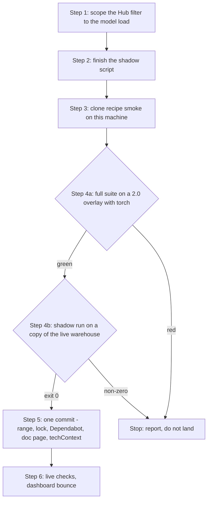

# Task: warehouse-file-growth, milestone 2 (DuckDB 2.0)

* Task ID: warehouse-file-growth
* Complexity: Level 3
* Type: feature (dependency move with a live-copy proof)

Move the engine from DuckDB 1.5.4 to DuckDB 2.0 and prove it on a copy of this machine's warehouse before the lock lands. The engine range becomes `>=2.0,<2.1` and the lock pins 2.0.0, the only final 2.0 release on PyPI today (2.0.1 exists only as a dev build). Dependabot ignores duckdb `>=2.1.0` in the engine block. `scripts/shadow_duckdb_20.py` gains the checks its Done line names and still lacks: the copy is at the schema head with no index, `stockroom semantic` returns a ranked hit, and no stockroom command prints a nanobind leak warning. `docs/advanced/duckdb.md` says which DuckDB versions can open the warehouse. The nanobind leak warnings that `stockroom embed` and `stockroom semantic` print at exit under 2.0 are fixed at their cause. The 2.0 move is one commit, landed last.

## Pinned Info

### Landing order and gates

Everything before the lock lands works on DuckDB 1.5.4 and 2.0 alike, because this checkout is the live engine: a saved file is live at once, and every commit's hook syncs `.venv` to the working-tree lock. The lock is the last change, and it lands only after both pre-lock gates pass.

### Measured during planning (2026-10-22)

- Nanobind cause. The warnings print only after `BgeEncoder()` runs in a process that has imported `duckdb` 2.0.0. `BgeEncoder.__init__` calls `silence_unauthenticated_hub_warning()`, which leaves a `_DropUnauthenticatedHubWarning` instance on the `huggingface_hub.utils._http` logger for the life of the process. Through its class's methods, that instance keeps the `stockroom.embed` module's globals alive, so the `duckdb` module, its default connection, and its type objects are still alive when nanobind runs its shutdown check. Probes (scripts in this session's scratchpad `m2/nanobind_probe*.py`):
    - No warning: DuckDB alone with any parameter binding (list, numpy, `executemany`), torch imported, `sentence_transformers` or `transformers` imported, a plain `SentenceTransformer` load and encode next to DuckDB, the filter alone without a model load, and `semantic.main` with a fake encoder.
    - Warning: `BgeEncoder().encode(...)`, with or without a DuckDB connection, and `embed.main` / `semantic.main` unchanged.
    - No warning after removing the filter once the model has loaded: `BgeEncoder` then `removeFilter`; `semantic.main` and `embed.main --full --verbose` with a factory that does this.
    - A torch-free process (as in CI) does not reproduce the warning, even with `huggingface_hub` or `transformers` imported and the notice logged through the filter. So only a torch-gated test can check the exit warning itself.
- The engine suite on a `uv run --with duckdb==2.0.0` overlay (no torch), after milestone 1: 1,040 passed, 38 skipped, the same counts as on 1.5.4. This includes the v2.1.2-chain worker and the killed-writer `.wal` tests, whose children load `vss` on 2.0.0.
- `uv lock --no-config` in a scratch copy with `duckdb>=2.0,<2.1`: only duckdb changes (1.5.4 → 2.0.0); 56 packages resolve.
- duckdb 2.0.0 wheels: cp311, plus cp312-abi3 for 3.12 and newer, on macOS arm64/x86_64/universal2 (10.15+), manylinux 2.26/2.27 aarch64/x86_64, and Windows. Platform coverage matches 1.5.4.
- A new warehouse from `warehouse.open()` on 2.0.0 is tagged `v2.0.0+`; on 1.5.4 it is `v1.0.0+`. Both reach schema 9.
- No engine SQL and no `sr-query` recipe uses the `x -> ...` lambda arrow that 2.0.0 rejects.
- Live warehouse: 42,436,407,296 bytes, schema 9, no index, no `.wal`. The scratchpad disk has 763 GB free; the shadow run needs twice the source plus 1 GiB.
- The session-start dashboard (pid 1762403, started 2026-10-20) is a long-lived process on this checkout's `.venv` with DuckDB 1.5.4 loaded. `stockroom dashboard --replace` restarts an owned listener.

## Component Analysis

### Affected Components

- `skills/sr-search/src/stockroom/embed.py`: `silence_unauthenticated_hub_warning()` attaches the Hub-notice filter for the life of the process, and `BgeEncoder.__init__` calls it → it becomes a context manager that adds the filter on entry and removes it on exit, even on an exception. `BgeEncoder.__init__` wraps the `SentenceTransformer(...)` construction in it. The Hub sends the notice during the model's Hub requests, all of which happen at construction.
- `skills/sr-search/tests/test_embed.py`: the existing Hub-notice test calls the function once and leaves the filter installed in the test process → it uses the context manager. New cases cover removal on exit, removal on an exception, `BgeEncoder`'s wiring with fake `torch` / `sentence_transformers` modules (torch-free, runs in CI), and a torch-gated subprocess test of the exit warning itself.
- `scripts/shadow_duckdb_20.py` (contributor program; milestone 2 owns everything still in it) → gains `check_live_copy(db)` (tag `v1.0.0+`, schema head, no non-primary index), `semantic_answered(lines)`, and `nanobind_lines(lines)`. `_stockroom` fails on any nanobind line. `_live` uses all three. The milestone-1 QA leftovers go: one child program instead of a prelude plus one child, no unused `read_only` / `start` / `storage` parameters, and `_run_child` folds into its one call site. The docstring gives the fresh-clone recipe and both run forms (2.0 lock, or a 1.5.4 lock plus `--with duckdb==2.0.0`).
- `skills/sr-search/tests/test_shadow_duckdb_20.py` → tests for the three new functions.
- `skills/sr-search/pyproject.toml` / `uv.lock`: `duckdb>=1.2` / 1.5.4 → `duckdb>=2.0,<2.1` / 2.0.0.
- `.github/dependabot.yaml`: the engine `uv` block → adds `ignore: duckdb versions ['>=2.1.0']`.
- `docs/advanced/duckdb.md` (the one home that every page linking to "a DuckDB client" points at) → a "DuckDB version" section.
- `memory-bank/techContext.md` → one sentence that the engine pins the DuckDB 2.0 line.

### Cross-Module Dependencies

- `semantic.main` and `embed.main` → `start_encoder(BgeEncoder)` → `silence_unauthenticated_hub_warning()`. The context manager's lifetime is the only change on this path; `start_encoder`'s torch-restore retry builds a new `BgeEncoder`, which scopes the filter again.
- `scripts/shadow_duckdb_20.py` → `stockroom.migrations.discover` (schema head), `python -m stockroom ingest|embed|semantic` (children under the overlay interpreter with `PYTHONPATH` = engine `src`), and `uv run --project skills/sr-search --no-config --no-sync --with duckdb==1.5.4` (the old writer).
- The commit hook and `make ci` → `uv sync --frozen` (exact) of `skills/sr-search/.venv`, which is the live engine here. It removes torch, which `stockroom shim ensure-env`, or `embed`'s own restore, puts back from the hashed freeze.
- The nightly cron at 03:30 runs `stockroom ingest && stockroom embed` through the shim on this checkout.

### Boundary Changes

- Warehouse file format for **new** warehouses: `v2.0.0+`, which DuckDB before 2.0 cannot open. Existing warehouses keep their `v1.0.0+` tag when 2.0 writes them, so the Claude Code stockroom 0.16.0 copy on this machine (DuckDB 1.5.4) can still open the live warehouse. The shadow run's 1.5.4 writer proves this on a copy.
- The engine's DuckDB range moves to `>=2.0,<2.1`. Python API change in `stockroom.embed`: `silence_unauthenticated_hub_warning` becomes a context manager. It is internal (one caller and one test); no compatibility shim.
- No schema change and no migration.

### Invariants & Constraints

- The 2.0 lock is the last change this milestone brings into this checkout, and it lands only after the full suite passes on a 2.0 overlay with torch and the shadow run exits 0 on a copy of this machine's warehouse.
- Every change before the lock behaves the same on DuckDB 1.5.4 and 2.0 (the working tree is live).
- The shadow script never opens `--source` with DuckDB; its only operations on that file are the flock, the `.wal` check, one byte copy, and a stat.
- The live warehouse is never opened for writing by anything except the stockroom commands of step 6, and is never replaced, renamed, or deleted. If step 6 finds damage, the build stops and asks the operator before restoring anything.
- The shadow run's baseline copy stays on disk after the run, as a byte-identical rollback copy for the landing, as long as the live file's size and mtime have not changed since the copy.
- No vector index, no `vss`, no migration, and no new user-facing command (cross-milestone invariants).
- Nothing in this milestone sets the new-file storage version explicitly or adds ZSTD clauses (milestone 3 owns both).
- The Hub's unauthenticated-request notice stays hidden during model load, and other warnings from that logger still pass.

## Open Questions

None. The implementation approach is clear. The choices the milestone left open were settled by measurement:
- [x] Nanobind warnings → Resolved: the cause is stockroom's own logger filter. Scope it to the model load with a context manager; no need to ask the operator to accept the warnings. Alternatives rejected: an `atexit` removal (global state that outlives its use), or a filter class in a module that does not import `duckdb` (breaks silently when someone adds an import).
- [x] Which 2.0 → Resolved: 2.0.0, the only final 2.0 release. The range admits later 2.0 patches.
- [x] Dependabot range syntax → Resolved: `versions: ['>=2.1.0']`, the comparison form GitHub documents ([controlling dependencies updated](https://docs.github.com/en/code-security/dependabot/dependabot-version-updates/controlling-dependencies-updated); `ignore` reference: [options reference](https://docs.github.com/en/code-security/dependabot/working-with-dependabot/dependabot-options-reference#ignore--)).
- [x] Pin test → Resolved: none. A test that `duckdb.__version__` starts with `2.0` goes red only when someone edits the pin on purpose; semantic versioning and the range carry that expectation (always-tdd).

## Test Plan (TDD)

### Behaviors to Verify

Hub-notice filter (`tests/test_embed.py`, torch-free, runs in CI):
- N1 Inside `with embed.silence_unauthenticated_hub_warning():` → the unauthenticated notice logged on `huggingface_hub.utils._http` is not captured; a different warning from the same logger is captured. (Rework of `test_unauthenticated_hub_notice_is_dropped_and_other_warnings_remain`.)
- N2 After the `with` block exits, both normally and through an exception raised inside it (parametrized) → a notice logged afterwards is captured (no filter left behind), and the exception still propagates.
- N3 `embed.BgeEncoder()` with fake `torch` (`cuda.is_available()` → False) and fake `sentence_transformers.SentenceTransformer` modules in `sys.modules`, where the fake constructor logs the notice → the notice logged during construction is not captured, and a notice logged after construction is captured.
- N4 Same fakes, but the fake constructor logs the notice and raises → the exception propagates out of `BgeEncoder()`, and a notice logged afterwards is captured.

Exit warning (`tests/test_embed.py`, torch-gated with `pytest.importorskip("torch")`; skipped in CI and wherever `.venv` has no torch):
- N5 `python -m stockroom embed` and then `python -m stockroom semantic -k 1 <query>` (subprocesses of `sys.executable`, `PYTHONPATH` = engine `src`, `STOCKROOM_HOME` = a seeded scratch home with one message) → both exit 0, `semantic` prints a rank-1 row, and neither stderr contains `nanobind`. Red under the 2.0 overlay before the fix; trivially green on 1.5.4 (pybind11 has no such check).

Shadow script (`tests/test_shadow_duckdb_20.py`, torch-free):
- S1 `check_live_copy(db)` on a `v1.0.0` file migrated to head by `stockroom.migrate.apply_pending`, with no extra index → returns `"v1.0.0+"`.
- S2 Same file plus `CREATE INDEX extra ON sessions (session_id)` → `PhaseError` whose message names `extra`.
- S3 Same file with the head row deleted from `schema_version` → `PhaseError` naming the found version and the head.
- S4 A file created at `storage_compatibility_version = 'v1.2.0'` and migrated to head → `PhaseError` naming its tag (`v1.2.0+`) and `v1.0.0+`.
- S5 `semantic_answered(lines)`: a TSV header alone, or no lines → False; a header plus a line starting `1\t` → True; a stderr line that merely contains `1\t` later in the line → False.
- S6 `nanobind_lines(lines)`: returns exactly the lines that start with `nanobind:` (several), and `[]` when there are none.
- Existing guard, copy, checkpoint-equality, and `embeddings_held` tests stay green after the cleanups (refactor cover).

Edge cases considered and left out on purpose:
- A long child query drawing DuckDB's progress bar into a parsed line. The one parsed child query (exact top-100) runs in about 200 ms on 133,793 vectors, far under the 2-second bar threshold, and a garbled line fails the `required` check loudly. No change.
- A 1.5.4 `.wal` replayed by the 2.0 engine. Measured on 2.0.0 (milestone invariants); the durable tests make their `.wal` with the pinned DuckDB, as the milestone plan prescribes for old-file tests.

### Test Infrastructure

- Framework: pytest with xdist (`-n auto`), configured in `skills/sr-search/pyproject.toml`; `pythonpath = ["src"]`.
- Test location: `skills/sr-search/tests/`.
- Conventions: torch-gated tests use `pytest.importorskip("torch")` (see `test_bge_encoder_encodes_to_384_on_cpu`); `warehouse_home` fixture plus `_seed_warehouse_message` for a scratch warehouse; the shadow script loads through the module-scoped `shadow` fixture (importlib from the anchored path) or runs as a subprocess of `sys.executable`; docstrings on each test.
- New test files: none.

### Integration Tests

- N5: the embed and semantic CLIs end to end with the real encoder, under the pinned DuckDB.
- Gate 4a: the full suite under `uv run --with duckdb==2.0.0` with torch installed into the overlay from the hashed freeze, so the torch-gated tests (N5, the BGE encoder tests, the semantic end-to-end test) run on 2.0.
- Gate 4b: the shadow script's full run on a copy of the live warehouse (copy, 2.0 checkpoint equality, ingest, embed, checkpoint, head and no index and tag, semantic, 1.5.4 writer, 2.0 reader, no nanobind line anywhere).

## Implementation Plan

### 1. Scope the Hub-notice filter to the model load — executable

- Files: `skills/sr-search/src/stockroom/embed.py`, `skills/sr-search/tests/test_embed.py`

1. Stub tests: in `test_embed.py`, rework `test_unauthenticated_hub_notice_is_dropped_and_other_warnings_remain` (N1) to use the context manager; add empty `test_hub_notice_filter_is_removed_on_exit` (N2, parametrized `normal` / `raised`), `test_bge_encoder_silences_hub_notice_only_while_loading` (N3), `test_bge_encoder_removes_hub_filter_when_load_fails` (N4), and the torch-gated `test_embed_and_semantic_exit_without_nanobind_leak_warnings` (N5) beside the other BGE tests, each with a docstring.
2. Stub interface: `silence_unauthenticated_hub_warning()` becomes `@contextlib.contextmanager def silence_unauthenticated_hub_warning() -> Iterator[None]` with a docstring that says why the filter must not outlive the load (it keeps `stockroom.embed`, and so `duckdb`, alive until nanobind's shutdown check under DuckDB 2.0). The body is still the old permanent add, so the stub keeps today's behaviour.
3. Write tests and run red: N3 and N4 install fakes with `monkeypatch.setitem(sys.modules, ...)`. The fake `SentenceTransformer` logs the notice through `logging.getLogger("huggingface_hub.utils._http")` and, for N4, raises `RuntimeError`. Assertions use `caplog` at WARNING on that logger, as N1 does. N5 seeds one message with `_seed_warehouse_message`, then runs both CLIs with `subprocess.run([sys.executable, "-m", "stockroom", ...], env={**os.environ, "PYTHONPATH": <src>, "STOCKROOM_HOME": str(warehouse_home)}, capture_output=True, text=True, timeout=600)`. Run `test_embed.py` on the project venv: N2, N3, and N4 fail (the filter stays). Then run N5 under the 2.0 overlay with torch: `uv run --project skills/sr-search --no-config --no-sync --with duckdb==2.0.0 bash -c '<install torch from ~/.local/share/stockroom/torch-requirements.txt into $(command -v python)>; python -m pytest -n0 tests/test_embed.py -k nanobind'`. N5 must fail on `nanobind`.
4. Write code and run green: the context manager adds a fresh `_DropUnauthenticatedHubWarning` to the Hub logger, yields, and removes that same instance in `finally` (the idempotence check goes away; nested uses each remove their own instance). `BgeEncoder.__init__` runs `SentenceTransformer(...)` inside `with silence_unauthenticated_hub_warning():`. Run `test_embed.py` and `test_semantic.py` on the project venv (green), then N5 again under the 2.0 overlay with torch (green). Commit: `fix: stop the Hub warning filter from outliving the model load`.

### 2. Finish the shadow script — executable

- Files: `scripts/shadow_duckdb_20.py`, `skills/sr-search/tests/test_shadow_duckdb_20.py`

1. Stub tests: add empty S1 to S6 to `test_shadow_duckdb_20.py`, with a helper `_head_warehouse(path, storage="v1.0.0")` that creates a file at that storage version, runs `stockroom.migrate.apply_pending`, and closes it.
2. Stub interface: in the script, add `check_live_copy(db: Path) -> str`, `semantic_answered(lines: list[str]) -> bool`, and `nanobind_lines(lines: list[str]) -> list[str]`, each with a docstring and an empty body (`raise NotImplementedError`).
3. Write tests and run red: S1 to S6 as in the test plan; S2 to S4 use `pytest.raises(shadow.PhaseError, match=...)`. Run `test_shadow_duckdb_20.py`: S1 to S6 fail and the existing tests pass.
4. Write code and run green:
    - `check_live_copy` opens `db` read-only, reads the storage tag, `max(version)` from `schema_version`, and `duckdb_indexes()` where `NOT is_primary`. It compares them with `OLD_TAG`, with `max(m.version for m in discover())` (imported after `_engine_on_path()`), and with an empty list, and raises one `PhaseError` that names every mismatch. It returns the tag.
    - `semantic_answered` is true when any line starts with `1\t`. `nanobind_lines` returns the lines that start with `nanobind:`.
    - `_stockroom` returns its lines and raises `PhaseError` when `nanobind_lines` finds any, naming the command. `_live` searches the joined embed output for the orphan line, replaces the inline tag check after the checkpoint with `check_live_copy(working)` (printing tag, schema, and "no index"), and raises when `semantic_answered` is false for the semantic output.
    - Cleanups from milestone 1's QA: merge `_CHILD_PRELUDE` into one `_WRITER_CHILD` program (connect without the unused `read_only`); remove `_run_child` and call `_run_command("duckdb 2.0", [sys.executable, "-c", _WRITER_CHILD, str(working)], ...)`; drop `_insert_random_embeddings`'s `start` and `_synthetic_warehouse`'s `storage` (always `v1.0.0`).
    - Docstring: the run forms ("with the 2.0 lock: `uv run --project skills/sr-search --no-config --no-sync python scripts/shadow_duckdb_20.py ...`; on a checkout still locked to 1.5.4, add `--with duckdb==2.0.0`"), the fresh-clone recipe for another machine (`git clone --branch <branch> <repo>`, `make sync` in the clone, then the run; never `make shim` or `make torch` there, because the script installs torch from that machine's hashed freeze into the run's own interpreter), and phase 5's new checks.
    - Run `test_shadow_duckdb_20.py` (green) and `make lint` / `make format-check`. Commit: `chore: finish the DuckDB 2.0 shadow script checks`.

### 3. Clone-recipe smoke on this machine — verification

- No files change.

1. Clone this branch into the scratchpad (`git clone --branch constrain-size-as-best-we-can /home/mobaxterm/git/stockroom <scratch>/m2/clone`), run `make sync` there, and run the docstring's 1.5.4-lock form with `--synthetic --home <scratch>/m2/clone-home`. Expect exit 0 and `shadow: synthetic section passed`. This shows the Mac recipe works mechanically and that the clone's run never touches this checkout's `.venv` or the live warehouse.
2. Delete the clone and its home.

### 4. Pre-lock gates — verification

- No files change. Both gates must pass before step 5. If either fails, stop, record it, and report; the 1.5.4 lock stays.

1. Gate 4a: `uv run --project skills/sr-search --no-config --no-sync --with duckdb==2.0.0 bash -c '<install torch from the freeze>; python -m pytest'` from the engine dir. Read the whole output. Expect green, with fewer skips than 38 (the torch-gated tests run).
2. Gate 4b, before record: stat the live warehouse (size, `mtime_ns`), confirm there is no `.wal`, and record `schema`, the storage tag, and row counts through `stockroom query` (1.5.4, read-only). Write them to `<scratch>/m2/live-before.txt`.
3. Gate 4b, the run, from the repo root: `set -o pipefail; uv run --project skills/sr-search --no-config --no-sync --with duckdb==2.0.0 python scripts/shadow_duckdb_20.py --source ~/.local/share/stockroom/warehouse.duckdb --home <scratch>/m2/shadow 2>&1 | tee <scratch>/m2/shadow.log`. `pipefail` keeps the script's exit status through `tee`. Expect exit 0 and `shadow: every phase passed`. Keep `<scratch>/m2/shadow/baseline.duckdb`.

### 5. The DuckDB 2.0 move (one commit) — executable config plus prose

- Files: `skills/sr-search/pyproject.toml`, `skills/sr-search/uv.lock`, `.github/dependabot.yaml`, `docs/advanced/duckdb.md`, `memory-bank/techContext.md`
- No new tests: the whole suite on 2.0 (gate 4a, then `make ci`) is the proof; a pin test would be a change-detector, and the Dependabot file and the doc page are config and prose.

1. Confirm the live warehouse's size and `mtime_ns` still equal the before record and that there is no `.wal`, so the baseline is a byte-identical rollback copy.
2. `pyproject.toml`: `"duckdb>=2.0,<2.1"`. Run `uv --directory skills/sr-search --no-config lock` and confirm the lock diff changes only duckdb (1.5.4 → 2.0.0).
3. `.github/dependabot.yaml`, engine `uv` block: an `ignore` entry for `dependency-name: 'duckdb'` with `versions: ['>=2.1.0']` and a comment that the engine stays on the 2.0 line. Check that the file still parses as YAML.
4. `docs/advanced/duckdb.md`: a "DuckDB version" section after the intro. It says to use DuckDB 2.0 or newer, that stockroom's engine runs DuckDB 2.0, and that a warehouse it creates is stored in DuckDB 2.0's file format, which DuckDB before 2.0 cannot open. It shows `duckdb --version` as the check. Plain language (ISO 24495); no version history.
5. `memory-bank/techContext.md`: one sentence in Environment Setup that the engine pins the DuckDB 2.0 line (`>=2.0,<2.1`; Dependabot ignores 2.1 and later).
6. `make ci`. This is the sync that moves `.venv`, the live engine, to 2.0. Then `make docs-build`. Read the whole output of both. If `make ci` fails: restore `pyproject.toml` and `uv.lock` from `HEAD` (one `git checkout --` call), run `make sync`, confirm `.venv` imports duckdb 1.5.4, stop, and report. That leaves the machine on 1.5.4 before the 03:30 job.
7. Commit all five files together: `feat: move the engine to DuckDB 2.0`, with a body saying new warehouses need DuckDB 2.0 or newer to open, and existing ones keep their format.

### 6. Live checks after landing — verification

- No files change.

1. `stockroom dashboard --replace`, so the session-start dashboard stops running 1.5.4 code against 2.0 files; check that `http://127.0.0.1:58008/` answers.
2. Read-only after record through `stockroom query` (now 2.0): storage tag `v1.0.0+`, schema 9, row counts equal to the before record.
3. `stockroom shim ensure-env` (the commit's exact sync removed torch), then `stockroom ingest`, `stockroom embed --verbose`, and `stockroom semantic -k 3 "how does the warehouse lock work"` through the shim. Each exits 0 and prints no `nanobind` line. `sessions`, `messages`, and `tool_calls` do not shrink, and `embeddings` shrinks by no more than the orphans embed reports.
4. A DuckDB 1.5.4 read-only open of the live warehouse (`uv run --project skills/sr-search --no-config --no-sync --with duckdb==1.5.4 python -c ...`) counts `messages`, as the stockroom 0.16.0 copy on this machine would.
5. On any failure: do not touch the live file. Revert the commit (`git revert`, one call), run `make sync`, and ask the operator before restoring the warehouse from the baseline.
6. Leave the baseline in place and report its path and size to the operator. Stockroom never deletes it, and the operator decides when it goes.

### 7. Final verification

1. `make ci` and `make docs-build` on the landed tree (2.0); read the whole output.
2. Update `tasks.md` and `progress.md` and commit per the workflow.

## Technology Validation

No new technology. DuckDB 2.0.0 replaces an existing dependency at a new major version; validated during planning:
- The lock resolves with only duckdb changing (scratch copy, `uv lock --no-config`, uv 0.12.22).
- Wheels exist for every platform the engine supports (macOS arm64 and x86_64, manylinux aarch64 and x86_64, Windows; CPython 3.11 and 3.12+ abi3).
- The full engine suite passes on a 2.0.0 overlay (1,040 passed, 38 skipped).
- `warehouse.open()` on 2.0.0 creates a `v2.0.0+` file at schema 9.
- The nanobind cause is found, and the fix is proven on the `embed` and `semantic` CLI paths under 2.0.0.

## Challenges & Mitigations

- The working tree is the live engine. Step 1's change reaches the 03:30 embed on 1.5.4 as soon as it is saved. Mitigation: the change only shortens how long a logging filter stays on, and behaves the same on 1.5.4 and 2.0; step 1 runs `test_embed.py` and `test_semantic.py` before commit.
- Torch is missing from `.venv` on this machine (each commit's exact sync removes it). Mitigation: the overlay gates install torch from the hashed freeze into the overlay's own interpreter only. Step 6 runs `stockroom shim ensure-env` before the live embed, and `embed` restores torch itself if needed.
- The 2.0 overlay is a temporary environment that `uv` deletes when the run ends. Mitigation: every overlay command installs torch and runs its work inside one `uv run ... bash -c` call.
- The shadow run copies 42 GB twice and runs `EXCEPT ALL` over every table. Mitigation: 763 GB is free. The run is long but reports progress line by line. `--stop-after` allows a partial rerun, though a rerun needs an empty `--home`.
- The first 2.0 write to the live warehouse. Mitigation: gate 4b proves it on a byte copy. The baseline stays on disk as a rollback copy (step 5.1 checks it is still byte-identical by size and mtime). Step 6 makes the first live 2.0 writes supervised, not at 03:30, and 1.5.4 must still open the file afterwards.
- The long-lived dashboard has DuckDB 1.5.4 loaded while `.venv` swaps to 2.0 under it. Mitigation: step 6.1 restarts it with `--replace`.
- Dependabot config errors show only on GitHub. Mitigation: the documented `>=` form, a YAML parse check, and the `<2.1` range in `pyproject.toml` as the first guard.
- 2.0.1 may be released mid-build (a dev build exists). Mitigation: pin 2.0.0; the range admits a later patch through Dependabot.

## Pre-Mortem

- The proof passes here on a schema-9 file without an index, but a Mac's schema-8 warehouse, which still has the HNSW index, fails under 2.0. Plan response: that case is the operator's Mac run, a release gate. Step 3 checks the clone recipe end to end mechanically, and the hand-off says plainly that the Mac run comes before the release. The suite's v2.1.2-chain and killed-writer tests already cover schema 8 with an index on 2.0.
- Another anchor keeps `duckdb` alive on macOS (another torch build or MPS), so the warnings come back there. Plan response: the shadow script now fails on any nanobind line from any stockroom command, so the Mac run catches it loudly before release.
- The failure is in the landing, not the code: a failed `make ci` leaves `.venv` on 2.0 with no 2.0 commit, and 03:30 runs on it. Plan response: step 5.6 restores the lock and runs `make sync` before stopping; already covered by Challenges.
- Wrong premise, "2.0 keeps an existing file readable by 1.5.4": if it were false, the live warehouse would lock out the 0.16.0 copy after step 6. Plan response: gate 4b's 1.5.4 writer runs on the copy after ingest, embed, and the checkpoint under 2.0, and step 6.4 checks the live file.

## Status

- [x] Component analysis complete
- [x] Open questions resolved
- [x] Test planning complete (TDD)
- [x] Implementation plan complete
- [x] Technology validation complete
- [x] Pre-Mortem complete
- [ ] Preflight
- [ ] Build
- [ ] QA
