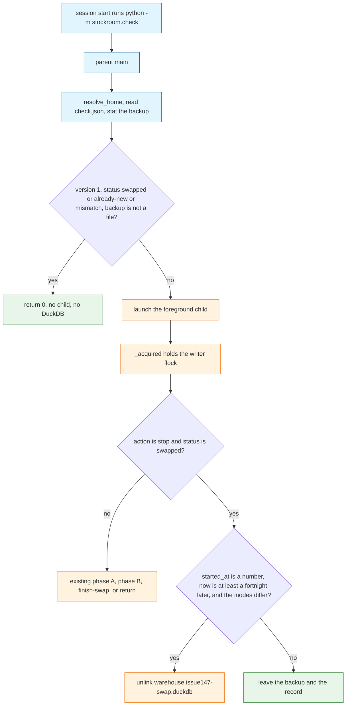

# Task: Fortnight backup reclaim and finished-home short-circuit

* Task ID: fortnight-backup-and-quiet-check
* Complexity: Level 3
* Type: feature

Unlink `warehouse.issue147-swap.duckdb` on the `swapped` stop path a fortnight after `started_at`, and return from `python -m stockroom.check` before `launch()` when check version 1 is `swapped`, `already-new`, or `mismatch` and that backup is not a file. The parent must not import DuckDB. Item 2 of issue 155 stays out: the hook command stays, `check.json` stays, and there is no `check-2.json`.

## Pinned Info

### Parent gate and child reclaim

The short-circuit and the unlink are one feature because they share the backup file. A finished home whose backup is still present must start the child. The child is the only place that unlinks.

## Component Analysis

### Affected Components

- `stockroom.check` (`skills/sr-search/src/stockroom/check.py`): owns the record, `next_action`, the flocked pass, and `main` / `launch`. Today the module imports DuckDB, `storage`, `migrate`, and `warehouse` at import time, and `main` always calls `launch` unless `--foreground` is set. The `stop` path removes `warehouse.copy.duckdb` and returns. It does not name the swap backup.
- `stockroom.doctor` (`skills/sr-search/src/stockroom/doctor.py`): defines `SWAP_BACKUP_FILENAME` and reports whether that name is a file. It imports DuckDB at import time. The parent gate cannot import this module.
- `stockroom.home`: stdlib `resolve_home`. The gate uses it. No change to the resolver.
- Session-start hooks (`hooks/cursor-hooks.json`, `hooks/claude-hooks.json`): already run `python -m stockroom.check`. They stay as they are. Home resolution stays out of the shell.
- User guide (`docs/user-guide/troubleshooting/index.md`): the Warehouse section says Stockroom never deletes `warehouse.issue147-swap.duckdb`, and that a `swapped` check does not touch that file again.

### Cross-Module Dependencies

- Hook shell → `python -m stockroom.check` → `main`. No new command.
- `main` (no `--foreground`) → `resolve_home` and `load_record` → either return or `launch`.
- `launch` → child `python -m stockroom.check --foreground <home>` → `entry` → `run_check` → writer flock → `_acquired`.
- `_acquired` on `stop` + `swapped` → unlink that one backup name. `check.json` is not written.
- The child still imports `doctor.live_bytes` inside `run_check` for the readiness ladder. That import is after the gate and stays on the child path.
- Doctor keeps reporting `backup: absent` when the name is gone. It does not delete the file.

### Boundary Changes

- `python -m stockroom.check` with no `--foreground` returns without a child when the home is finished and the backup is not a file. Every other record, a missing or unreadable record, and a present backup still call `launch`.
- Importing `stockroom.check` does not import DuckDB. `--foreground` still imports DuckDB when the pass runs.
- `SWAP_BACKUP_FILENAME` is defined on `stockroom.check` and re-exported from `stockroom.doctor`, so `doctor.SWAP_BACKUP_FILENAME` stays the name tests and the probe already use.
- No schema change, no hook-text change, no new record file, no `check.json` rewrite on the reclaim path.

### Invariants & Constraints

- The live `warehouse.duckdb` bytes stay. The backup is unlinked only when both paths are files and `stat().st_ino` differs. `stat` follows links. Same inode keeps the backup name.
- `started_at` is the phase B clock on the swapped record. The retention constant is `14 * 86400`, compared like the rehearsal wait: unlink when `now >= started_at + SWAP_BACKUP_RETENTION_SECONDS`. A bool is not a timestamp.
- The unlink runs only inside `_acquired`, after `_remove_sibling`, when `next_action` returned `stop` and the record status is `swapped`. `mismatch`, `already-new`, and an expired `started` are also `stop`; they do not unlink.
- A missing backup on that path is a no-op. The raw `check.json` bytes are unchanged.
- The parent returns only when the backup is not a file. Short-circuiting on `swapped` alone is a failure.
- `--foreground` is not gated. The child is the process that unlinks.
- Item 2 of issue 155 is out of scope. Do not delete the hook line, the module, or the restore procedure. Do not add `check-2.json`.
- Backup mtime, access time, row counts, and ingest are not inputs.

## Open Questions

None - implementation approach is clear. The issue text and these decisions already choose the behavior:

- Check-pass retention, 14 days from `started_at` (`memory-bank/active/creative/creative-swap-backup-cleanup.md`)
- Time-boxed check: parent gate now, removal in a later major (`memory-bank/active/creative/creative-check-machinery-lifetime.md`)

## Test Plan (TDD)

### Behaviors to Verify

- Young swap: `run_check` on version 1 `swapped`, numeric `started_at`, `now` one second under a fortnight, two distinct files → backup remains, warehouse bytes unchanged, raw `check.json` unchanged.
- Deadline: same setup at exactly `started_at + 14 * 86400` → backup name is gone, warehouse bytes unchanged, raw `check.json` unchanged.
- Same inode: backup name is a hard link of `warehouse.duckdb`, deadline passed → backup name remains, warehouse bytes unchanged, raw `check.json` unchanged.
- Missing `started_at`: deadline would otherwise have passed → backup remains, raw `check.json` unchanged.
- `linked`, with `started_at` a fortnight old and a distinct backup file: backup path remains. Do not require the record to stay `linked`; finish-swap may write `swapped`.
- `mismatch` and `already-new`, fortnight old, distinct backup: backup remains, raw `check.json` unchanged.
- Expired `started` (the other `stop` status), fortnight-old `started_at`, distinct backup: backup remains.
- Second pass: after the deadline pass has unlinked the backup, `run_check` again → no error, raw `check.json` unchanged, backup still absent.
- Quiet parent: `main` with no flags, version 1 `swapped` / `already-new` / `mismatch`, backup name absent → returns 0 and does not call `launch`.
- Present backup: version 1 `swapped`, backup is a file → `main` calls `launch`.
- Unfinished: `rehearsed`, `linked`, `started`, `skip`, or no record → `main` calls `launch`.
- Unreadable record, and a `swapped` record whose `check_version` is not 1 → `main` calls `launch`.
- Import boundary: a fresh interpreter imports `stockroom.check` and `duckdb` is not in `sys.modules`. Calling `main` on a finished home with no backup still leaves `duckdb` out of that process.

### Test Infrastructure

- Framework: pytest, as configured in `skills/sr-search/pyproject.toml`
- Test location: `skills/sr-search/tests/test_check.py`
- Conventions: one behavior per test, docstring is the behavior, `now` is injected, homes are `tmp_path`, never the live warehouse. Launch tests that need a child put the engine `src` on `PYTHONPATH` the way `_set_child_pythonpath` does.
- New test files: none

The reclaim cases call `run_check` with `now=` and do not need a real DuckDB file. Two small files with different inodes are enough, because the `swapped` stop path returns before `_readiness`. Compare warehouse bytes and the raw `check.json` bytes.

The spawn cases follow `test_main_without_flags_launches_and_does_not_enter`: monkeypatch `check.launch`, and monkeypatch `check.entry` so a wrong branch fails the test. Parametrize the status lists.

The import case is a subprocess of `sys.executable`, with `PYTHONPATH` set to the engine `src`. An in-process assertion is not this test: `test_check.py` imports DuckDB itself.

### Integration Tests

- None beyond the subprocess import. `main` is asserted by monkeypatching `launch`. `run_check` is asserted by the file outcomes. Those are the two sides of the pinned diagram.

## Implementation Plan

### 1. Fortnight unlink on the swapped stop path — executable

- Files: `skills/sr-search/src/stockroom/check.py`, `skills/sr-search/tests/test_check.py`
- Creative ref: `memory-bank/active/creative/creative-swap-backup-cleanup.md`

1. Stub tests: add empty tests in `test_check.py` for the young swap, the exact fortnight, the same inode, missing `started_at`, `linked`, `mismatch`, `already-new`, expired `started`, and the second pass.
2. Stub interface: add `SWAP_BACKUP_RETENTION_SECONDS = 14 * 86400` and `_reclaim_swap_backup(home, record, *, now, backup_name) -> None` with a docstring that states the predicate. Body returns without unlinking. Do not call it yet.
3. Write tests and run red: fill the tests. Each builds a home with `warehouse.duckdb`, `warehouse.issue147-swap.duckdb`, and a record written through `write_record`. Deadline tests use `now=lambda: started_at + check.SWAP_BACKUP_RETENTION_SECONDS`. The young test subtracts one second. The same-inode test uses `os.link`. Assert raw `check.json` bytes, warehouse bytes, and whether the backup path exists. Run those tests and confirm they fail.
4. Write code and run green: from `_acquired`, after `_remove_sibling`, when `action == "stop"` and `record is not None`, call `_reclaim_swap_backup` with `now()` and `backup_name`. The function unlinks only when `check_version` is `CHECK_VERSION`, status is `swapped`, `started_at` is an `int` or `float` and not a `bool`, `now >= started_at + SWAP_BACKUP_RETENTION_SECONDS`, both paths `is_file()`, and `stat().st_ino` differs. `unlink` that backup path only. Then run the new tests, then `make test` is not required until the last executable step is green; run the new tests here.

### 2. Quiet parent, DuckDB not imported — executable

- Files: `skills/sr-search/src/stockroom/check.py`, `skills/sr-search/src/stockroom/doctor.py`, `skills/sr-search/tests/test_check.py`
- Creative ref: `memory-bank/active/creative/creative-check-machinery-lifetime.md`

1. Stub tests: empty tests for the quiet statuses, the present backup, the unfinished statuses, the unreadable record, the other `check_version`, and the fresh-interpreter import.
2. Stub interface: `_finished_without_backup(home) -> bool` with a docstring. Body returns `False`. `main` does not call it yet. Move `SWAP_BACKUP_FILENAME = "warehouse.issue147-swap.duckdb"` onto `check` and re-export it from `doctor` (`from stockroom.check import SWAP_BACKUP_FILENAME`). `run_check` keeps passing that name into `_acquired`.
3. Write tests and run red: quiet and unfinished tests monkeypatch `launch` and `entry` as `test_main_without_flags_launches_and_does_not_enter` does, with `STOCKROOM_HOME` set. The import test runs a fresh interpreter. Run them and confirm the spawn and import tests fail.
4. Write code and run green:
    - Add `from __future__ import annotations` so the `duckdb` and `storage` annotations are not evaluated at import.
    - Remove the module-level imports of `duckdb`, `storage`, `migrate`, and `warehouse`. Add `_import_engine()` that binds those names on the module (`duckdb`, `storage`, `current_version`, `LOCK_FILENAME`, `WAREHOUSE_FILENAME`, `_flock`). Call it at the start of `run_check`, before `_flock`. Do not call it from `main`'s parent branch.
    - `check` must not import `doctor` at module level. `run_check` may still import `live_bytes` from `doctor` inside the function. That keeps the child behavior and avoids an import cycle with doctor's re-export.
    - `_finished_without_backup` loads the record, returns `False` on `OSError` or `ValueError` (this includes a non-object and `JSONDecodeError`), on `None`, on a `check_version` other than `CHECK_VERSION`, and on any other status. It returns `True` only when the status is `swapped`, `already-new`, or `mismatch` and `(home / SWAP_BACKUP_FILENAME).is_file()` is false.
    - In `main`, keep the `--foreground` branch first (`entry`, return). Otherwise, if `_finished_without_backup(home)`, return 0. Otherwise `launch`.
    - Update the module docstring: importing the module does not start a pass and does not import DuckDB; `main` returns before `launch` when the home is finished and the backup is gone.
    - Run the new parent tests, then the whole engine suite (`make test` from the repo root).

### 3. Restore section — prose/policy

- Files: `docs/user-guide/troubleshooting/index.md`
- No tests: prose/policy artifact
- Creative ref: `memory-bank/active/creative/creative-swap-backup-cleanup.md`

1. In the Warehouse overview, replace the claim that Stockroom never deletes `warehouse.issue147-swap.duckdb`. State that the file stays for a fortnight after the swap, and that a later session start can remove it after that.
2. In "Put the original warehouse back", replace the claim that a `swapped` check does not touch the backup again. State that the check leaves `warehouse.duckdb` in place, and that it removes the backup after the fortnight. Putting the original back has to happen before then. A session started after the deadline can remove the backup in the background.
3. Leave the rest of the procedure: probe first, stop when `backup` is `absent`, wait on `busy` / `running`, one session on `linked`, rename only when the word is `swapped`, do not use `warehouse.copy.duckdb`, keep `check.json`.

## Technology Validation

No new technology - validation not required.

## Challenges & Mitigations

- Moving only `import duckdb` still imports DuckDB, because `storage`, `migrate`, and `warehouse` import it. `_import_engine()` is the one child-side import, called from `run_check`.
- The backup name lives on `doctor` today, and importing `doctor` imports DuckDB. Define the string on `check` and re-export it from `doctor` so existing `doctor.SWAP_BACKUP_FILENAME` callers stay valid.
- A gate that runs before `--foreground` skips the unlink in the child. The foreground branch stays first.
- A crash in `main` on a bad `check.json` would fail the hook's check even though the shell swallows the status. `_finished_without_backup` treats `OSError` and `ValueError` as "not finished" and `launch` still runs.
- `Path.lstat()` would treat a symlink to the live warehouse as a different inode and could unlink the wrong name. Use `Path.stat()`.
- `bool` is an `int`. Reject it so `true` in JSON is not a clock.
- `test_main_without_flags_launches_and_does_not_enter` has no record. The gate must return false for `None`, or that test changes meaning.

## Pre-Mortem

- The guide changes the "never deletes" sentence and leaves "does not touch the backup again" in the restore steps. A reader follows the steps after the fortnight and the file is already gone. The prose step names both sentences.
- The unlink is implemented in the parent gate, and the child `launch` starts never removes the file. The plan keeps the unlink in step 1's `run_check` tests and forbids the gate from unlinking. Step 2's present-backup test only asserts that `launch` is called.
- An in-process "DuckDB was not imported" assertion passes because `test_check.py` imported DuckDB first. The import behavior is specified as a fresh interpreter.

## Status

- [x] Component analysis complete
- [x] Open questions resolved
- [x] Test planning complete (TDD)
- [x] Implementation plan complete
- [x] Technology validation complete
- [x] Pre-Mortem complete
- [ ] Preflight
- [ ] Build
- [ ] QA
