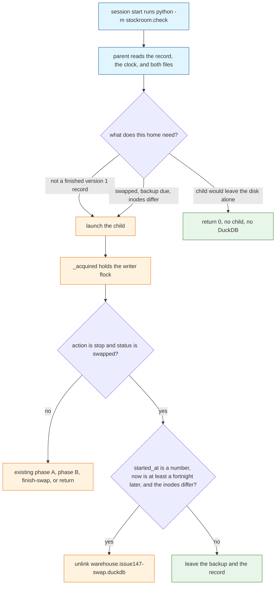

# Task: Fortnight backup reclaim and finished-home short-circuit

* Task ID: fortnight-backup-and-quiet-check
* Complexity: Level 3
* Type: feature

Unlink `warehouse.issue147-swap.duckdb` on the `swapped` stop path a fortnight after `started_at`. The session-start hook text stays. `python -m stockroom.check` calls `launch()` in two cases: the home is not a finished version-1 record, or the unlink predicate is already true. It returns before `launch()` when the child would leave the disk alone. The parent must not import DuckDB, and it must not unlink. Item 2 of issue 155 stays out: `check.json` stays, and there is no `check-2.json`.

Operator revision, 2026-10-27: a present backup is not by itself a reason to start the child.

## Pinned Info

### Parent gate and child reclaim

The hook starts one process. That process can see the record, the clock, and the two files without DuckDB. It starts a child only when that child might change the disk. The child is the only place that unlinks, and it does so under the writer flock the pass already holds.

"Child would leave the disk alone" means all of the following returns:

- Version 1 and `swapped`, `already-new`, or `mismatch`, and the backup is not a file.
- Version 1 and `swapped`, the backup is a file, and the fortnight is still ahead, or `started_at` is not a number, or the live warehouse is not a file, or the inodes match.
- Version 1 and `already-new` or `mismatch`, even when the backup name is a file.

## Component Analysis

### Affected Components

- `stockroom.check` (`skills/sr-search/src/stockroom/check.py`): owns the record, `next_action`, the flocked pass, and `main` / `launch`. Today the module imports DuckDB, `storage`, `migrate`, and `warehouse` at import time, and `main` always calls `launch` unless `--foreground` is set. The `stop` path removes `warehouse.copy.duckdb` and returns. It does not name the swap backup.
- `stockroom.home` (`skills/sr-search/src/stockroom/home.py`): stdlib `resolve_home`. The parent already imports it. The plain filenames the parent must `stat` live here, so the parent does not import `warehouse` or `doctor`.
- `stockroom.doctor` (`skills/sr-search/src/stockroom/doctor.py`): defines `SWAP_BACKUP_FILENAME` today and reports whether that name is a file. It imports DuckDB at import time. The parent gate cannot import this module. It re-exports the backup name after the move.
- `stockroom.warehouse` (`skills/sr-search/src/stockroom/warehouse.py`): defines `WAREHOUSE_FILENAME` today and imports DuckDB. It re-exports that name from `home` so existing callers stay valid. `LOCK_FILENAME` and `_flock` stay here. The parent does not take the flock. The due child still may import DuckDB once, because the flock lives here. Do not extract the flock.
- Session-start hooks (`hooks/cursor-hooks.json`, `hooks/claude-hooks.json`): already run `python -m stockroom.check`. They stay byte for byte. Home resolution stays out of the shell.
- User guide (`docs/user-guide/troubleshooting/index.md`): the Warehouse section says Stockroom never deletes `warehouse.issue147-swap.duckdb`, and that a `swapped` check does not touch that file again.

### Cross-Module Dependencies

- Hook shell → `python -m stockroom.check` → `main`. No new command, and no hook edit.
- `main` (no `--foreground`) → `resolve_home`, `load_record`, and `stat` of the two filenames from `home` → either return or `launch`.
- `launch` → child `python -m stockroom.check --foreground <home>` → `entry` → `run_check` → writer flock → `_acquired`.
- `_acquired` on `stop` + `swapped` → unlink that one backup name when the predicate holds. `check.json` is not written. The parent does not unlink.
- The child still imports `doctor.live_bytes` inside `run_check` for the readiness ladder. That import is after the gate and stays on the child path. A `stop` that only unlinks still reaches `run_check`, so the due child may load DuckDB. That is one session, the session where the file is removed.
- Doctor keeps reporting `backup: absent` when the name is gone. It does not delete the file.

### Boundary Changes

- `python -m stockroom.check` with no `--foreground` calls `launch()` in two cases: the record is not a finished version-1 home, or the unlink predicate is already true. Every other finished home returns without a child.
- Importing `stockroom.check` does not import DuckDB. The return paths do not import it either. `--foreground` still imports DuckDB when the pass runs.
- `WAREHOUSE_FILENAME` and `SWAP_BACKUP_FILENAME` are defined on `stockroom.home`. `warehouse` and `doctor` re-export them, so `warehouse.WAREHOUSE_FILENAME` and `doctor.SWAP_BACKUP_FILENAME` stay the names existing callers use.
- No schema change, no hook-text change, no new record file, no `check.json` rewrite on the reclaim path.

### Invariants & Constraints

- The live `warehouse.duckdb` bytes stay. The backup is unlinked only when both paths are files and `stat().st_ino` differs. `stat` follows links. Same inode keeps the backup name.
- `started_at` is the phase B clock on the swapped record. The retention constant is `14 * 86400`, compared like the rehearsal wait: unlink when `now >= started_at + SWAP_BACKUP_RETENTION_SECONDS`. A bool is not a timestamp.
- The unlink runs only inside `_acquired`, after `_remove_sibling`, when `next_action` returned `stop` and the record status is `swapped`. `mismatch`, `already-new`, and an expired `started` are also `stop`; they do not unlink.
- A missing backup on that path is a no-op. The raw `check.json` bytes are unchanged.
- The parent returns when the child would leave the disk alone. It launches when the unlink predicate is already true, so a due backup is still removed. Returning for every `swapped` record would skip that removal.
- `--foreground` is not gated. The child is the process that unlinks.
- The hook files are not edited. An unfinished home still gets a child, so a migration that has not finished still runs.
- Item 2 of issue 155 is out of scope. Do not delete the hook line, the module, or the restore procedure. Do not add `check-2.json`.
- Backup mtime, access time, row counts, and ingest are not inputs.
- Do not move `_flock` out of `warehouse` to spare the due child its DuckDB import.

## Open Questions

- [x] When does a present backup still start the child? → Operator, 2026-10-27: only when the unlink predicate is already true. A young swapped backup, a missing `started_at`, matching inodes, a missing live warehouse, and an `already-new` or `mismatch` record return without a child. Unfinished homes still launch. See `memory-bank/active/creative/creative-check-machinery-lifetime.md`.
- [x] Check-pass retention, 14 days from `started_at` (`memory-bank/active/creative/creative-swap-backup-cleanup.md`)
- [x] The hook text stays. Removal of the machinery waits for a later major (`memory-bank/active/creative/creative-check-machinery-lifetime.md`)

## Test Plan (TDD)

### Behaviors to Verify

- Young swap: `run_check` on version 1 `swapped`, numeric `started_at`, `now` one second under a fortnight, two distinct files → backup remains, warehouse bytes unchanged, raw `check.json` unchanged.
- Deadline: same setup at exactly `started_at + 14 * 86400` → backup name is gone, warehouse bytes unchanged, raw `check.json` unchanged.
- Same inode: backup name is a hard link of `warehouse.duckdb`, deadline passed → backup name remains, warehouse bytes unchanged, raw `check.json` unchanged.
- Missing `started_at`: deadline would otherwise have passed → backup remains, raw `check.json` unchanged.
- `linked`, with `started_at` a fortnight old and a distinct backup file: backup path remains. Do not require the record to stay `linked`; finish-swap may write `swapped`.
- `mismatch` and `already-new`, fortnight old, distinct backup: backup remains, raw `check.json` unchanged.
- Expired `started` (the other `stop` status), fortnight-old `started_at`, distinct backup: backup remains.
- Second pass: after the deadline pass has unlinked the backup, `run_check` again → no error, raw `check.json` unchanged, backup still absent.
- Quiet parent, backup absent: `main` with no flags, version 1 `swapped` / `already-new` / `mismatch`, backup name absent → returns 0 and does not call `launch`.
- Young parent: version 1 `swapped`, backup present, distinct inodes, clock one second under the fortnight → `main` does not call `launch` or `entry`.
- Due parent: same files, clock exactly at `started_at + SWAP_BACKUP_RETENTION_SECONDS` → `main` calls `launch` and does not call `entry`.
- Same-inode parent: backup name is a hard link of the live warehouse, fortnight elapsed → `main` does not call `launch`.
- Missing `started_at` parent: version 1 `swapped`, backup present → `main` does not call `launch`.
- Missing live warehouse: version 1 `swapped`, backup present, fortnight elapsed, no `warehouse.duckdb` → `main` does not call `launch`.
- Other terminal parent: version 1 `already-new` or `mismatch`, backup present → `main` does not call `launch`.
- Unfinished: `rehearsed`, `linked`, `started`, `skip`, or no record → `main` calls `launch`.
- Unreadable record, and a `swapped` record whose `check_version` is not 1 → `main` calls `launch`.
- Import boundary: a fresh interpreter imports `stockroom.check` and `duckdb` is not in `sys.modules`. Calling `main` on a young swapped home whose backup file is present still leaves `duckdb` out of that process.

### Test Infrastructure

- Framework: pytest, as configured in `skills/sr-search/pyproject.toml`
- Test location: `skills/sr-search/tests/test_check.py`
- Conventions: one behavior per test, docstring is the behavior, `now` is injected, homes are `tmp_path`, never the live warehouse. Launch tests that need a child put the engine `src` on `PYTHONPATH` the way `_set_child_pythonpath` does.
- New test files: none

The reclaim cases call `run_check` with `now=` and do not need a real DuckDB file. Two small files with different inodes are enough, because the `swapped` stop path returns before `_readiness`. Compare warehouse bytes and the raw `check.json` bytes.

The spawn cases follow `test_main_without_flags_launches_and_does_not_enter`: monkeypatch `check.launch`, and monkeypatch `check.entry` so a wrong branch fails the test. Set `STOCKROOM_HOME`. Control the parent clock by monkeypatching `check.time.time`. Parametrize the status lists.

The import case is a subprocess of `sys.executable`, with `PYTHONPATH` set to the engine `src`, and `STOCKROOM_HOME` set to a young swapped home that has the backup file. An in-process assertion is not this test: `test_check.py` imports DuckDB itself.

### Integration Tests

- None beyond the subprocess import. `main` is asserted by monkeypatching `launch`. `run_check` is asserted by the file outcomes. Those are the two sides of the pinned diagram.

## Implementation Plan

### 1. Fortnight unlink on the swapped stop path — executable

- Files: `skills/sr-search/src/stockroom/check.py`, `skills/sr-search/tests/test_check.py`
- Creative ref: `memory-bank/active/creative/creative-swap-backup-cleanup.md`

1. [x] Stub tests: add empty tests in `test_check.py` for the young swap, the exact fortnight, the same inode, missing `started_at`, `linked`, `mismatch`, `already-new`, expired `started`, and the second pass.
2. [x] Stub interface: add `SWAP_BACKUP_RETENTION_SECONDS = 14 * 86400` and `_reclaim_swap_backup(home, record, *, now, backup_name) -> None` with a docstring that states the predicate. Body returns without unlinking. Do not call it yet.
3. [x] Write tests and run red: fill the tests. Each builds a home with `warehouse.duckdb`, `warehouse.issue147-swap.duckdb`, and a record written through `write_record`. Deadline tests use `now=lambda: started_at + check.SWAP_BACKUP_RETENTION_SECONDS`. The young test subtracts one second. The same-inode test uses `os.link`. Assert raw `check.json` bytes, warehouse bytes, and whether the backup path exists. Run those tests and confirm they fail.
4. [x] Write code and run green: from `_acquired`, after `_remove_sibling`, when `action == "stop"` and `record is not None`, call `_reclaim_swap_backup` with `now()` and `backup_name`. The function unlinks only when `check_version` is `CHECK_VERSION`, status is `swapped`, `started_at` is an `int` or `float` and not a `bool`, `now >= started_at + SWAP_BACKUP_RETENTION_SECONDS`, both paths `is_file()`, and `stat().st_ino` differs. `unlink` that backup path only. Run the new tests.

Build note: the predicate lives in `_swap_backup_due`. `_reclaim_swap_backup` unlinks only when it is true, and an `OSError` from the check leaves the backup. A bool `started_at` is covered by `test_reclaim_bool_started_at_keeps_the_backup`. The expired-start case is the existing `test_expired_start_deletes_a_leftover_and_keeps_the_backup`, with `now` at the fortnight. `tests/test_check.py`: 54 passed.

### 2. Quiet parent, DuckDB not imported — executable

- Files: `skills/sr-search/src/stockroom/check.py`, `skills/sr-search/src/stockroom/home.py`, `skills/sr-search/src/stockroom/doctor.py`, `skills/sr-search/src/stockroom/warehouse.py`, `skills/sr-search/tests/test_check.py`
- Creative ref: `memory-bank/active/creative/creative-check-machinery-lifetime.md`

1. [x] Stub tests: empty tests for backup-absent quiet, the young parent, the due parent, the same-inode parent, missing `started_at`, the missing live warehouse, `already-new` and `mismatch` with a backup file, the unfinished statuses, the unreadable record, the other `check_version`, and the fresh-interpreter import on a young swapped home.
2. [x] Stub interface: `_needs_child(home, *, now: float) -> bool` with a docstring that states the two launch cases and the returns. Body returns `True`. `main` does not call it yet. Move `WAREHOUSE_FILENAME = "warehouse.duckdb"` and `SWAP_BACKUP_FILENAME = "warehouse.issue147-swap.duckdb"` onto `stockroom.home`. Re-export `WAREHOUSE_FILENAME` from `warehouse` and `SWAP_BACKUP_FILENAME` from `doctor`. `home` stays stdlib-only. `run_check` passes `SWAP_BACKUP_FILENAME` into `_acquired`.
3. [x] Write tests and run red: parent tests monkeypatch `launch` and `entry` as `test_main_without_flags_launches_and_does_not_enter` does, and monkeypatch `check.time.time` for the clock. The import test runs a fresh interpreter against a young swapped home that still has the backup file. Run them and confirm the spawn and import tests fail.
4. [x] Write code and run green:
    - Add `from __future__ import annotations` so the `duckdb` and `storage` annotations are not evaluated at import.
    - Import DuckDB, `storage`, and `warehouse` only for type checkers (`TYPE_CHECKING`). Remove those module-level runtime imports, and the `migrate` import. Add `_import_engine()` that binds `duckdb`, `storage`, `current_version`, `LOCK_FILENAME`, and `_flock` on the module. Call it at the start of `run_check`, before `_flock`. Do not call it from `main`'s parent branch. Do not rebind `WAREHOUSE_FILENAME`; the parent and the child both use the name from `home`.
    - `check` must not import `doctor` or `warehouse` at module level. `run_check` may still import `live_bytes` from `doctor` inside the function. That keeps the child behavior and avoids an import cycle with doctor's re-export.
    - `_needs_child` returns `True` on `OSError` or `ValueError` from `load_record` (a non-object and `JSONDecodeError`), on `None`, on a `check_version` other than `CHECK_VERSION`, and on any status other than `swapped`, `already-new`, or `mismatch`. It returns `True` for version 1 `swapped` only when the backup and the live warehouse are both files, `started_at` is an `int` or `float` and not a `bool`, `now >= started_at + SWAP_BACKUP_RETENTION_SECONDS`, and `stat().st_ino` differs. Every other input returns `False`. It does not unlink and it does not write.
    - In `main`, keep the `--foreground` branch first (`entry`, return). Otherwise, if `_needs_child(home, now=time.time())`, call `launch`. Otherwise return 0.
    - Update the module docstring: importing the module does not start a pass and does not import DuckDB; `main` launches a child only for an unfinished home or a backup that is due, and returns without a child when the child would leave the disk alone.
    - Run the new parent tests, then the whole engine suite (`make test` from the repo root).

Build note: `_needs_child` calls `_swap_backup_due`. `OSError` from that call starts the child. The unlink path treats the same error as not due. `tests/test_check.py`: 75 passed. `tests/test_doctor.py`: 46 passed, 1 skipped. `tests/test_warehouse_home_xdg.py`: 6 passed. The engine suite runs after the prose step.

### 3. Restore section — prose/policy

- Files: `docs/user-guide/troubleshooting/index.md`
- No tests: prose/policy artifact
- Creative ref: `memory-bank/active/creative/creative-swap-backup-cleanup.md`

1. [x] In the Warehouse overview, replace the claim that Stockroom never deletes `warehouse.issue147-swap.duckdb`. State that the file stays for a fortnight after the swap, and that a later session start can remove it after that.
2. [x] In "Put the original warehouse back", replace the claim that a `swapped` check does not touch the backup again. State that the check leaves `warehouse.duckdb` in place, and that it removes the backup after the fortnight. Putting the original back has to happen before then. A session started after the deadline can remove the backup in the background. A session during the fortnight does not.
3. [x] Leave the rest of the procedure: probe first, stop when `backup` is `absent`, wait on `busy` / `running`, one session on `linked`, rename only when the word is `swapped`, do not use `warehouse.copy.duckdb`, keep `check.json`.

Build note: the user guide says 14 days. `docs/architecture/lifecycle.md` adds one sentence: a finished home whose backup is not due starts no child.

## Technology Validation

No new technology - validation not required.

## Challenges & Mitigations

- Moving only `import duckdb` still imports DuckDB, because `storage`, `migrate`, and `warehouse` import it. `_import_engine()` is the one child-side import, called from `run_check`. `TYPE_CHECKING` imports keep the names visible to Ruff without a runtime import. The first preflight's F821 advisory is this step.
- The backup name lives on `doctor` today, and the live warehouse name lives on `warehouse`. Both modules import DuckDB. Define the two strings on `home` and re-export them, so the parent can `stat` without those imports and existing callers keep their names.
- A gate that runs before `--foreground` skips the unlink in the child. The foreground branch stays first.
- A gate that returns for every `swapped` record skips the unlink. `_needs_child` returns true when the unlink predicate is already true. The due-parent test asserts `launch` is called.
- Checking the clock and not the inodes would launch forever when the inodes match, because the child would keep the file. The parent uses `Path.stat()`, which follows links.
- A crash in `main` on a bad `check.json` would fail the hook's check even though the shell swallows the status. `_needs_child` treats `OSError` and `ValueError` as "start the child".
- `bool` is an `int`. Reject it so `true` in JSON is not a clock.
- `test_main_without_flags_launches_and_does_not_enter` has no record. `_needs_child` returns true for `None`, or that test changes meaning.
- `already-new` or `mismatch` with a stray backup file is not unlinked. Launching those forever takes the lock and exits. The parent returns.

## Pre-Mortem

- The guide changes the "never deletes" sentence and leaves "does not touch the backup again" in the restore steps. A reader follows the steps after the fortnight and the file is already gone. The prose step names both sentences, and it says a session during the fortnight does not remove the file.
- The parent returns for a due backup, or the parent unlinks the file itself. The due-parent test asserts `launch` and not `entry`. The unlink tests call `run_check`. The gate function does not unlink.
- An in-process "DuckDB was not imported" assertion passes because `test_check.py` imported DuckDB first. The import behavior is a fresh interpreter on the young-backup return, which is the path most likely to import DuckDB while it stats the file.
- The previous preflight passed the coarser rule. That status file is deleted. This plan is not cleared for build until a new preflight runs.

## Status

- [x] Component analysis complete
- [x] Open questions resolved
- [x] Test planning complete (TDD)
- [x] Implementation plan complete
- [x] Technology validation complete
- [x] Pre-Mortem complete
- [x] Preflight
- [x] Build
- [ ] QA
