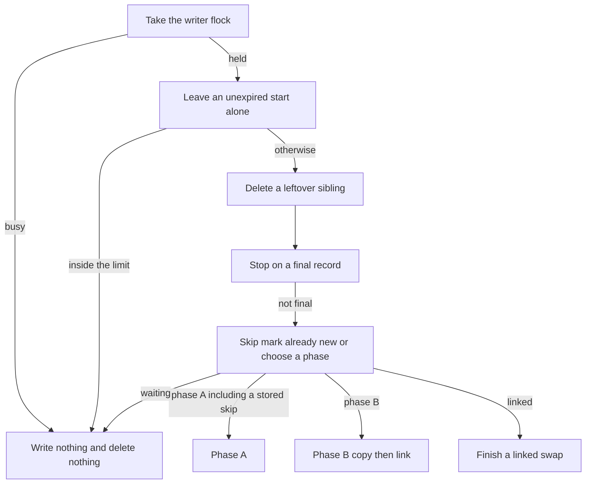

# Task: warehouse-file-growth, milestone 6 (check pass)

* Task ID: warehouse-file-growth-m6
* Complexity: Level 3
* Type: feature

`run_check` takes the writer flock and either records a rehearsal or, at least one day after that rehearsal, swaps a new verified copy into place. The original is hard-linked to `warehouse.issue147-swap.duckdb` and is never deleted. Skips retry. A final record does not build again. Nothing in this milestone starts the pass except tests. Doctor prints one read-only line for the record.

## Pinned Info

### Check pass

The pass takes the writer flock before it reads the record. A busy flock writes nothing and deletes nothing. An unexpired start is left alone so the pass that holds the flock can finish. Every other acquired pass deletes a leftover sibling first. Final records then stop. A stored skip is phase A, and the readiness ladder still runs before any build. Status `linked` finishes a swap that already hard-linked the original. It does not copy again.

## Component Analysis

### Affected Components

- `stockroom.check` (new): the record, the phase choice, `run_check`, and the process entry point that sets the alarm
- `stockroom.storage`: `copy_warehouse` stays the builder. Add `large_column_zstd_problem` so the already-new check and `_require_zstd` share one walk of `pragma_storage_info`
- `stockroom.doctor`: one `check` fact on every `storage_facts` return, including absent and busy. Help text names that fact
- `stockroom.warehouse`: `run_check` uses `LOCK_FILENAME` and `_flock`. No change to `open` or `open_current`
- `docs/user-guide/troubleshooting/index.md`: how to rename the swap backup back, and that stockroom does not delete it
- `docs/contributing/preparation.md`: the probe index gains the check line

### Cross-Module Dependencies

- `check.run_check` calls `storage.copy_warehouse` and `warehouse._flock`. It imports `doctor.live_bytes` and `doctor.SWAP_BACKUP_FILENAME` inside the function, not at module import
- `doctor.storage_facts` imports `check.check_line` inside the function, on every return including `warehouse: unavailable`, and does not call `run_check`
- `storage._require_zstd` calls `storage.large_column_zstd_problem` and raises `CopyMismatch` with that message
- `__main__.py` `SUBCOMMANDS` does not gain an entry. Hooks do not change

### Boundary Changes

- New module `stockroom.check`. Not a user-facing subcommand
- `storage.large_column_zstd_problem(con) -> str | None`. `None` means both large columns pass. A populated column with no persistent data segment returns `"{table}.{column} has rows and no zstd data segment"`. Any other persistent non-validity segment that is not zstd returns `"{table}.{column} stored as ({segment_type}, {compression})"`. Empty columns return `None`
- `doctor.storage_facts` gains a `check` pair. Existing keys stay
- `run_check(home, *, now, disk_free)` and `entry(home, *, limit_seconds)` are the seams tests use. Defaults are `time.time`, `shutil.disk_usage`, and `TIME_LIMIT_SECONDS`

### Invariants

- The original is read only through `copy_warehouse`. This milestone never opens it for writing
- `warehouse.duckdb` and `warehouse.issue147-swap.duckdb` are never deleted
- A pass that cannot take the flock reads nothing, deletes nothing, and writes nothing
- Phase B calls `copy_warehouse` again. It does not rename the rehearsal's sibling into place
- `os.link` of the original onto the backup name happens before `os.replace`. A failed link does not replace
- The sibling is `warehouse.copy.duckdb` beside the warehouse. Phase A deletes it only after the rehearsed record is in place
- Busy, low disk, a wal, a read-only filesystem, no warehouse, and a schema below `FORMAT_BOUNDARY` are skips. Skips are not final. `next_action` on `skip` returns `phase-a`. The readiness ladder runs before the build, so a skip whose cause is still true is written again and does not build
- `swapped`, `mismatch`, `already-new`, and an expired `started` entry are final for `CHECK_VERSION`. `linked` is not final. An expired `started` entry does not replace the warehouse, even if a sibling and a backup are both present
- After `os.link` succeeds, the pass writes `linked` before `os.replace`. `swapped` carries the same measurement fields as `rehearsed`
- `rehearsed` waits `86400` seconds, then phase B runs
- The alarm ceiling is `14400` seconds. Only `entry` calls `signal.alarm`. It installs no handler
- Free disk must be at least `2 * live_bytes + 64 MiB` or the pass skips
- Doctor does not create the home, the warehouse, the lock, or the record
- A skip does not change schema version. `open_current` is untouched
- No hook, ingest, embed, nightly job, dashboard, or doctor action starts the pass

## Open Questions

- [x] Time limit → Resolved: `14400` seconds (see `memory-bank/active/creative/creative-check-time-limit.md`)
- [x] Free-disk margin → Resolved: skip when free disk is below `2 * live_bytes + 64 MiB` (see `memory-bank/active/creative/creative-free-disk-margin.md`)
- [x] Expired started entry → Resolved: doctor prints `overrun` and the entry is final. Inside the limit it prints `running` (see `memory-bank/active/creative/creative-expired-check-label.md`)

## Test Plan (TDD)

### Behaviors to Verify

Record and phase choice, with `now` supplied by the test:

- No record → phase A
- `rehearsed` of this check version younger than `86400` seconds → wait
- `rehearsed` at least `86400` seconds old → phase B
- A record whose `check_version` is not `1` → phase A
- `swapped`, `mismatch`, or `already-new` → stop
- `started` and `now < started_at + limit_seconds` → running, do not build
- `started` and `now >= started_at + limit_seconds` → stop
- `skip` → phase A
- `linked` → finish the swap, do not copy again

`run_check` on a home directory:

- Home missing, or home with no `warehouse.duckdb` → no directory created when it was missing; when the home exists, record `skip` / `no-warehouse`, no sibling
- `warehouse.duckdb.wal` present → `skip` / `wal`, original bytes unchanged, no sibling
- `os.statvfs` reports `ST_RDONLY` → `skip` / `read-only`, original bytes unchanged, no sibling
- `released_chain_file(8)` placed at `warehouse.duckdb` → `skip` / `below-boundary`, original bytes unchanged, no sibling
- Schema-file warehouse with a zstd `messages.text` row, and one with no rows → `already-new`, no sibling
- A schema-9 `v2.0.0+` file whose `messages.text` has a persistent non-zstd segment, and one whose `tool_calls.tool_input` does → `copy_warehouse` is called and the record is not `already-new`. Each file is built by connecting with `storage_compatibility_version` `v2.0.0`, running the schema-file SQL with the zstd clause removed from only that column, inserting `(9, 'schema_0009.sql')`, inserting one non-null value, checkpointing, and closing that connection before `run_check`
- `warehouse.duckdb.wal` records `skip` / `wal`; after that wal is removed, the next `run_check` on `generations_file` calls `copy_warehouse`
- `disk_free` below `2 * live_bytes + 64 MiB` → `skip` / `low-disk`, no sibling
- `disk_free` equal to that threshold → not a low-disk skip
- Writer flock already held → the record file is unchanged, the sibling is unchanged, and nothing is deleted
- Phase A on `generations_file` → record `rehearsed` with original size, copy size, free disk, build seconds, verify seconds, and lock seconds; sibling absent; original SHA-256 unchanged
- A second `run_check` one second after that rehearsal does not call `copy_warehouse`
- Phase B when `now` is `86400` seconds after `rehearsed_at` → `copy_warehouse` runs again; backup SHA-256 equals the original's SHA-256 from before the link; backup inode matched the original before the replace; `warehouse.duckdb` is the new file; sibling absent; record `swapped` and still carries `original_bytes`
- A marker left at `warehouse.copy.duckdb` before phase B is not the file that ends up at `warehouse.duckdb`
- `verify_copy` raises `CopyMismatch` → record `mismatch`, sibling absent, original unchanged, and a later `run_check` does not call `copy_warehouse`
- `os.link` raises → no replace, original bytes unchanged, backup absent
- `os.link` links and then raises, before `linked` is written → backup SHA-256 equals the original, `warehouse.duckdb` still the original bytes, record still `started`
- `os.replace` raises after `linked` is on disk → warehouse bytes unchanged, backup inode matches the warehouse, record is `linked`. The next `run_check` replaces the sibling onto `warehouse.duckdb`, writes `swapped` with `original_bytes`, and does not call `copy_warehouse`
- `os.replace` replaces and the process stops before `swapped` → inodes differ and the record is still `linked`. The next `run_check` writes `swapped` and does not call `copy_warehouse` or `os.link`
- Final `swapped` record plus a leftover sibling → sibling deleted, record still `swapped`, `copy_warehouse` not called
- Expired `started` plus a leftover sibling and a backup whose inode differs → sibling deleted, warehouse bytes unchanged, backup left in place, record still `started`, `copy_warehouse` not called
- Unexpired `started` plus a sibling → sibling kept, `copy_warehouse` not called
- `entry` in a child with `limit_seconds=1` → the child uses `generations_file` (`v1.0.0` at the schema head, parent directory is the home). It patches the `storage.copy_warehouse` that `run_check` calls so that stand-in sleeps. The child dies by a signal, the parent takes the flock, the record is `started`, and the original bytes are unchanged
- An in-process `run_check` that returns does not leave an alarm that kills the worker

Doctor, read-only:

- No record → `check` value `absent`
- `rehearsed` record → one `check` value containing `rehearsed`, `original_bytes`, and the record path, and no newline
- `started` with `started_at` now and limit `14400` → value starts with `running` and does not contain `crash`
- `started` with `started_at` `0` and limit `1` → value starts with `overrun`
- `skip` / `low-disk` → value contains `low-disk`
- Unreadable record file → value `unreadable`
- `storage_facts` does not change the warehouse mtime or the record mtime
- `stockroom doctor probe --help` text contains the check fact
- Absent, busy, unavailable, and present warehouse returns all include `check`

### Test Infrastructure

- Framework: pytest, `pytest-xdist` via the engine `addopts`
- Test location: `skills/sr-search/tests/`
- Conventions: one behavior per test, docstring says what happens, fixtures from `conftest.py` (`generations_file`, `released_chain_file`)
- New test files: `skills/sr-search/tests/test_check.py`
- Extended files: `skills/sr-search/tests/test_doctor.py`, `skills/sr-search/tests/test_doctor_cli.py`

### Integration Tests

- Phase A and phase B in `test_check.py` call the real `copy_warehouse` on `generations_file`
- The alarm test is a subprocess so the default `SIGALRM` action cannot kill the xdist worker
- Doctor tests read a record `run_check` would have written and assert the one `check` line through `storage_facts`

## Implementation Plan

### 1. Record and phase choice — executable

- Files: `skills/sr-search/src/stockroom/check.py`, `skills/sr-search/tests/test_check.py`
- Creative ref: `memory-bank/active/creative/creative-check-time-limit.md`, `memory-bank/active/creative/creative-expired-check-label.md`

1. Stub tests: empty tests for the record behaviors above, plus a round trip that writes a record and reads it back.
2. Stub interface: `CHECK_VERSION = 1`, `TIME_LIMIT_SECONDS = 14400`, `PHASE_B_WAIT_SECONDS = 86400`, `CHECK_RECORD_FILENAME = "check.json"`, `load_record`, `write_record`, and `next_action`.
3. Write tests and run red: `next_action` returns `phase-a`, `phase-b`, `wait`, `running`, `stop`, or `finish-swap` for the cases above. `skip` returns `phase-a`. `linked` returns `finish-swap`. `write_record` writes `home/check.json` by renaming a temp file in that home. A missing file loads as no record.
4. Write code and run green: JSON object with `check_version`, `status`, `phase`, `started_at`, `limit_seconds`, `rehearsed_at`, the measurement fields, and `skip_reason`. `write_record` fsyncs the temp file, `os.replace`s it onto `check.json`, and fsyncs the directory. `next_action` implements those cases and nothing else.

### 2. Skip ladder and already new — executable

- Files: `check.py`, `skills/sr-search/src/stockroom/storage.py`, `test_check.py`
- Creative ref: `memory-bank/active/creative/creative-free-disk-margin.md`

1. Stub tests: empty tests for missing home, missing warehouse, wal, wal removed then a build, read-only, schema 8, zstd row, empty warehouse, non-zstd `messages.text`, non-zstd `tool_calls.tool_input`, low disk, disk equal to the threshold, and busy flock.
2. Stub interface: `run_check(home, *, now=time.time, disk_free=None)` and `storage.large_column_zstd_problem(con) -> str | None`. `_require_zstd` raises `CopyMismatch` with the returned message and raises nothing when the helper returns `None`.
3. Write tests and run red: each skip asserts the record status and reason, an unchanged original SHA-256 when a file existed, and no `warehouse.copy.duckdb`. The wal-retry test uses `generations_file`, deletes the wal after the skip, and asserts the next `run_check` calls `copy_warehouse`. Already-new asserts status `already-new` and no sibling. Each non-zstd file asserts the spy was called and the status is not `already-new`. The threshold case uses a `disk_free` that returns exactly `2 * live_bytes + 64 * 1024 * 1024` and must not record `low-disk`. The busy test holds `warehouse._flock` on `home / LOCK_FILENAME` and asserts the record bytes and a pre-created sibling are unchanged.
4. Write code and run green: import `live_bytes` inside `run_check`, not at module import. If `home` is not a directory, return without creating it. Otherwise take `warehouse._flock` with `blocking=False` and return on `BlockingIOError` before any read or delete. Then the order in the pinned diagram. Read-only means `os.statvfs(home).f_flag & os.ST_RDONLY`. Schema comes from a read-only connect and `current_version`, with no migrate. Already-new means storage tag `v2.0.0+` and `large_column_zstd_problem` returns `None`. Low disk uses `live_bytes` on that same read-only connection. A stored `skip` still walks this ladder before phase A. Skips and `already-new` are written with `write_record`. A record write that raises `OSError` returns without replacing the warehouse.

### 3. Phase A — executable

- Files: `check.py`, `test_check.py`

1. Stub tests: empty tests for the rehearsal record, the unchanged original, and the second call inside one day.
2. Stub interface: no new signature. `run_check` grows a phase A body.
3. Write tests and run red: `generations_file`'s parent is the home. After `run_check`, the record is `rehearsed` and carries the measurement names, the sibling is gone, and the original SHA-256 matches the hash taken before the call. A spy replaces `storage.copy_warehouse` only in the second test, after a real first call has written `rehearsed`, and `now` is one second later. The spy must not be called.
4. Write code and run green: on `phase-a`, write `started` with phase `A`, `started_at`, and `limit_seconds` before `copy_warehouse`. On `CopyMismatch`, write `mismatch` and return. On success, write `rehearsed` with the `CopyResult` fields, the free-disk sample from before the build, and `lock_seconds` from flock acquire until just before that write. Then delete `warehouse.copy.duckdb` and its `.wal`. `rehearsed_at` is `now()`.

### 4. Phase B — executable

- Files: `check.py`, `test_check.py`

1. Stub tests: empty tests for the swap proof, the marker sibling, replace-after-`linked`, and a `linked` record whose inodes already differ.
2. Stub interface: no new signature.
3. Write tests and run red: run a real phase A, then `run_check` with `now` at `rehearsed_at + 86400`. Backup path is `home / doctor.SWAP_BACKUP_FILENAME`. Its SHA-256 equals the original hash from before this second call. `warehouse.duckdb` opens read-only at storage tag `v2.0.0+` and contains the generation rows. The sibling is gone. The record is `swapped` and its `original_bytes` equals the rehearsed record's `original_bytes`. The marker test plants `b"not a database"` at the sibling after phase A and asserts `warehouse.duckdb` is not those bytes. The replace-after-`linked` test makes `os.replace` raise and asserts the record is `linked`, the warehouse bytes are unchanged, and the backup inode matches. A following `run_check` writes `swapped` with `original_bytes` and does not call `copy_warehouse`. The inode-differ test stops after `os.replace` and before `swapped`. A following `run_check` writes `swapped` and does not call `copy_warehouse` or `os.link`.
4. Write code and run green: on `phase-b`, delete a leftover sibling, write `started` with phase `B`, call `copy_warehouse`, hash the original, `os.link` it to the backup name, and write `linked` with the `CopyResult` fields before `os.replace`. Fsync the sibling and the directory, `os.replace` the sibling onto `warehouse.duckdb`, hash the backup, and write `swapped` with those same fields. On `finish-swap`, if the backup inode equals the warehouse inode and the sibling exists, replace and write `swapped`. If the inodes differ, write `swapped` and do not copy or link. Do not remove an existing backup. If `os.link` raises before `linked` is written, do not replace. A bare `started` record never takes the finish-swap path.

### 5. Failures, finality, and leftover cleanup — executable

- Files: `check.py`, `test_check.py`
- Creative ref: `memory-bank/active/creative/creative-expired-check-label.md`

1. Stub tests: empty tests for `CopyMismatch`, link failure, link-then-raise before `linked`, leftover cleanup on `swapped`, leftover cleanup on an expired start that also has a foreign backup, and keeping the sibling on an unexpired start.
2. Stub interface: no new signature. The cleanup order from the diagram is part of `run_check`.
3. Write tests and run red: monkeypatch `storage.verify_copy`, `os.link`, and `os.replace` at the points above. Finality tests write the record with `write_record`, plant a sibling, call `run_check`, and assert `copy_warehouse` was not used. The expired-start test also plants a backup whose inode differs and asserts the warehouse bytes are unchanged.
4. Write code and run green: cleanup runs only after the unexpired-start return, and it unlinks the sibling and its `.wal` only. It does not unlink `warehouse.duckdb` or the backup name. Expired `started` returns after cleanup without rewriting the record and without `os.replace`. `CopyMismatch` writes `mismatch`. Other exceptions from the build propagate with the `started` record left as written. `linked` is only written after `os.link` returns.

### 6. Alarm entry point — executable

- Files: `check.py`, `test_check.py`
- Creative ref: `memory-bank/active/creative/creative-check-time-limit.md`

1. Stub tests: one empty subprocess test, and one empty test that an in-process `run_check` returns while the worker stays alive.
2. Stub interface: `entry(home, *, limit_seconds=TIME_LIMIT_SECONDS)`.
3. Write tests and run red: the subprocess runs a fresh interpreter, not under pytest, with `PYTHONPATH` pointing at `src`. The parent passes the `generations_file` home. The child patches `stockroom.storage.copy_warehouse` to a function that sleeps, then calls `entry(home, limit_seconds=1)`. The parent asserts the child exit is from a signal, then acquires the flock, reads `started`, and matches the original SHA-256. The in-process test calls `run_check` on a warehouse that skips and then sleeps past one second in the test process.
4. Write code and run green: `entry` calls `signal.alarm(limit_seconds)`, then `run_check`, then `signal.alarm(0)` in a `finally`. It does not call `signal.signal`. `run_check` does not call `signal.alarm`. The module is not added to `SUBCOMMANDS`. The subprocess invokes `entry` by import, not `stockroom check`.

### 7. Doctor line and help — executable

- Files: `skills/sr-search/src/stockroom/doctor.py`, `skills/sr-search/src/stockroom/check.py`, `tests/test_doctor.py`, `tests/test_doctor_cli.py`
- Creative ref: `memory-bank/active/creative/creative-expired-check-label.md`

1. Stub tests: empty tests for the doctor behaviors listed above, in `test_doctor.py` except the help assertion, which extends the existing probe help test in `test_doctor_cli.py`.
2. Stub interface: `check.check_line(home, *, now=time.time) -> str`. `storage_facts` calls it from inside the function on every return path, including the `warehouse: unavailable` handler.
3. Write tests and run red: assert the `check` values above, that the value has no newline, and that warehouse and record mtimes are unchanged across `storage_facts`. The help test asserts the description contains `check`.
4. Write code and run green: import `check_line` inside `storage_facts`, not at module import. `check_line` returns `absent` when the file is missing, `unreadable` when it is not the JSON object `load_record` expects, `running` or `overrun` for a started entry, `skip` plus `reason=<skip_reason>` for a skip, and the status word otherwise. It appends each present measurement as `key=value` and always appends `path=<record path>` except for `absent` and `unreadable`. `format_facts` renders that as one line. The probe help description lists the check outcome next to the backup sentence. `storage_facts` does not write.

### 8. Rollback prose — prose/policy

- Files: `docs/user-guide/troubleshooting/index.md`, `docs/contributing/preparation.md`
- No tests: prose/policy artifact

1. Add a `## Warehouse` section to the troubleshooting page. State that `warehouse.issue147-swap.duckdb` is the warehouse from before a check replaced the file, and that stockroom does not delete it. Then four numbered steps: do not run a writer while renaming, read the backup path from `stockroom doctor probe`, rename `warehouse.duckdb` to a name of your own, rename the backup to `warehouse.duckdb`. Do not say that session start launches the check.
2. Extend the `stockroom doctor probe` comment in `docs/contributing/preparation.md` so the index includes the check outcome.

## Technology Validation

No new technology - validation not required.

The pass uses `fcntl.flock`, `os.link`, `os.replace`, `signal.alarm`, and `hashlib.sha256`, which this engine already uses or which are in the Python standard library. DuckDB stays on the existing 2.0 pin.

## Challenges & Mitigations

- A Python `SIGALRM` handler does not interrupt a DuckDB call. `entry` does not install one. The limit test runs in a child interpreter.
- `signal.alarm` in the xdist worker would kill the worker. `run_check` does not set it. `entry`'s `finally` clears it when the pass returns. The hang test is a subprocess.
- `copy_warehouse` leaves the sibling on success and deletes it on `CopyMismatch`. Phase A writes `rehearsed` before it deletes the sibling. A crash between those two is cleaned up on the next acquired pass.
- Deleting the sibling while a start is unexpired would remove the live pass's file. Cleanup is skipped for `running`.
- `os.link` onto an existing backup raises when the record is not `linked`. The pass does not delete that backup and does not replace the warehouse. A `linked` record finishes the replace or writes `swapped` when the inodes already differ, and does not copy again.
- `statvfs` `ST_RDONLY` is the read-only skip. A directory mode of `0555` is not that flag. The test stubs `os.statvfs`. An `OSError` while writing the record returns without replacing the warehouse.
- The 20 MB wal measured on 2026-10-24 was an already-zstd file the pass will not copy. The `2 * live_bytes + 64 MiB` rule is for uncompressed sources. A source whose logical rows are far larger than live bytes can still run out of space and leave a final `started` entry.
- This checkout is the live shim. Tests use `tmp_path` and do not open the live warehouse. `make ci` and the commit hook's frozen sync remove torch. After either one, `stockroom shim ensure-env` puts the freeze back. Do not use a bare `uv sync` for these tests.
- A module-level import between `check` and `doctor` cycles through `embed`. `run_check` imports `live_bytes` inside the function. `storage_facts` imports `check_line` inside the function.

## Pre-Mortem

- The pass gets a user-facing subcommand or starts from `open`. The plan keeps it out of `SUBCOMMANDS` and out of `open` / `open_current`. Milestone 7 is what launches it.
- Phase B renames the rehearsal sibling. The plan deletes a leftover sibling and calls `copy_warehouse` again, and a test plants a marker to prove it.
- The disk check uses the warehouse file size. The plan uses `doctor.live_bytes`, because the work machine's 88 GB file would otherwise skip forever.
- The record is written in place and doctor reads a partial file. The plan writes a temp file, fsyncs, and `os.replace`s it.
- The SHA-256 compared after the swap is `warehouse.duckdb`, which is already the new file. The plan hashes the original before the link and the backup path after the replace.
- A short alarm becomes a false final overrun. The ceiling is 4 hours, and tests that need a fast death pass `limit_seconds=1` into the child only. The child sleeps inside `copy_warehouse` on `generations_file`, which is not already new.
- A crash after the hard link leaves a backup that makes the next `os.link` fail, and a final `started` entry would never retry. The plan writes `linked` before `os.replace`. `linked` is not final, and the next pass finishes the swap without copying. An expired `started` entry still does not replace.

## Status

- [x] Component analysis complete
- [x] Open questions resolved
- [x] Test planning complete (TDD)
- [x] Implementation plan complete
- [x] Technology validation complete
- [x] Pre-Mortem complete
- [ ] Preflight
- [ ] Build
- [ ] QA
