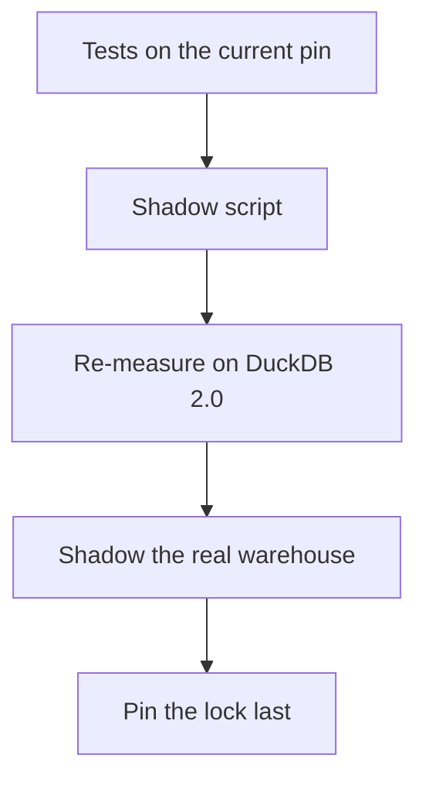

# Task: warehouse-file-growth

* Task ID: warehouse-file-growth
* Complexity: Level 3
* Type: feature

Move the engine to DuckDB 2.0 and prove it on a copy of a real warehouse. This sub-run owns the pin, the dependency range, the shadow-test script, and the user-facing statement of which DuckDB versions can open a new warehouse. It does not change the storage setting or migration `0001`. The lock file is the last change this sub-run brings into this checkout.

## Pinned Info

### Lock lands last

This checkout is the live engine. The commit hook runs `make format`, and that target syncs the environment to the working-tree lock. A commit that contains the 2.0 lock installs DuckDB 2.0 here. The shadow script has to pass on this machine's warehouse before that commit.

## Component Analysis

### Affected Components
- Engine dependency (`skills/sr-search/pyproject.toml`, `skills/sr-search/uv.lock`): pins `duckdb` 1.5.4 with specifier `>=1.2`. Becomes specifier `>=2.0,<2.1`, locked to 2.0.0 or the newest 2.0 patch below 2.1.
- Dependabot (`.github/dependabot.yaml`): the engine `uv` block at `/skills/sr-search` has no ignore list. It gains an ignore for `duckdb` versions `>= 2.1.0`. The docs toolchain block is unchanged.
- Warehouse open (`skills/sr-search/src/stockroom/warehouse.py`): `open()` migrates a behind file and `ensure_vss()` loads `vss`, installing it only when `LOAD` fails. No code change. The first 2.0 open downloads the matching `vss` when the cached extension is for 1.5.4.
- Semantic search (`skills/sr-search/src/stockroom/semantic.py`): unscoped search is `_hnsw_hits`, called from `run_semantic_search` when `harness` and `role` are both unset. No code change unless the plan test shows the query does not use the index.
- Migrations (`skills/sr-search/src/stockroom/migrations/0001_initial_schema.sql`, `0003_embeddings_hnsw_index.sql`): unchanged. `0003` is the index statement the shadow script's repair runs: `CREATE INDEX embeddings_vector_hnsw ON embeddings USING HNSW (vector) WITH (metric = 'cosine')`.
- Docs (`docs/advanced/duckdb.md`): today tells a user how to open the file read-only. Gains the 2.0 format statement, the CLI version, and the offline `vss` recovery.
- Architecture note (`docs/architecture/embeddings.md`): says VSS applies `WHERE` after the HNSW pick. Rewritten only if the re-measure disagrees.
- Milestone sentences (`memory-bank/active/milestones.md`): DuckDB-behaviour sentences in later milestones' Done and Risks lines, rewritten only where 2.0 differs. Scope, order, and ownership stay.
- Shadow script (`scripts/shadow_duckdb_20.py`, new): the committed proof. Not a user-facing command and not started by a hook.

### Cross-Module Dependencies
- `warehouse.open()` → `ensure_vss()` → `migrate.apply_pending()`: the schema-1 test uses this path. The script does not.
- Shadow script → `python -m stockroom ingest`, `embed`, and `semantic`: subprocesses with `STOCKROOM_HOME` set to the scratch home. They write only the copy.
- Shadow script → `uv run --project skills/sr-search --no-config --no-sync --with duckdb==1.5.4`: the older writer, with its own `vss` load, on the copy. While this checkout's lock is 1.5.4, that command runs the project interpreter.
- Commit hook → `make format` → `uv sync --frozen`: any commit installs the lock that is in the tree. The pin commit is the one that moves this machine.

### Boundary Changes
- The engine's DuckDB requirement becomes `>=2.0,<2.1`. After the pin, a file this engine creates is `v2.0.0+` by DuckDB's default. DuckDB before 2.0 cannot open that file. Existing `v1.0.0+` files keep their tag. No Python function signature changes. No migration SQL changes.

### Invariants & Constraints
- The live warehouse is never opened with DuckDB. The script's only operations on it are the writer flock, a wal check, a byte copy, and a stat.
- The script never runs `make shim`. Build does not run `make shim`.
- `skills/sr-search/pyproject.toml` and `skills/sr-search/uv.lock` stay at DuckDB 1.5.4 until the shadow script has exited 0 on this machine's warehouse.
- Until that exit, build does not run `make sync`, `make test`, `make ci`, `make format`, or any other target whose recipe syncs, and does not commit a dirty lock.
- This sub-run does not change the storage setting or `0001`.
- A premise of a later milestone that no longer holds on 2.0 stops for the operator. A sentence that only corrects a measured DuckDB behaviour may be rewritten, which the milestone invariants allow.
- The dependency range stays below 2.1.
- Tests that need an old file create it at storage `v1.0.0`. The tag is `duckdb_databases().tags['storage_version']`, measured on 1.5.4 as `v1.0.0+`.
- No new user-facing command. The script is a contributor program under `scripts/`.

## Open Questions

None - implementation approach is clear

## Test Plan (TDD)

### Behaviors to Verify

- Schema-1 file: a `v1.0.0+` warehouse whose `schema_version` is 1, opened through `warehouse.open(read_only=False)` → schema head, and `tags['storage_version']` is still `v1.0.0+`
- Unscoped plan: `run_semantic_search` with no harness and no role → the `embeddings` statement it executes, under `EXPLAIN`, contains `HNSW`
- Wal guard: `--source` whose `.wal` sibling exists → exit non-zero, and `--home` has no copy
- Home guard: `--home` is the source file's directory → exit non-zero, the source bytes are unchanged, and that directory's entry names are unchanged
- Disk guard: required free bytes above the free space → exit non-zero, and no copy
- Checkpoint proof: a tiny warehouse, `--stop-after checkpoint` → source size and bytes unchanged, no `.wal` beside the source, and every table in the working copy equals the baseline in both directions
- Missing source: a path that is not a file → exit non-zero
- `classify`: a probe that did not open, or whose text contains `Could not set lock` → `blocked`
- `classify`: the wal remains and an opened probe hung or raised → `loud`
- `classify`: the wal is gone and the index count is lower than the row count → `folded`
- `classify`: any other combination → `healthy`
- Flushed count: a child has already printed one integer with `flush=True` and is sleeping, stdout on a pipe → `read_count_line` with a 5-second deadline returns that integer. `reproduce` does not use this deadline
- Count deadline: the child prints without flushing and stays alive → `read_count_line` with a 5-second deadline fails
- Embeddings floor: count after embed, count after ingest, and the orphan line → after embed is at least the after-ingest count minus N, and N is 0 when the line is absent
- `reproduce` on a tiny file, project interpreter → returns `loud`, `folded`, `blocked`, or `healthy` before its deadline. DuckDB 1.5.4 may return `healthy`

### Test Infrastructure

- Framework: pytest, configured in `skills/sr-search/pyproject.toml`, `pythonpath = ["src"]`
- Test location: `skills/sr-search/tests/`
- Conventions: function tests with docstrings, fixtures from `conftest.py` (`warehouse_home`), DuckDB connections closed in the test
- New test files: `skills/sr-search/tests/test_shadow_duckdb_20.py`

### Integration Tests

- Schema-1 file through `warehouse.open` on a `warehouse_home` fixture: migration runner plus the storage tag
- Unscoped `run_semantic_search` on a file warehouse from `warehouse.open`: the statement and its plan
- The shadow script as a subprocess on a tiny file: guards, the checkpoint comparison, the flushed count, and the read deadline
- `reproduce` on a tiny file from the project interpreter: one kill protocol, without requiring the DuckDB 2.0 replay bug
- The 39 GiB run is the acceptance run of the script, not a pytest. `make ci` does not copy the live warehouse

## Implementation Plan

### 1. Schema-1 file keeps its storage tag — executable

- Files: `skills/sr-search/tests/test_warehouse_open.py`
- `warehouse.open` already migrates a behind file. This test locks that, plus the tag. Run it. A pass on DuckDB 1.5.4 means the behavior is already there. Do not change `open()` to force a red run. After the pin, the same test is the 2.0 proof.

1. Stub tests: `test_schema_one_v1_file_migrates_to_head_and_keeps_storage_tag` in `test_warehouse_open.py`
2. Stub interface: none. `warehouse.open`, `migrate.ensure_schema_version_table`, and `migrate.apply_pending` already exist
3. Write tests and run red: with `warehouse_home`, follow `test_open_current_refuses_stale_schema_without_migrating`. Connect with `storage_compatibility_version` `v1.0.0`, execute `0001_initial_schema.sql`, call `migrate.ensure_schema_version_table`, and insert `(version, filename)` for that migration. `filename` is `NOT NULL`. Close that connection, then `warehouse.open(read_only=False)`. Assert `migrate.current_version` is 8 and `duckdb_databases().tags` for that file has `storage_version` `v1.0.0+`. Close the connection
4. Write code and run green: no production change when the test passes. If the tag changes, stop. That is a premise failure

### 2. Unscoped semantic search plans through HNSW — executable

- Files: `skills/sr-search/tests/test_semantic.py`
- The assertion is that the plan text contains `HNSW`. On 1.5.4 that substring is `HNSW_INDEX_SCAN`. On 2.0.0, measured 2026-10-21, the operator title is `Hnsw Index Scan`, which does not contain `HNSW`. The line `HNSW Index: embeddings_vector_hnsw` does. Assert `HNSW`. Do not assert the operator title.

1. Stub tests: `test_unscoped_semantic_plan_uses_hnsw`
2. Stub interface: none. `run_semantic_search` and `FakeEncoder` already exist
3. Write tests and run red: `warehouse_home`, `warehouse.open(read_only=False)` so `0003` builds the index, insert one `messages` row and one `embeddings` row of `embed.EMBED_DIM` floats, then call `run_semantic_search` with a connection proxy that records SQL and the bound vector and delegates. `EXPLAIN` the recorded `embeddings` statement on the real connection, with that vector bound. The statement contains `?::FLOAT[384]`, and `EXPLAIN` without the value raises `InvalidInputException`. Assert the plan text contains `HNSW`. A pass on 1.5.4 locks current behavior
4. Write code and run green: no production change when the test passes. If the plan has no `HNSW`, stop

### 3. Shadow script guards and checkpoint equality — executable

- Files: `scripts/shadow_duckdb_20.py`, `skills/sr-search/tests/test_shadow_duckdb_20.py`
- The script is stdlib at import. Tests invoke it with the project interpreter and `--stop-after checkpoint`. They do not overlay DuckDB 2.0. Pytest's cwd is the engine directory, so the script path is `Path(__file__).resolve().parents[3] / "scripts" / "shadow_duckdb_20.py"`.

1. Stub tests: the four guard and checkpoint cases in `test_shadow_duckdb_20.py`, each a subprocess of that anchored script path, plus four direct tests of `classify`, a flushed-count test, a deadline test, an embeddings-floor test, and one tiny-file `reproduce` test
2. Stub interface: `scripts/shadow_duckdb_20.py` with `--source`, `--home`, `--stop-after`, and `--min-free-bytes`, a `main` that exits 2, `classify(wal_present, probes, index_count, row_count)` returning `healthy`, `read_count_line(stream, deadline)`, `embeddings_held(after_ingest, after_embed, removed_orphans)` returning `False`, and `reproduce(db, *, threshold, fold)` returning `healthy`
3. Write tests and run red: wal sibling refuses and leaves `--home` empty; `--home` equal to the source directory refuses, leaves the source bytes unchanged, and leaves that directory's entry names unchanged; `--min-free-bytes` above the free space refuses and writes nothing; a tiny `v1.0.0` file with one table, `--stop-after checkpoint`, leaves the source bytes unchanged, creates no source `.wal`, and the working copy matches the baseline both ways. Missing source exits non-zero. `classify` returns `blocked` when a probe did not open or its text contains `Could not set lock`, `loud` when the wal remains and an opened probe hung or raised, `folded` when the wal is gone and the index count is lower than the row count, and `healthy` otherwise. `read_count_line` with a 5-second deadline returns the integer from a child that has already printed it with `flush=True` and is sleeping. The same read fails within 5 seconds when that child printed without flushing. `reproduce` waits 180 seconds for its count line, not 5. `embeddings_held` is true when `after_embed >= after_ingest - removed_orphans`, including when `removed_orphans` is 0. `reproduce` on a tiny file returns one of the four labels. The tests load the functions with `importlib` from the anchored script path.
4. Write code and run green: hold `fcntl.LOCK_EX` on `source.parent / ".warehouse.lock"` for the wal check and the byte copies. Wal path is the source path plus `.wal`. Require `shutil.disk_usage(home).free` of at least twice the source size plus 1 GiB, unless `--min-free-bytes` sets the bar. Copy to `baseline.duckdb` and `warehouse.duckdb` inside a new empty `--home`. Never `duckdb.connect` the source. Checkpoint only the working copy, attach the baseline read-only, and `EXCEPT ALL` every non-internal table both directions. `--stop-after copy` returns after the copies. `--stop-after checkpoint` returns after the comparison. `classify` is pure and uses the four results above. A probe record carries `opened`, `hung`, and the exception text. `read_count_line` returns one flushed integer or fails when the deadline passes. `embeddings_held` is `after_embed >= after_ingest - removed_orphans`. `reproduce` is the kill protocol specified in step 4, and this step implements it so the tiny-file test can call it.

### 4. Re-measure DuckDB 2.0 and shadow the real warehouse — executable

- Files: `scripts/shadow_duckdb_20.py`, then `memory-bank/active/milestones.md` and `docs/architecture/embeddings.md` only where a measurement disagrees
- No pytest beyond step 3. The script is the proof. From the repo root, invoke it with `uv run --project skills/sr-search --no-config --no-sync --with duckdb==2.0.0 python scripts/shadow_duckdb_20.py`. `--no-sync` keeps this command from syncing `.venv`. `--project` keeps the working directory at the repo root.
- Before and after that command, `uv run --project skills/sr-search --no-config --no-sync python -c "import duckdb; print(duckdb.__version__)"` prints `1.5.4`. If the project interpreter changes, stop.
- On the 2.0 phases the script prints its own `duckdb.__version__`, which is `2.0.0` or a later 2.0 patch. If `import torch` fails, it runs `uv pip install --no-config --require-hashes -r` against `~/.local/share/stockroom/torch-requirements.txt`, with no `--directory`, so the install follows `VIRTUAL_ENV` and does not touch the project `.venv`. It does not run `uv sync`.
- The project is `package = false`, so the overlay does not import `stockroom` on its own. Before any copy of the live warehouse, the script runs `sys.executable` with `PYTHONPATH` set to `skills/sr-search/src` and requires `import duckdb`, `import stockroom`, and `import torch` to succeed, and requires `duckdb.__version__` to start with `2.0`. If that check fails, it exits before the copy.
- Ingest, embed, and semantic are that same `sys.executable -m stockroom`, with `PYTHONPATH=skills/sr-search/src` and `STOCKROOM_HOME` set to the scratch home. That process is the overlay that already imported DuckDB 2.0, `stockroom`, and torch. A nested `uv run --project skills/sr-search --no-config --no-sync` with no `--with` runs the project interpreter, DuckDB 1.5.4, because uv ignores a `VIRTUAL_ENV` that does not match `skills/sr-search/.venv`. A nested `--with duckdb==2.0.0` selects 2.0.0 in a new environment, which does not have the torch install. That install follows the overlay's `VIRTUAL_ENV`. The 1.5.4 writer is `uv run --project skills/sr-search --no-config --no-sync --with duckdb==1.5.4`. It prints `duckdb.__version__`. The phase fails when that is not `1.5.4`. While the lock is 1.5.4, this command runs `skills/sr-search/.venv` whether or not `VIRTUAL_ENV` is set, because that environment already provides 1.5.4. It uses `duckdb` directly, not `import stockroom`.

- `classify` is the function from step 3. `reproduce(db, *, threshold, fold)` is the only kill protocol. The synthetic section, both live branches, and the newer-patch repeat call `reproduce`, and `reproduce` calls `classify`. `threshold` is `None` for DuckDB's default, or `4096` for the measured `SET checkpoint_threshold = '4KB'`. That setting is applied after the index is checkpointed, never before the build. `fold=False` repairs only when `classify` returns `loud`, and it does not fold. `fold=True` crosses the threshold with a writer that does not touch `embeddings`, then repairs only when `classify` returns `folded`. `blocked` and `healthy` do not repair, and the caller fails the phase. The child loads `vss`, sets `hnsw_enable_experimental_persistence`, inserts into `embeddings`, commits, prints the count with `flush=True`, and stays alive holding the connection. The parent waits until that flushed line arrives or the child exits. The wait is 180 seconds, the same budget as one probe, because the child prints only after the insert commits. The 5-second deadline belongs only to the unit test where the child has already printed and is sleeping. If the wait ends without a line, or the child exits without a line, the parent sends SIGKILL so the child does not keep the file, and the phase fails. It does not open the file while the insert child holds it, and it does not kill when the `.wal` appears. It sends SIGKILL after the line arrives. Then, while the `.wal` is still present, one child runs the cosine query, an embeddings delete, an insert, and `CHECKPOINT`, in that order. After each statement it prints one flushed line, `name ok` or `name error <text>`. The parent closes its own connection before that child starts. The parent SIGKILLs that child once, at the first statement still running after 180 seconds, and records which statement did not return. A statement that does not open the database fails the phase. It is not loud. Those four statements hang or raise in the loud state, including a delete that matches no rows, so they do not commit. For `fold=True`, after those statements, a writer that does not touch `embeddings` commits ordinary rows until the `.wal` file is gone. That writer does not issue `CHECKPOINT`. `threshold=None` is the 16 MiB default, so one small row does not fold. `threshold=4096` is the synthetic bar. Then `classify`. `pragma_hnsw_index_info` is read only when the `.wal` is gone. While the log remains, that pragma raises `InternalException`, and loud does not need the count. Repair runs only when the label matches: `LOAD vss`, `SET hnsw_enable_experimental_persistence = true`, `DROP INDEX embeddings_vector_hnsw`, the `CREATE INDEX` from `0003_embeddings_hnsw_index.sql`, and `CHECKPOINT`. Immediately after that checkpoint, the `embeddings` count equals the flushed count and the index count equals that row count. After that check, the same four statements run again and must finish, with no kill. A delete in that later pass runs after the count check. A repair statement that does not finish fails the phase. The script prints those facts. It does not write a second JSON record.

1. Synthetic section, `--synthetic`, on small files, no live warehouse: storage tag of a new file and of an existing `v1.0.0` file opened without the setting; `USING COMPRESSION zstd` after `ALTER TABLE ... ADD COLUMN`; a delete of `embeddings` rows with the index up, then checkpoint, counted in used blocks; from a read-only connection after that delete, the used-block total and the distinct data-block count; `pragma_hnsw_index_info` count against `count(*)` on a healthy index; an unscoped plan and a scoped plan where the predicate is applied after the HNSW pick; `COPY FROM DATABASE` codecs and whether the index comes along; the zstd clause on a `v1.0.0` file; `con.interrupt()` during `CREATE INDEX ... USING HNSW`. Print each result in one line.
2. Still in `--synthetic`, two small `v1.0.0` files with an HNSW index. `reproduce(db, threshold=4096, fold=False)` returns `loud`. `reproduce(db, threshold=4096, fold=True)` returns `folded`. Both have to match before the script copies the live warehouse.
3. Compare those lines, and the lines already in the milestone list, with the Done and Risks sentences and with `docs/architecture/embeddings.md`. Rewrite a sentence where 2.0 differs. If a later milestone's premise is false, stop for the operator and do not edit scope, order, or ownership.
4. Full run: `--source` this machine's `warehouse.duckdb`, `--home` a scratch directory with room for two copies plus 1 GiB, `--stop-after all`. Checkpoint equality, then ingest, embed, and a checkpoint through `sys.executable -m stockroom` as specified above. Embed is `embed --verbose`, because that is when `on_progress` is set and the orphan line is printed. Ingest exiting 0 is not a health check. The checks are: the copy's tag stays `v1.0.0+`; `sessions`, `messages`, and `tool_calls` each have at least as many rows as before ingest; the `embeddings` count is recorded after ingest and before embed; after embed, `embeddings_held` is true, with N taken from an `embed: removed N orphaned embedding rows` line and N as 0 when that line is absent; `stockroom semantic` returns; and `EXPLAIN` of the unscoped statement, with its vector bound, contains `HNSW`.
5. Close every connection to the working copy. A `uv run --project skills/sr-search --no-config --no-sync --with duckdb==1.5.4` process loads `vss`, writes `shadow_probe`, runs the unscoped cosine query, prints `duckdb.__version__`, and exits. The phase fails when that version is not `1.5.4`. Leave `VIRTUAL_ENV` as the overlay set it. After it exits, the parent 2.0 process opens the copy and runs that same query. Both must return. Then delete the working `warehouse.duckdb` and any `.wal` beside it. Keep `baseline.duckdb`.
6. Branch A, on a fresh copy of `baseline.duckdb`: `reproduce(db, threshold=None, fold=False)` returns `loud`. Remove the working file and its `.wal`.
7. Branch B, on another fresh copy of `baseline.duckdb`: `reproduce(db, threshold=None, fold=True)` returns `folded`. Remove the working file and its `.wal`.
8. Repeat branches A and B only for a final `2.0.N` version from the PyPI simple index. Ignore uploads whose version contains `dev`, `a`, `b`, or `rc`. String order places `2.0.0.dev*` after `2.0.0`, and those are not a newer patch. When the newest final version is `2.0.0`, the script prints that and does not repeat. A newer final patch is a child: `uv run --project skills/sr-search --no-config --no-sync --with duckdb==<version>`, with `VIRTUAL_ENV` left as the overlay set it. The child prints `duckdb.__version__`, and the phase fails when that is not the requested patch. Measured from inside the 2.0.0 overlay: that command with `duckdb==2.0.0` prints `2.0.0` from a new ephemeral prefix while `VIRTUAL_ENV` is inherited. `duckdb==2.0.99` exits 1 during resolution and does not run 1.5.4. Unsetting `VIRTUAL_ENV` is not what selects the version. The child does not install into the project environment. Each branch starts from a fresh copy of `baseline.duckdb` and calls `reproduce`.
9. The script exits 0 only when every phase passed. It never calls `make shim`. Only `baseline.duckdb` and one working file exist at a time.

### 5. Docs, Dependabot, and the pin — prose/policy, then executable

- Files: `docs/advanced/duckdb.md`, `.github/dependabot.yaml`, `skills/sr-search/pyproject.toml`, `skills/sr-search/uv.lock`
- This step starts only after step 4 has exited 0 on this machine. It is one commit. The Mac runs of the same script are the operator's, before the release, and are not this commit's gate.

1. In `docs/advanced/duckdb.md`, state that a new warehouse uses DuckDB 2.0's format, that DuckDB before 2.0 cannot open that file, and that the DuckDB CLI must be 2.0 or newer. State the recovery: the first open after the move downloads the matching `vss` extension when `LOAD` fails; a machine that cannot reach the extension repository cannot open the warehouse until it can; the next successful open caches the extension.
2. No tests: prose/policy artifact for the doc page and the Dependabot ignore.
3. From `skills/sr-search`, before any lock edit, run `uv run --no-config --no-sync --with duckdb==2.0.0 pytest tests/test_warehouse_open.py::test_schema_one_v1_file_migrates_to_head_and_keeps_storage_tag tests/test_semantic.py::test_unscoped_semantic_plan_uses_hnsw -n0`. Pytest's `pythonpath` makes the engine importable. `--no-sync` leaves `.venv` on 1.5.4. A failure stops here.
4. Set the engine dependency to `duckdb>=2.0,<2.1`. Under the engine `uv` block in `.github/dependabot.yaml`, ignore dependency `duckdb` versions `>= 2.1.0`.
5. Regenerate the engine lock with `uv lock --directory skills/sr-search --no-config`. Do not refresh the docs lock. The locked version is 2.0.0 or a later 2.0 patch below 2.1.
6. Run `make ci`. That target's `sync` is what installs the working-tree lock into `.venv`, before the commit. The commit hook's `make format` syncs the same lock again. If `make ci` fails, restore `skills/sr-search/pyproject.toml` and `skills/sr-search/uv.lock` with `git checkout --` on those two files, run `make sync`, and confirm the project interpreter prints `1.5.4`, before the next 03:30 job. Do not run `make shim`. If `make ci` passes, commit. After the commit, the nightly job's `stockroom shim ensure-env` puts torch back.

## Technology Validation

No new dependency. DuckDB is already the engine. On 1.5.4, a file created with `storage_compatibility_version` `v1.0.0` reports `duckdb_databases().tags['storage_version']` of `v1.0.0+`. Preflight measured that `uv run --with duckdb==2.0.0` reports 2.0.0 from an ephemeral environment and leaves the project interpreter on 1.5.4. Step 4 checks both, and it installs torch from the hashed freeze into that ephemeral environment only. Measured 2026-10-21 from inside that overlay, uv 0.12.22: a nested `uv run --project skills/sr-search --no-config --no-sync` with no `--with` prints 1.5.4 from `skills/sr-search/.venv`. The same command `--with duckdb==2.0.0` prints 2.0.0 from a new ephemeral prefix with `VIRTUAL_ENV` inherited and with it unset. `--with duckdb==1.5.4` prints 1.5.4 from the project interpreter in both cases. `--with duckdb==2.0.99` exits 1 and does not run 1.5.4. The project interpreter stays 1.5.4 afterwards. On 2.0.0, `EXPLAIN` of the unscoped cosine statement contains `HNSW` on the line `HNSW Index: embeddings_vector_hnsw`. The operator title in that plan is `Hnsw Index Scan`.

## Challenges & Mitigations

- The commit hook syncs the lock into the live environment: `make ci` moves the environment first, and a failed gate restores the 1.5.4 lock and runs `make sync` before 03:30. Step 4 confirms the project interpreter around the overlay.
- The shadow copy needs twice the warehouse size plus 1 GiB: the script checks free space and exits before copying when the space is short. Two files, `baseline.duckdb` and `warehouse.duckdb`, because a hard link would share the inode DuckDB writes in place.
- The copy holds the writer flock for the byte copy: run it when the 03:30 job is not in that copy. The rest of the script works on the scratch files.
- An observation probe can hang or raise: both are recorded, and either one can satisfy the loud classification. A full set of normal returns fails the phase. Repair runs only after `classify` matches. A repair probe that does not finish fails the script. The synthetic branches run first, so a missing bug or a repair hang fails before a copy of the live warehouse.
- The kill child's count is printed after the insert commits: `reproduce` waits 180 seconds for that flushed line, or until the child exits, and sends SIGKILL if there is no line. The 5-second `read_count_line` deadline is the unit test of a child that has already printed. An unflushed `print` was still buffered after one second.
- Embed prints the orphan line only with `--verbose`: the command is `embed --verbose`. The embeddings floor is the count after ingest, minus N from that line, because ingest deletes embeddings for a rewritten message before embed runs. N is 0 when the line is absent.
- `stockroom ingest` can exit 0 while the index is broken: the script does not treat that exit as health. The tag, the row counts, semantic search, and `EXPLAIN` are the checks, and the repair probes are the proof after a kill.
- `make ci` and the pin commit run an exact sync, which removes out-of-lock torch: the nightly entry already runs `stockroom shim ensure-env` before ingest. Do not start a 2.0 embed in this checkout by hand before that heal.
- Ingest, embed, and semantic have to stay on the overlay that holds torch: they use `sys.executable` and `PYTHONPATH`. A nested `uv run --project --no-sync` with no `--with` is the project interpreter, DuckDB 1.5.4. A nested `--with duckdb==2.0.0` selects 2.0.0 in a new environment without that torch install. The 1.5.4 writer and the patch child request their version with `--with`, print `duckdb.__version__`, and fail the phase on a mismatch. They leave `VIRTUAL_ENV` set.
- `uv lock` can move more than duckdb if the solver refreshes other pins: review the lock diff and keep it to the duckdb bump. Do not pass `--refresh` on the docs lock.

## Pre-Mortem

- The lock reaches this checkout before the shadow passes: the pin files stay unmodified until step 4 exits 0, and the venv version is printed before and after the overlay. A commit in steps 1 to 4 must not contain `uv.lock` or `pyproject.toml`. The two durable tests run on the 2.0 overlay before `uv lock`, so a 2.0 failure of those tests happens while `.venv` is still 1.5.4.
- `make ci` fails after `sync` and the 03:30 job runs DuckDB 2.0 on the live warehouse: step 5 restores the two lock files and runs `make sync` before that job.
- The script exits 0 without ever seeing the replay bug: `classify` returns `loud` or `folded` before repair. `blocked` and `healthy` fail the phase. A lock error is `blocked`. The kill is SIGKILL after the child has committed and printed the row count. That count is compared immediately after the repair checkpoint, before the later probes.
- A 2.0 measurement removes a later milestone's premise and the sentence edit hides it: step 4 stops for the operator instead of changing scope, order, or ownership.
- The 39 GiB copy fills the disk: the free-space check happens first, and the script writes nothing when it fails. Repair copies are one at a time, after the working file from ingest is deleted.
- A repair of the loud state is skipped because the script folds first: branch A repairs while `warehouse.duckdb.wal` exists, and only after `classify` returns loud. Not adopted: moving the kill, fold, and repair off the real warehouse. The Done line puts them on that copy. The synthetic branches are a prelude, not a replacement.
- Not adopted: a JSON file of phase results under the scratch home. The script prints the facts `classify` uses. A second record can drift from those prints.
- Not adopted: a stdlib launcher that spawns every DuckDB version as a sibling. Measured 2026-10-21: from inside the 2.0.0 overlay, `uv run --project skills/sr-search --no-config --no-sync --with duckdb==<version>` selects that version while `VIRTUAL_ENV` is inherited. A version that does not exist exits 1 instead of running 1.5.4. Unsetting `VIRTUAL_ENV` is not the switch. The printed version remains the gate.
- Not adopted: allowing `sessions`, `messages`, or `tool_calls` to shrink during ingest. Ingest deletes one session's rows and inserts the replacement, so a shorter rewrite can drop a count. The milestone Done line still requires no fewer rows. A live run that loses rows stops for the operator.
- Adopted: one `reproduce` function. The synthetic section and the live branches call it, so the kill, the flush, and the repair are not a second prose protocol.
- Adopted: after SIGKILL, and before any fold, the four observation statements run in one child. Each prints a flushed line. The parent kills that child once, at the first hang. The proof pass after repair is the same four statements with no kill.

## Status

- [x] Component analysis complete
- [x] Open questions resolved
- [x] Test planning complete (TDD)
- [x] Implementation plan complete
- [x] Technology validation complete
- [x] Pre-Mortem complete
- [x] Preflight
- [ ] Build
    - [x] 1. Schema-1 file keeps its storage tag (passes on 1.5.4, no production change)
    - [x] 2. Unscoped semantic search plans through HNSW (passes on 1.5.4, no production change)
    - [x] 3. Shadow script guards and checkpoint equality (14 tests green on 1.5.4; `reproduce` returns `healthy` there)
    - [ ] 4. Re-measure DuckDB 2.0 and shadow the real warehouse
    - [ ] 5. Docs, Dependabot, and the pin
- [ ] QA
