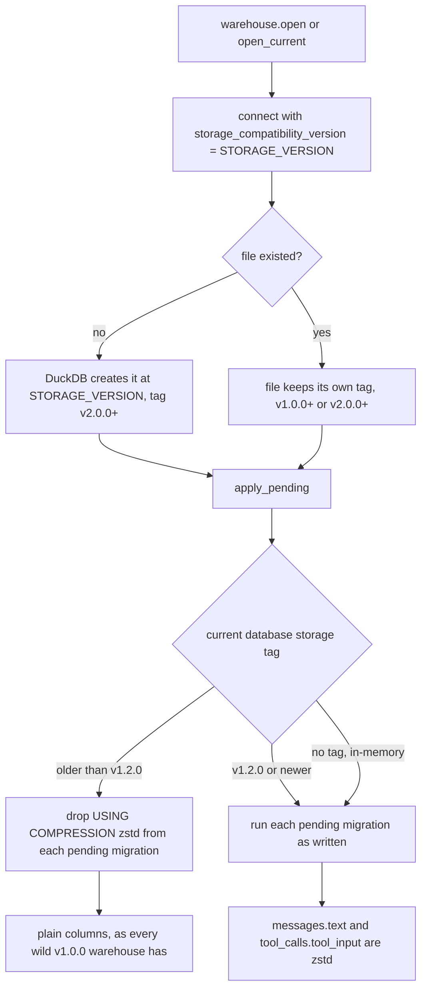

# Task: warehouse-file-growth, milestone 3: new warehouses in DuckDB 2.0's format with zstd

* Task ID: warehouse-file-growth
* Complexity: Level 3
* Type: feature (L4 milestone 3 of 7)

A brand-new warehouse file is created at an explicit storage version, `warehouse.STORAGE_VERSION = "v2.0.0"`, and not at DuckDB's default. Migration `0001` creates `messages.text` and `tool_calls.tool_input` with `USING COMPRESSION zstd`. Existing files are not rebuilt, and a stockroom writer that opens one leaves its storage tag unchanged. A `v1.0.0+` file at schema 0, the bare file that a failed first open under v2.1.2 or earlier left behind, still opens and migrates to head without being deleted. To make that work, the runner drops the zstd clause on any file whose storage version is older than `v1.2.0`, where DuckDB refuses it.

## Pinned Info

### How a migration's zstd clause meets a file

Every engine connection carries the same storage setting. The runner decides per file whether the clause can stay. This one picture covers new files, old files, the bare schema-0 leftover, and in-memory test databases, so it is pinned.

## Planning measurements (DuckDB 2.0.0, 2026-10-22)

Scripts: `scratchpad/m3/probe_storage.py`, `probe_followup.py`, `measure_zstd_reads.py`.

- `storage_compatibility_version` accepts `'v2.0.0'`, `'latest'`, `'v1.5.0'`, and `'v1.2.0'`, and rejects `'v2.0'`. A new file gets `v2.0.0+` with `'v2.0.0'`, with `'latest'`, and with no setting. DuckDB 2.0.0's default is `'latest'`.
- With `'v2.0.0'` and the clause, a new file's `messages.text` and `tool_input` data segments are `ZSTD`.
- In-memory databases accept the clause and store the data `Uncompressed`, with no storage tag. So `schema_con` and `migrated_con` keep working.
- An old `v1.0.0` file opened read-write with `'v2.0.0'` reports `v1.0.0+` while open and after a write, checkpoint, and close. It opens read-only with the setting too. DuckDB 1.5.4 then reads it, writes to it, and checkpoints. The same holds for a bare file given plain tables by 2.0.
- In one process, a second connection to the same path with a different configuration raises `ConnectionException`. That covers a plain connection next to one with the setting, in either order, and an explicit `'latest'` next to a plain one. Read-only next to read-write already conflicted before this milestone.
- The zstd clause raises `BinderException` ("Can't compress using user-provided compression type 'ZSTD', that type is not available yet") on `v1.0.0` and `v1.1.0` files. It works on `v1.2.0`. A rolled-back attempt leaves no table.
- DuckDB has no `ALTER ... SET COMPRESSION`. Compression is set only in `CREATE TABLE`.
- v2.1.2 called `ensure_vss` before `apply_pending`, so its schema-0 leftover is a bare 12,288-byte `v1.0.0+` file with no tables at all, not even `schema_version`.
- Read cost on this machine's tables (from the milestone 2 backup, attached read-only; its SHA-256 is unchanged). The plain `v2.0.0` copy is 489 MiB, with text stored `Uncompressed`. The zstd copy is 290 MiB. Both copies took 5.3 s to build. An `ILIKE` scan over text took 142 ms plain and 196 ms with zstd, and over `tool_input` 150 ms and 207 ms. `sum(length(text))` took 27 ms and 97 ms. The latest 50 rows took 3 ms in both. Zstd is the operator's choice in issue 147, and these numbers do not change it.

## Component Analysis

### Affected Components
- `stockroom.warehouse` (`skills/sr-search/src/stockroom/warehouse.py`): owns every engine DuckDB connect, in `_open_with_backoff`. → Add `STORAGE_VERSION = "v2.0.0"`. Pass `config={"storage_compatibility_version": STORAGE_VERSION}` on every connect, read-only and read-write, so engine connections in one process always share one configuration.
- `stockroom.migrate` (`skills/sr-search/src/stockroom/migrate.py`): applies pending migrations in transactions. → Read the current database's storage tag once per `apply_pending` call. When the tag is older than `v1.2.0`, drop `USING COMPRESSION zstd` from each pending migration's SQL before it runs. No tag (in-memory) or a tag that does not parse keeps the SQL as written.
- Migration `0001` (`skills/sr-search/src/stockroom/migrations/0001_initial_schema.sql`): → `text TEXT USING COMPRESSION zstd` and `tool_input JSON NOT NULL USING COMPRESSION zstd`, plus a header bullet saying why and what the runner does on old files. Column types, nullability, and keys do not change, so the golden snapshots and the ERD do not change.
- Tests (`skills/sr-search/tests/`): `test_migrate_runner.py` (new runner tests), `test_warehouse_open.py` (new-file tests, plus a rework of `test_schema_one_v1_file_migrates_to_head_and_keeps_storage_tag`, which runs the packaged `0001` straight on a `v1.0.0` file and would raise), and the docstring of `_warehouse_worker.build_v2_1_2_chain` (its packaged `0001` now reaches a `v1.0.0` file through the runner's clause drop).
- Docs: the `docs/architecture/warehouse.md` Migrations section, plus `memory-bank/systemPatterns.md` and `techContext.md`. `docs/advanced/duckdb.md` already says new warehouses use DuckDB 2.0's format and needs no change.

### Cross-Module Dependencies
- `warehouse.open()` / `open_current()` → `_open_with_backoff` → `duckdb.connect(..., config=...)`. All callers go through the chokepoint, and nothing else in `src` connects.
- `warehouse` → `migrate.apply_pending(con)`. The runner reads the tag from the connection it is given. That is the current database, so a future builder that runs the chain with a new-format copy as the current database gets zstd.
- Test helpers and `scripts/shadow_duckdb_20.py` `_synthetic_warehouse` call `apply_pending` on `v1.0.0` files, and with the clause drop they keep producing v2.1.2's shape.

### Boundary Changes
- New module constant `warehouse.STORAGE_VERSION`. The verified copy (milestone 5) attaches its copy at this version, and the check (milestone 6) compares against it. It is the one home of the storage choice.
- Engine connections now carry a non-default configuration. In one process, a plain `duckdb.connect` to the warehouse path while an engine connection is open, or the other way round, raises `ConnectionException`. Different processes are unaffected. Milestones 5 and 6 must plan for this.
- Migration SQL may carry `USING COMPRESSION zstd`. The runner removes it on files older than `v1.2.0`.

### Invariants & Constraints
- Existing populated files are never rebuilt. Writer opens keep a file's storage tag, and DuckDB 1.5.4 can still open a `v1.0.0+` file after the engine writes to it.
- No file is deleted or replaced. The bare schema-0 file migrates in place, with the same inode.
- `schema_version` stays the schema record. The storage format is not part of it, and `open_current()` staleness depends only on `schema_version`.
- `0001`'s column contract (names, types, nullability, keys) is unchanged. Only the physical compression of two columns changes.
- No vector index or `vss`, and no new user-facing command.
- Every release stands alone. A user who arrives from any earlier release (a `v1.0.0+` file at schema 0 to 8, with or without a leftover `.wal`, or no warehouse at all) still opens and migrates.
- This machine's live engine is this checkout's working tree. A saved file is live before any commit (see Challenges).

## Open Questions

- [x] `'latest'` or an explicit storage version, and on which connects → Resolved: an explicit `STORAGE_VERSION = "v2.0.0"` on every engine connect. The operator chose `v2.0.0` for new files and the copy. `'latest'` moves with a DuckDB bump, and an explicit `'latest'` still conflicts with plain connects, so it buys nothing. One setting on every engine connect keeps engine connections in a process mutually compatible. On old files the setting changes nothing measurable: the tag stays and 1.5.4 still reads and writes. Setting it only on create would leave connections to new and old files configured differently and needs an existence check before connecting.
- [x] How `0001`, which now carries zstd, runs on a `v1.0.0+` schema-0 file → Resolved: the runner drops `USING COMPRESSION zstd` when the current database's tag is older than `v1.2.0`, the first version DuckDB accepts it on (measured). The rule is general, so a later migration with the clause also works on old files. The bare file ends at head with plain columns, the same as every wild `v1.0.0` warehouse, and a later milestone's copy gives it zstd. Rejected: deleting and recreating the bare file (the milestone forbids deleting it); templated migrations (a new pattern with no gain over one fixed clause); retrying on the `BinderException` text (depends on DuckDB's message wording).

## Test Plan (TDD)

### Behaviors to Verify

Runner (`test_migrate_runner.py`):
- R1 (red): a `v1.0.0` file plus a scratch migration whose column carries `USING COMPRESSION zstd`, run through `apply_pending` → the migration applies and is recorded. After rows are inserted and the file is checkpointed, closed, and reopened read-only, the column's data segments are not `ZSTD`. Today this raises `BinderException`. A `v1.1.0` setting persists as tag `v1.0.0+`, so it is the same case and gets no test of its own (preflight advisory 2).
- R2 (guard): the same migration on a `v1.2.0` file and on a `v2.0.0` file → the clause stays, and the data segments are `ZSTD`. This catches an implementation that always strips.

Warehouse (`test_warehouse_open.py`):
- W1 (red): with `warehouse.STORAGE_VERSION` monkeypatched to `"v1.2.0"`, `warehouse.open()` with no file creates one → after close, a fresh plain read-only connection reads tag `v1.2.0+`. Today it reads `v2.0.0+`, DuckDB's default. Unpatched (guard): the tag is `f"{warehouse.STORAGE_VERSION}+"`.
- W2 (red): `warehouse.open()` creates a new warehouse, rows go into `sessions`, `messages`, and `tool_calls`, and the file is checkpointed and closed → in a fresh read-only connection, the `VARCHAR` data segments of `messages.text` and the `JSON` data segments of `tool_calls.tool_input` are non-empty and all `ZSTD`. Today they are `Uncompressed`. The test writes rows first, because an empty table has no data segments to read.
- W3 (guard; rework of the schema-1 tag test): a `v1.0.0` file at schema 1, built by the runner from the packaged `0001` (the clause dropped, as v2.1.2 shipped it) → `warehouse.open(read_only=False)` migrates it to head. After a `messages` write, a checkpoint, and a close, a fresh connection reads tag `v1.0.0+`, and `messages.text` data segments are not `ZSTD` (no rebuild). `open_current()` then opens it.
- W4 (guard): a bare `v1.0.0` file (connected with `v1.0.0` and closed, no tables) → `warehouse.open(read_only=False)` reaches head with every product table. The path keeps the same inode, the tag stays `v1.0.0+`, and a row can be written.

W3 and W4 pass before this milestone. They are the regression guards for the done item. With the clause in `0001` and without the runner change, both raise `BinderException`. Step 3.4 proves that with a one-off mutation.

Edge cases:
- In-memory databases (no tag) keep the clause: every `schema_con` and `migrated_con` test runs the packaged `0001` in memory.
- Readers on old files with the setting: covered by W3's `open_current()` and the existing reader tests.
- The 2.1.2 chain builder (`build_indexed`), with its leftover-`.wal` and `0009` tests, and the shadow script's `--synthetic` builder, all run `apply_pending` on `v1.0.0` files. They are covered by their existing tests in the full suite.
- In-process configuration conflicts: the full suite shows any test that holds a plain connection while an engine connection is open (see Challenges).

### Test Infrastructure

- Framework: pytest with pytest-xdist (`-n auto` by default; `-n0` when iterating on one test)
- Test location: `skills/sr-search/tests/`
- Conventions: `test_<module>.py`, module docstring stating the contract, `warehouse_home` fixture for an isolated `STOCKROOM_HOME`, `tmp_migrations_dir` for scratch migrations, data segments read through `pragma_storage_info` with validity segments excluded
- Run form (from the repo root): `uv --directory skills/sr-search --no-config run --no-sync pytest tests/<file> -n0`
- New test files: none

### Integration Tests

- W2 to W4 go through `warehouse.open()`, the runner, and the packaged migration chain together.
- After landing, the shadow script runs from a fresh clone on a copy of this machine's warehouse (step 6). It exercises the engine's new connect setting through ingest, embed, and semantic, then has DuckDB 1.5.4 write the copy.

## Implementation Plan

### 0. Where milestone 3's commits go — resolved (operator, 2026-10-22)

Milestones 1 and 2 make the first release, which waits on the operator's shadow run on the personal Mac. Pull requests are squash-merged. `constrain-size-as-best-we-can` is the milestone 1+2 branch, pushed to origin so another machine can pull it. Build starts by creating a new branch for milestone 3 from this branch's tip, in this checkout. After the first pull request squash-merges, rebase it with `git rebase --onto origin/main <tip of constrain-size-as-best-we-can>`.

### 1. Backup and real-data proof before the first source edit — build-time operation

- Files: none in the repo; scripts in `scratchpad/m3/`
- No tests: an operational safety step on this machine (the live engine is this working tree)

1. Make `~/.local/share/stockroom/warehouse.issue147-pre-m3.duckdb`: a byte copy under the writer flock with no `.wal`, with SHA-256 equal to the live file (milestone 2's backup pattern). Report its size. The milestone 2 backup stays.
2. On a byte copy of the live warehouse under a scratch home, with plain DuckDB 2.0.0 (no engine code): connect read-write with `storage_compatibility_version='v2.0.0'`, insert scratch rows into `messages` and `tool_calls`, checkpoint, and close. Then check that the tag still reads `v1.0.0+`, that every row count is the copy's plus the scratch rows, that DuckDB 1.5.4 opens the copy read-write and checkpoints, and that 2.0 then reopens it read-only with the setting. Delete the scratch home after.
3. Steps 2 to 5 run in one sitting, well before 03:30. If the live file has changed since step 1's SHA, stop and ask before editing `warehouse.py`.

### 2. Runner: drop the zstd clause on files that predate it — executable

- Files: `skills/sr-search/src/stockroom/migrate.py`, `skills/sr-search/tests/test_migrate_runner.py`

1. Stub tests: in `test_migrate_runner.py`, add `test_apply_pending_drops_zstd_on_a_v1_0_0_file` and `test_apply_pending_keeps_zstd_from_v1_2` (parametrized `v1.2.0`, `v2.0.0`), with docstrings and empty bodies, and add one line on the new runner rule to the module docstring (preflight advisory 4). In `conftest.py`, add one shared helper stub that both test files import, the way `FakeEncoder` is shared (preflight advisory 5): `data_codecs(path, table, column) -> set[str]`, which opens a fresh plain read-only connection and returns the compression of the column's `VARCHAR` or `JSON` data segments, validity excluded.
2. Stub interface: in `migrate.py`, add `_ZSTD_CLAUSE` (a compiled pattern matching `\s+USING\s+COMPRESSION\s+zstd\b`, case-insensitive), `_storage_version(con) -> tuple[int, int, int] | None` (parses `duckdb_databases()` tags for `current_database()`, `None` for no tag or an unknown form), and `_predates_zstd(con) -> bool` (`True` only for a parsed version below `(1, 2, 0)`). Docstrings say which files the clause is dropped on and why (measured `BinderException`). The bodies return "no strip" for now.
3. Write tests and run red: each test creates a file in `tmp_path` at the parametrized `storage_compatibility_version`. It applies a `tmp_migrations_dir` migration `CREATE TABLE t (id INTEGER, body TEXT USING COMPRESSION zstd);`, inserts 2,000 rows of about 1.8 KB, checkpoints, and closes. It reopens read-only and asserts `current_version == 1` and the codec set of `body`'s `VARCHAR` data segments: `ZSTD` for `v1.2.0` and `v2.0.0`, without `ZSTD` and non-empty for `v1.0.0`. Implement `data_codecs`. Run `tests/test_migrate_runner.py -n0`. Expect `v1.0.0` red (`BinderException`) and `v1.2.0` and `v2.0.0` green as guards.
4. Write code and run green: implement the helpers. In `apply_pending`, compute `strip = _predates_zstd(con)` once, after `ensure_schema_version_table`, and run `_ZSTD_CLAUSE.sub("", sql)` when `strip` is set. Update the module docstring with one bullet on the storage-aware clause. Run the file green, then `tests/test_migrations_discovery.py tests/test_migrate_cli.py`.

### 3. New-file format: storage setting on every connect, and zstd in `0001` — executable

- Files: `skills/sr-search/src/stockroom/warehouse.py`, `skills/sr-search/src/stockroom/migrations/0001_initial_schema.sql`, `skills/sr-search/tests/test_warehouse_open.py`, `skills/sr-search/tests/_warehouse_worker.py` (docstring only)

1. Stub tests: in `test_warehouse_open.py`, add `test_new_warehouse_uses_the_engine_storage_version`, `test_new_warehouse_stores_text_and_tool_input_with_zstd`, and `test_bare_v1_file_from_a_failed_first_open_migrates_in_place`, and rework `test_schema_one_v1_file_migrates_to_head_and_keeps_storage_tag` into an empty body with its new docstring (W3). Add a stubbed helper `_persisted_tag(path)` (fresh plain read-only connect). Codecs come from the shared `data_codecs` in `conftest.py`.
2. Stub interface: in `warehouse.py`, add `STORAGE_VERSION = "v2.0.0"` with a comment block (the operator's choice, why it is explicit and not `'latest'`, that a file that already exists keeps its own tag, and the in-process same-configuration rule), and add it to `__all__`. Do not wire it into `_open_with_backoff` yet.
3. Write tests and run red: W1 to W4 as in the Test Plan. W2 writes 500 messages and 500 tool calls of about 1.8 KB through the engine connection, checkpoints, and closes before reading codecs. W3 builds schema 1 on a `v1.0.0` connection by copying the packaged `0001` under its own name into a scratch folder and running `apply_pending(con, folder)`, which records the `schema_version` row itself. A `JSON` column's data segments report `segment_type = 'JSON'`, measured as `ZSTD` at 500 rows. Run `tests/test_warehouse_open.py -n0`. Expect W1 and W2 red, and W3 and W4 green.
4. Write code and run green:
   - In `0001`, add `USING COMPRESSION zstd` to `messages.text` and `tool_calls.tool_input`, plus a header bullet: zstd on the two large columns; new files only; the runner drops it on files older than `v1.2.0`; the copy (a later milestone) applies it to existing files.
   - Mutation check (one-off, not committed): make `_predates_zstd` return `False`, then run `tests/test_warehouse_open.py tests/test_migrate_runner.py tests/test_schema_0009.py -n0`. Expect W3, W4, R1, and the `build_indexed`-based tests red. Restore it and run the same set green.
   - In `_open_with_backoff`, pass `config={"storage_compatibility_version": STORAGE_VERSION}` to `duckdb.connect`. Run `tests/test_warehouse_open.py -n0` green.
   - Update the `build_v2_1_2_chain` docstring: the packaged `0001` carries the zstd clause, and the runner drops it on the `v1.0.0` file, so the chain still builds v2.1.2's shape.
   - Run the full suite. Fix any test that holds a plain connection to a warehouse path while an engine connection to it is open by closing the first or reordering. Do not add a product workaround.

### 4. Docs and memory-bank — prose/policy

- Files: `docs/architecture/warehouse.md`, `memory-bank/systemPatterns.md`, `memory-bank/techContext.md`
- No tests: prose/policy artifact

1. `docs/architecture/warehouse.md`, Migrations section: a new warehouse is created at storage version `v2.0.0`, with zstd on `messages.text` and `tool_calls.tool_input`. A warehouse from an earlier release keeps its format, and on a file older than DuckDB's `v1.2.0` storage the runner drops the zstd clause, so those columns stay plain there.
2. `systemPatterns.md`, "Two-layer warehouse lock behind chokepoints": every engine connect carries `storage_compatibility_version = warehouse.STORAGE_VERSION`, the one home of the storage choice. A plain connection to the same file in the same process conflicts. The runner drops `USING COMPRESSION zstd` on files older than `v1.2.0`.
3. `techContext.md`, Warehouse Schema: one sentence on new files (`v2.0.0`, zstd on the two columns), pointing to `warehouse.STORAGE_VERSION`.
4. `make docs-build` (strict) green.

### 5. Land — build-time operation

1. `make ci` green from the repo root, with the full output read.
2. One commit: `feat: create new warehouses in DuckDB 2.0's storage format with zstd on message text and tool inputs`, with the seat trailer. Then run `stockroom shim ensure-env` (the commit hook strips torch) and confirm that torch imports.

### 6. Live checks and shadow run after landing — build-time operation

1. Live: `stockroom migrate` (a no-op at head), `stockroom query "SELECT count(*) FROM messages"`, `stockroom semantic -k 3 <query>`, and `stockroom doctor` all exit 0. A fresh plain read-only connection reads the live tag `v1.0.0+`. DuckDB 1.5.4 opens the live file read-only. Restart the dashboard from this checkout as in milestone 2 so it runs the new connect, and confirm it serves.
2. The shadow script's 2.0-lock form, from a fresh clone of the landed commit, on a byte copy of the live warehouse under a scratch home (the docstring recipe, as milestone 2's reflection asks): exit 0, `shadow: every phase passed`, no `nanobind` line. Delete the scratch home and clone after.
3. Update `activeContext.md` with the results.

## Technology Validation

No new technology - validation not required. The DuckDB 2.0.0 behaviour the plan relies on is measured above.

## Challenges & Mitigations

- **Live working tree**: this checkout is the live engine, so saving `warehouse.py` changes how every `stockroom` command on this machine connects. Mitigation: step 1's backup and real-data proof come before the edit, and steps 2 to 5 run in one sitting well before 03:30. The measured effect on an old file is none: the tag stays, and 1.5.4 still reads and writes. Rollback is reverting the commit; the file needs nothing.
- **In-process configuration conflicts**: a test that keeps a plain connection open beside an engine connection to the same file now raises `ConnectionException`. The audit found only sequential uses (each plain connection closes before the engine opens). The full suite in step 3.4 is the check, and any fix goes in the test.
- **Torch stripped by commits**: the commit hook's exact sync removes torch from the live `.venv`. Mitigation: `stockroom shim ensure-env` after each commit, and before any live semantic or embed check.
- **Tag parsing**: an unknown tag form keeps the clause, so DuckDB raises loudly rather than the runner silently guessing. In-memory databases have no tag and accept the clause.
- **Old-file builders**: the 2.1.2 chain builder and the shadow script's `--synthetic` builder pass only because of the runner's clause drop. The step 3.4 mutation check shows they depend on it, and the full suite and step 6.2 run them.
- **Read cost**: a full-text scan is about 40% slower with zstd (196 ms against 142 ms on this machine's data) for a file about 40% smaller. Reported, not re-decided.
- **Handoff to milestones 5 and 6**: their builder and pass must attach the copy at `warehouse.STORAGE_VERSION`. They must not hold a plain connection, or an `ATTACH` they have not measured, to the live path while an engine connection to it is open in the same process. Recorded in `systemPatterns.md` (step 4) so their plans find it.

## Pre-Mortem

- **Milestone 3 ships inside the milestone 1 and 2 release by accident**: step 0 puts milestone 3 on its own branch before any milestone 3 commit.
- **The clause drop hides a mistake later**: a future migration's author expects zstd everywhere, and old files silently get plain columns. Response: that is the intended policy, because old files get zstd from the copy. `systemPatterns.md` and the `0001` header state it, so the behaviour is documented and not a surprise.
- **Zstd is not applied in practice** (for example, DuckDB skips forced compression on small segments): W2 writes about 900 KB per column and asserts on the file, not on the DDL. P3 measured `ZSTD` at this scale.
- **The setting reaches a file it should not change**: covered by the first challenge, and by W3 plus step 6's 1.5.4 open of the live file.
- **A later milestone defines its own storage version**: `STORAGE_VERSION` is public, documented, and named in `systemPatterns.md`, so milestones 5 and 6 reuse it.

## Status

- [x] Component analysis complete
- [x] Open questions resolved
- [x] Test planning complete (TDD)
- [x] Implementation plan complete
- [x] Technology validation complete
- [x] Pre-Mortem complete
- [ ] Preflight
- [ ] Build
- [ ] QA
