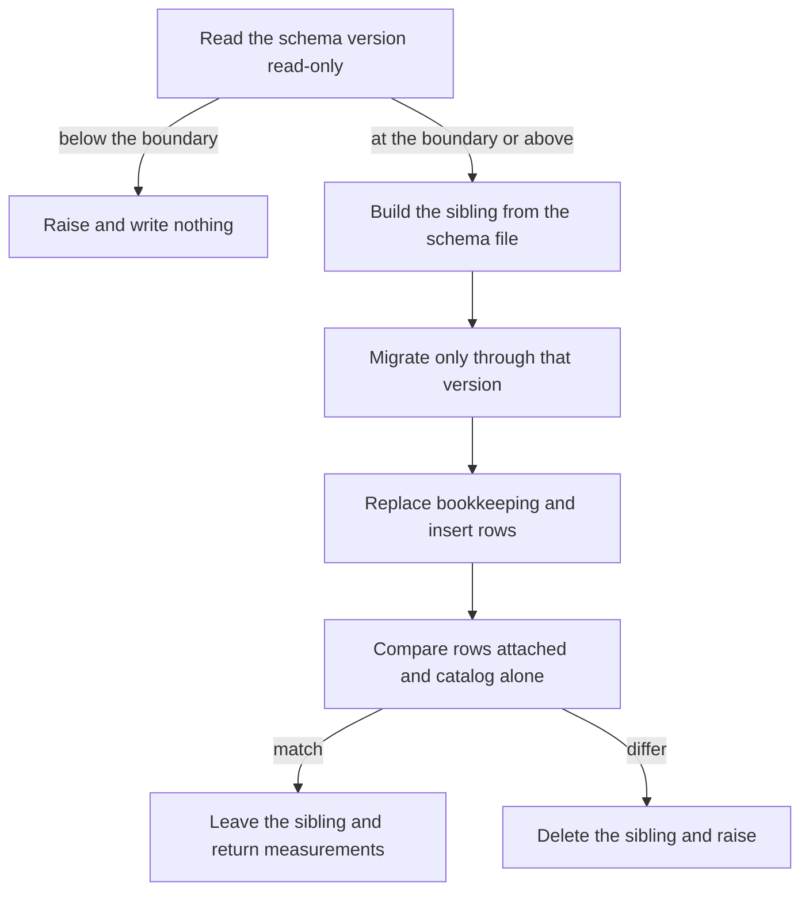

# Task: warehouse-file-growth, milestone 5 (verified newer-format copy)

* Task ID: warehouse-file-growth-m5
* Complexity: Level 3
* Type: feature

Extend `stockroom.storage` so it can copy an existing warehouse into a verified newer-format sibling. The original is attached read-only and its bytes stay as they are. The sibling is built from the frozen schema file at `STORAGE_VERSION`, migrated only through the original's schema version, then filled with the original's rows. A fresh read-only connection checks multiset equality in both directions and catalog equality. The builder returns the sibling path, both file sizes, and the build and verification times. It leaves the sibling in place. It does not replace the live file, take the writer flock, or start from any hook, `open()`, doctor, ingest, embed, or the nightly job. Those belong to later milestones.

## Pinned Info

### Copy order

The order is the plan. Building the sibling at the storage version comes before any table exists, because the zstd clause fails on an old-format file. Migrating stops at the original's version, because a later migration would make the sibling's tables differ from the rows about to be inserted. Bookkeeping is replaced after that, because the schema file records its own row and equality includes `schema_version`. `EXCEPT ALL` uses a new read-only connection with the original attached, and only the current database's base tables. Schema and constraints are read from each file with nothing attached, because an attached file makes those helpers list both databases and shifts `constraint_index`.

## Component Analysis

### Affected Components
- `stockroom.migrate.apply_pending`: applies every pending migration → gains a keyword-only `through` version and applies nothing above it. The default stays "apply every pending migration".
- `stockroom.storage.build_warehouse`: builds a head file from the schema file → forwards that same `through` keyword to `apply_pending`. The default stays "apply every later migration".
- `stockroom.storage`: creates a missing warehouse → also copies an existing warehouse to a sibling named `warehouse.copy.duckdb`, verifies it, and returns measurements.
- `tests/_warehouse_worker.py`: builds released-chain files in a child process → grows one command that writes rows at version 1, migrates to the head, and writes rows again. The child loads `vss`. The pytest process does not.
- `tests/conftest.py`: caches released-chain templates → caches that two-generation file the same way and hands each test its own copy.
- `tests/test_migrate_runner.py` and `tests/test_storage.py`: existing builder tests → gain the bound and the copy behaviors.

### Cross-Module Dependencies
- `copy_warehouse` → `build_warehouse` → `install_schema` and `apply_pending(through=original_version)`. The schema file already records version 9, so with the packaged chain and an original at version 9, `apply_pending` applies nothing.
- `copy_warehouse` → a read-only `duckdb.connect` on the original to read `migrate.current_version`, then `ATTACH ? AS source (READ_ONLY)` from the sibling. Neither connection sets `storage_compatibility_version` on the original.
- `verify_copy` → one read-only connection on the sibling, with the original attached, used only for `EXCEPT ALL`. The table names come from `duckdb_tables()` where `database_name = current_database()` and `schema_name = 'main'`. Catalog checks open the original and the sibling separately, with nothing attached, and call the helpers already in `tests/test_storage.py`. Those helpers are not called on a connection that has the other file attached.
- The worker → `apply_pending` and `LOAD vss`, in the child only. `0003` is the migration that needs `vss`. The worker checkpoints once, after version 9, when the index is already gone.

### Boundary Changes
- `apply_pending(con, directory=None, *, through=None)` and `build_warehouse(dest, *, through=None)`. Existing callers pass neither keyword. `test_create_warehouse_failure_leaves_no_warehouse` replaces `build_warehouse` with a one-argument function and calls it as `build_warehouse(temp)`, so that replacement still fits.
- New names on `stockroom.storage`: `COPY_FILENAME`, `CopyError`, `CopyMismatch`, `CopyResult`, `copy_warehouse`, `verify_copy`. Nothing in the product calls them yet. Milestone 6 is the caller that will delete the sibling or put it on the live path.
- No change to `warehouse.open`, doctor, hooks, ingest, embed, schedule, or the schema file.

### Invariants and constraints
- The original is read with a read-only connection and `ATTACH ... (READ_ONLY)`. The copy never opens it for writing. Its SHA-256 is the same after the call, and it grows no `.wal`.
- The sibling is `original.with_name("warehouse.copy.duckdb")`, so it is on the same filesystem. The call removes a leftover of that name and its `.wal` before building. It does not remove the original or any `warehouse.issue147-*.duckdb` backup.
- The sibling is created at `STORAGE_VERSION` from the schema file, then closed with no `.wal`, then opened again with a plain `duckdb.connect` (no storage setting) for the row copy. A second connection in this process may set `storage_compatibility_version` only after the first connection is closed, and this second connection sets none.
- Migrations `0001` through `0009` do not run on the sibling. The schema file is that schema. Only a migration whose version is greater than `SCHEMA_FILE_VERSION` and at most the original's version runs. This project has none.
- Before insert, every base table on the sibling is emptied, including `schema_version`. The table list is `duckdb_tables()` filtered to `database_name = current_database()` and `schema_name = 'main'`. After `ATTACH`, that view also lists the original and the system database; walking the unfiltered list inserts each table twice and the second insert hits the primary key. Rows then come from the original with `INSERT INTO ... BY NAME SELECT *`. That drops a row a later migration might have seeded, and it copies `applied_at` rather than stamping a new time.
- Verification failure raises `CopyMismatch` and deletes the sibling and its `.wal`. The original stays. Success leaves the sibling and returns `CopyResult(path, original_bytes, copy_bytes, build_seconds, verify_seconds)`.
- An original whose `current_version` is below `FORMAT_BOUNDARY` raises `CopyError` before any sibling is created.
- Catalog equality is read from each file with nothing attached. It allows the zstd clause in `duckdb_tables().sql`. It does not compare `duckdb_views().sql`: a `v1.0.0` file reloads the view with different parentheses than a `v2.0.0` file. Column lists, the full constraint rows (including `constraint_index`), and view columns are compared. `constraint_index` shifts while the other file is attached, so no constraint compare runs on that connection.
- Zstd is read from data segments of `messages.text` and `tool_calls.tool_input` (`segment_type != 'VALIDITY'`). The fixture has a row in each column, so each check expects `ZSTD`.
- The copy is not `COPY FROM DATABASE`. On DuckDB 2.0.0 that stores `messages.text` as `DICT_FSST`.
- No test opens the live warehouse. The fixture file is a temp path. The schema-8 refuse test never runs `CHECKPOINT`, because that file still has the HNSW index.

## Open Questions

None - implementation approach is clear.

## Test Plan (TDD)

### Behaviors to Verify

- `apply_pending(con, directory, through=9)` when `directory` holds only `0010_m10.sql` (`ALTER TABLE sessions ADD COLUMN m10 TEXT`) and `schema_version` is already at 9 → returns `[]`, and `sessions` has no `m10` column.
- `build_warehouse(dest, through=9)` while `migrations_dir` points at a folder that contains the packaged migrations plus `0010_m10.sql` → bookkeeping is only `(9, 'schema_0009.sql')`, and `sessions` has no `m10` column. The existing unbounded `build_warehouse(dest)` test still applies `0010`.
- Two-generation `v1.0.0` file at the head, rows `e#0` written at version 1 and `l#0` written after version 9, plus a `warehouse.issue147-swap.duckdb` sibling with known bytes → `copy_warehouse` returns the path `warehouse.copy.duckdb` in that directory. The original's SHA-256 and `v1.0.0+` tag are unchanged. The backup's bytes are unchanged. Neither file has a new `.wal`. The sibling exists, has no `.wal`, has tag `v2.0.0+`, and contains both `e#0` and `l#0`.
- That same pair → for every base table, both `EXCEPT ALL` directions return no rows, including `schema_version` (`applied_at` included). The copy's version-9 filename is the original's migration name, not `schema_0009.sql`.
- That same pair, each file opened read-only with nothing attached → introspected columns, primary keys, and non-primary indexes match; the full constraint rows match, including `constraint_index`; table SQL matches once ` USING COMPRESSION ZSTD` is removed; the view name `session_token_usage` matches and its columns match. View SQL text is not an assertion. The helpers are not called on the connection that has the other file attached.
- That same sibling → `messages.text` data segments are `(VARCHAR, ZSTD)` and `tool_calls.tool_input` data segments are type `VARCHAR` or `JSON` with compression `ZSTD`.
- Returned `original_bytes` and `copy_bytes` equal the two files' sizes. `build_seconds` and `verify_seconds` are `>= 0`.
- After a successful copy, delete `l#0` from the sibling, checkpoint, and close → `verify_copy` raises `CopyMismatch`. The original's SHA-256 is unchanged.
- `verify_copy` patched to raise `CopyMismatch` → `copy_warehouse` raises `CopyMismatch`, `warehouse.copy.duckdb` and its `.wal` are absent, and the original's SHA-256 is unchanged.
- `build_warehouse` patched to insert message `seed#0` after the real build → `copy_warehouse` still matches the original, and `seed#0` is absent. The patch accepts `through`, because the copy passes it.
- A pre-existing `warehouse.copy.duckdb` and its `.wal` full of garbage → `copy_warehouse` replaces them with the verified sibling and leaves no `.wal`.
- `released_chain_file(8)` (index present, no `CHECKPOINT` in the test) → `copy_warehouse` raises `CopyError`, creates no sibling, leaves no `.wal`, and does not change the file's SHA-256.
- `released_chain_file(9, rows=1)` while `migrations_dir` also contains `0010_m10.sql` → the sibling has no `m10` column and no version-10 bookkeeping row.

### Test Infrastructure

- Framework: pytest, with the engine suite's existing `addopts`.
- Test location: `skills/sr-search/tests/`.
- Conventions: behavior tests are functions with a docstring that names the contract. Old files are built in a child so this process never loads `vss`. `released_chain_file` and a new generations helper hand each test a private copy of a session template. Temp homes and temp files only.
- New test files: none.

### Integration Tests

- The two-generation copy crosses the worker, `apply_pending`, `build_warehouse`, row replace, and `verify_copy`. One test runs that path and asserts equality, catalog, zstd, tags, hashes, and the backup.
- `apply_pending(..., through=9)` is a unit test on an in-memory connection. It does not build a released-chain file.

## Implementation Plan

### 1. Stop apply_pending at a version — done

- Files: `skills/sr-search/src/stockroom/migrate.py`, `skills/sr-search/tests/test_migrate_runner.py`

1. Stub tests: add `test_apply_pending_stops_at_through` with an empty body and a docstring for the bound.
2. Stub interface: add `through: int | None = None` as a keyword-only parameter on `apply_pending`. Leave the body applying every pending migration, so current callers stay green and the new test can fail.
3. Write tests and run red: in-memory connection, `ensure_schema_version_table`, `CREATE TABLE sessions (harness TEXT)`, one `schema_version` row `(9, 'schema_0009.sql')`, a temp directory whose only migration is `0010_m10.sql`. `apply_pending(con, folder, through=9)` returns `[]` and `sessions` has no `m10` column.
4. Write code and run green: `pending` keeps migrations with `version > current_version` and, when `through` is not `None`, `version <= through`. Update the docstring. The default `through=None` still means every pending migration.

### 2. Copy and verify the sibling — done

- Files: `skills/sr-search/src/stockroom/storage.py`, `skills/sr-search/src/stockroom/migrate.py` (caller only; the bound already exists), `skills/sr-search/tests/test_storage.py`, `skills/sr-search/tests/_warehouse_worker.py`, `skills/sr-search/tests/conftest.py`

1. Stub tests: add empty tests in `test_storage.py` for the behaviors listed above, except the `apply_pending` unit test. Docstrings name the contract. Add the worker command and the conftest helper in this same step, before production code, because the equality test cannot run without a file.
2. Stub interface: `COPY_FILENAME`, `CopyError(RuntimeError)`, `CopyMismatch(CopyError)`, `CopyResult` as a `NamedTuple` of `path`, `original_bytes`, `copy_bytes`, `build_seconds`, `verify_seconds`. `build_warehouse(dest, *, through=None)`, `copy_warehouse(original) -> CopyResult`, and `verify_copy(original, copy) -> None`, each with a docstring and a body that raises `NotImplementedError`. `build_warehouse`'s current body stays until the tests are red; the new keyword defaults to `None`.
3. Write tests and run red:
    - Worker command `build_generations <db> <scratch>`: connect at storage `v1.0.0`; apply the packaged chain through version 1; insert message `e#0` with text `"early " * 40` and a `tool_calls` row whose `tool_input` is `{"path": "/tmp/early"}`; load `vss`; apply the chain through version 9; insert message `l#0` with text `"late " * 40` and tool input `{"path": "/tmp/late"}`; `CHECKPOINT`; close; print `built`. Do not checkpoint while the HNSW index exists. Export `EARLY_ID` and `LATE_ID`.
    - Conftest helper, same cache-and-copy shape as `released_chain_file`: one session template, each test gets its own file. The helper's name is `generations_file`.
    - Fill the assertions listed under Behaviors. The equality test calls `_introspect_schema`, `_constraints`, and `_tables_sql` on two connections that have attached nothing. The schema-8 file comes from `released_chain_file(8)` and the test never checkpoints it. The `0010` copy test uses `released_chain_file(9, rows=1)` and the same `migrations_dir` monkeypatch as `test_build_warehouse_applies_later_migrations`.
    - Run the new tests. They fail because the new functions raise `NotImplementedError`.
4. Write code and run green:
    - `build_warehouse` passes `through` to `apply_pending`.
    - `copy_warehouse` reads `current_version` on a read-only connection and closes it. Below `FORMAT_BOUNDARY`, raise `CopyError` and create nothing.
    - Remove a leftover `COPY_FILENAME` and its `.wal`. `build_warehouse(temp, through=version)`. Time that build, including the row copy that follows.
    - Plain-connect the sibling. `ATTACH ? AS source (READ_ONLY)` with the original path. Take base-table names from `duckdb_tables()` where `database_name = current_database()` and `schema_name = 'main'`. `DELETE` each of those tables, then `INSERT INTO table BY NAME SELECT * FROM source.table`. `CHECKPOINT`, close, require no `.wal`, `_fsync` the sibling.
    - `verify_copy` raises `CopyMismatch` when either `EXCEPT ALL` direction differs, or when the unattached catalogs differ. `EXCEPT ALL` runs on a read-only connection to the sibling with the original attached, over the current-database base tables only. Schema, constraints, zstd-stripped table SQL, the view name, and view columns are read by opening each file with nothing attached. The two zstd data segments are read from the sibling on that unattached connection. View SQL text is not compared. `constraint_index` is compared only on those unattached connections.
    - On `CopyMismatch` or any other failure after the sibling is created, `_remove_temp` and re-raise. On success, return `CopyResult` with both sizes and both durations. Do not rename the sibling onto the original, do not delete a backup, and do not take the flock.
    - Extend the module docstring's "this module owns" list with the copy. Do not edit `docs/` or `memory-bank/systemPatterns.md`: `open()` still does not convert an existing file, and nothing a user can run calls the copy yet.

## Technology Validation

No new technology - validation not required.

Confirmed in this checkout on DuckDB 2.0, on temp files only, while writing this plan. `ATTACH ? AS source (READ_ONLY)` accepts a path parameter. A plain `duckdb.connect` works after a `storage_compatibility_version` connection to that path is closed. `INSERT INTO ... BY NAME SELECT *` copies `schema_version.applied_at`. A read-only reopen can attach the original read-only, and `EXCEPT ALL` across the two databases returns no rows when the tables match. After `CHECKPOINT` and close, neither file has a `.wal`. One long `VARCHAR` row and one small `JSON` row land as persistent `ZSTD` data segments.

## Challenges & Mitigations

- `0003` needs `vss`, and this process must not load it. The generations file is built in the worker. The schema-8 refuse test only reads the file and never checkpoints it.
- `build_warehouse` closes the storage-setting connection before the row-copy connection opens, and the row-copy connection sets no storage version. The planning probe is the sequence the code uses.
- After `ATTACH`, `duckdb_tables()` lists the sibling and the original. The row copy and `EXCEPT ALL` take names only from `database_name = current_database()`. Catalog helpers run on connections that have attached nothing, where the full constraint rows match. They are not used on the attached connection, where `constraint_index` shifts.
- The schema file's bookkeeping row would fail `EXCEPT ALL`. The row copy deletes `schema_version` and inserts the original's rows.
- A migration past version 9 could add a column or seed a row. `through` stops the column case, and the `0010` tests lock it. `DELETE` before `INSERT` drops a seed; the patched-`build_warehouse` test locks that.
- View SQL differs by parentheses across storage versions. Verification compares view columns and does not compare `duckdb_views().sql`.
- `COPY FROM DATABASE` stores `DICT_FSST`. The zstd assertion rejects that path. The code inserts by name into tables the schema file created with the zstd clause.
- A one-argument test double replaces `build_warehouse` today. `create_warehouse` keeps calling `build_warehouse(temp)` with no keyword, so that double stays valid. The new seed double accepts `through`.
- Parallel tests each get a private directory from `tmp_path` or `generations_file`, so the fixed sibling name does not collide.
- This checkout is the live engine. No test path is the live warehouse. These tests do not import torch. A commit on this branch still runs the hook that removes torch; `stockroom shim ensure-env` puts it back before a later full suite.

## Pre-Mortem

- The plan copies by renaming onto the original, the way `create_warehouse` does. The equality test then sees a `v2.0.0+` tag on the original path and fails. The code path in step 2 calls `build_warehouse` on `COPY_FILENAME` and never `os.replace` onto the original. No change to that step.
- The plan treats view SQL as catalog equality and the two-generation test never goes green. Step 2 already compares view columns instead of view SQL. No change.
- The plan verifies inside the writing connection, so a crash after close is never what the test observes. `verify_copy` opens a new read-only connection. No change.
- Milestone 6 cannot swap because this builder deletes a good sibling. The success assertion is that `warehouse.copy.duckdb` still exists and is the returned path. No change.
- The flock, the check record, and the hard-link swap sneak into this milestone. No step edits `warehouse.py`, `doctor.py`, the hooks, or a record file. A failure of that kind is a new step, which this plan does not add.

## Status

- [x] Component analysis complete
- [x] Open questions resolved
- [x] Test planning complete (TDD)
- [x] Implementation plan complete
- [x] Technology validation complete
- [x] Pre-Mortem complete
- [x] Preflight
- [x] Build
- [x] QA

## QA

PASS. The verified newer-format copy is acceptable as-is.

- `through`: keyword-only, default still applies every later migration. The predicate keeps `version > current` and `version <= through`. The specified tests only show that version 10 stays out when the ceiling is 9. Advisory. Acceptable as-is.
- Copy: the original stays read-only, a version below `FORMAT_BOUNDARY` raises `CopyError` before a sibling exists, and `warehouse.copy.duckdb` is built from the schema file, filled from the current database, and left in place with sizes and times. Failure deletes the sibling. The backup and the flock stay out.
- Verification: `EXCEPT ALL` both ways on the attached read-only connection; columns, full constraint rows, non-primary indexes, zstd-stripped table SQL, the view name, and view columns on unattached connections. View SQL stays out. A populated large column must store persistent zstd. An empty column does not fail.
- Catalog fault injection covers a deleted row. A dropped view is not a test. The catalog compare is implemented, and the success test asserts those facts. Advisory. Acceptable as-is.
- The schema-8 test catches `CopyError`, which is also the base of `CopyMismatch`. The code raises before `build_warehouse`. Advisory. Acceptable as-is.
- Documentation: the storage module docstring lists the copy. `docs/` and `memory-bank/systemPatterns.md` stay as the plan required. `verify_copy`'s docstring omits the empty-column case that `_require_zstd` implements. Advisory. Acceptable as-is.
