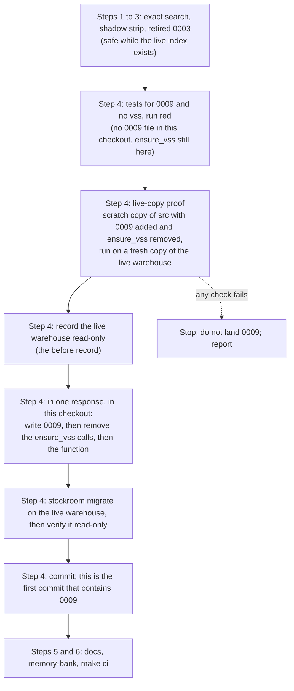

# Task: Drop the HNSW index and remove vss from the engine (warehouse-file-growth, milestone 1)

* Task ID: warehouse-file-growth
* Complexity: Level 3
* Type: feature (L4 milestone 1 of 7)

A new migration `0009` drops the HNSW index from any warehouse that has one. Migration `0003` becomes an empty, retired migration, so a new warehouse never gets an index. `warehouse.ensure_vss` and all its calls go, so nothing in the engine loads or installs `vss`. Semantic search becomes one exact path for unscoped and scoped searches. It takes the nearest chunk per message owner, cuts to the limit, and only then joins `messages` for text. Tests, snapshots, the shadow script, docs, and memory-bank context stop describing an index. Before `0009` exists in this checkout, it runs on a copy of this machine's warehouse. `make ci` passes on DuckDB 1.5.4.

## Pinned Info

### This checkout is live: the landing order

This checkout's working tree runs the live `stockroom` shim, which the 03:30 nightly job also uses. The engine runs from the working tree's source, not from commits, so a file is live as soon as it is saved, committed or not. A probe on DuckDB 1.5.4 (`/tmp/claude-1000/-home-mobaxterm-git-stockroom/31832922-95fd-4a02-aec9-4b57d804689d/scratchpad/m1/unbound_index_probe.py`) showed that a connection without `vss`, on a file that still has the index, can drop the index inside a transaction. On the same file, every `INSERT` or `DELETE` on `embeddings` fails, even a delete that matches no row ("Cannot bind index … unknown index type 'HNSW'"). So removing `ensure_vss` before `0009` exists would break the nightly ingest (its cascade delete) and embed on this machine. And an empty stub `0009` would record version 9 on the live warehouse without dropping the index, after which the real `0009` would never run there. The order below avoids both. It is pinned because every step of the build depends on it.



### The exact search statement

One statement serves every scope. The `ranked` part reads only `embeddings`, plus `messages` key and role columns when `--role` is set. Message text is read only for the rows that survive the cut. The tie-break on `harness, owner_id` makes equal distances rank the same way on every DuckDB version.

```sql
WITH ranked AS (
    SELECT e.harness, e.owner_id,
           min(array_cosine_distance(e.vector, ?::FLOAT[384])) AS distance
    FROM embeddings e
    -- only with --role:  JOIN messages s ON s.harness = e.harness AND s.message_id = e.owner_id
    WHERE e.owner_table = 'messages'
    -- with --harness: AND e.harness = ?      with --role: AND s.role = ?
    GROUP BY e.harness, e.owner_id
    ORDER BY distance, e.harness, e.owner_id
    LIMIT <limit>
)
SELECT w.harness, w.owner_id, m.session_id, m.role, m.text, w.distance
FROM ranked w
JOIN messages m ON m.harness = w.harness AND m.message_id = w.owner_id
ORDER BY w.distance, w.harness, w.owner_id
```

Measured during planning (`/tmp/claude-1000/-home-mobaxterm-git-stockroom/31832922-95fd-4a02-aec9-4b57d804689d/scratchpad/m1/measure_shapes.py`, top-100, 133,793 vectors, read-only copies of this machine's data, `vss` not loaded):

| Shape | DuckDB 1.5.4 | DuckDB 2.0.0 |
|---|---|---|
| Today's scoped SQL run with no scope (join, `QUALIFY`, `LIMIT`) | 1,704 ms | 1,906 to 2,192 ms |
| Rank, cut, then join (the statement above, no scope) | 220 ms | 151 to 168 ms |
| The same with `EXISTS` on `messages` keys (orphan-proof) | 689 ms | 317 to 323 ms |
| The same with a key join on `messages` | 559 ms | 217 ms |
| `--role user`, the statement above | 389 ms | 144 to 152 ms |
| `--role user`, today's scoped SQL | 1,272 ms | 428 to 430 ms |

Every shape returned the same 100 owners. Only the order of equal distances differed. The live data has 0 orphan embeddings.

## Component Analysis

### Affected Components

- **Migrations** (`skills/sr-search/src/stockroom/migrations/`): `0003_embeddings_hnsw_index.sql` creates the HNSW index → renamed to `0003_retired.sql`, comment-only, so it does nothing. New `0009_drop_vector_index.sql` runs `DROP INDEX IF EXISTS embeddings_vector_hnsw`. `0001_initial_schema.sql`: three comment lines that promise a later index are reworded. No executable SQL in `0001` changes.
- **Warehouse chokepoint** (`warehouse.py`): `ensure_vss` loads and installs `vss` and sets HNSW persistence on every connection from `open()`, `open_current()`, and `_migrate_under_lock()` → the function, its 5 calls, and its `__all__` entry are deleted.
- **Semantic search** (`semantic.py`): two paths, `_hnsw_hits` (index KNN with `OVERFETCH`) and `_scoped_hits` (join first, `QUALIFY`) → one `_ranked_hits` that runs the statement above. `OVERFETCH` is deleted. `run_semantic_search` and the CLI keep their signatures. Docstrings stop mentioning the index.
- **Embed** (`embed.py`): docstrings say a connection has `vss` loaded → reworded. No code change.
- **Test infrastructure** (`tests/conftest.py`, `tests/_warehouse_worker.py`): `migrated_con` stops calling `ensure_vss`. The worker gains the v2.1.2 `0003` SQL, a builder for an old indexed warehouse, a killed embed writer, and a killed migrator.
- **Schema tests and snapshots** (`tests/test_schema_0003.py` … `test_schema_0008.py`, new `test_schema_0009.py`, `tests/fixtures/schema/0003…0008_snapshot.json`): stop loading `vss`. The `0003`, `0004`, `0006`, `0007`, and `0008` snapshots are regenerated with `"indexes": []`. `0009` adds no DDL, so its test reuses the `0008` snapshot, as `0005` reuses `0004`'s.
- **Chokepoint and runner tests** (`test_warehouse_open.py`, `test_warehouse_concurrency.py`, `test_migrate_runner.py`): head moves from 8 to 9. The "reader has vss loaded" test is replaced by "no connection has vss loaded". New tests cover a new warehouse with no index and an old indexed warehouse with a leftover `.wal`.
- **Semantic tests** (`test_semantic.py`): the HNSW plan test and `_RecordingConnection` are deleted. The starvation test keeps its point (a scope applies before the cut) without the HNSW reason and with fewer rows. New tests cover a crowding owner, an orphan, ties, and role-scope starvation.
- **Shadow script** (`scripts/shadow_duckdb_20.py`, `tests/test_shadow_duckdb_20.py`): the kill protocol, `Probe`, `classify`, `read_count_line`, `reproduce`, branches A and B, the patch repeat (`newest_final_patch`, PyPI), the HNSW plan line, and the index measurements are deleted, with their tests. `_connect` and the child prelude stop loading `vss`. The guards, the copy, checkpoint equality, the overlay check, the live phase, `embeddings_held`, and the non-index measurements stay for milestone 2.
- **Docs and context** (prose): `docs/architecture/embeddings.md`, `docs/architecture/index.md`, `docs/architecture/warehouse.md`, the hand-written footer of `skills/sr-query/references/warehouse-schema.md`, `skills/sr-search/references/system-model.md`, `memory-bank/systemPatterns.md`, `memory-bank/techContext.md`.

### Cross-Module Dependencies

- Every consumer → `warehouse.open()` / `open_current()`: after this milestone, neither loads `vss`. Every writer opens through the migrating `open()` (ingest, embed, backfill, migrate). No production code opens with `migrate=False`. So `0009` always runs before the first write to `embeddings`, which matters because writes fail while an unbound index exists.
- `semantic.run_semantic_search` → `warehouse.open(read_only=True)`: a reader on a schema-8 file becomes the migrator, so the drop also runs before a search.
- `open_current()` (dashboard, backfill dry run) never migrates. On a schema-8 file it raises `WarehouseStaleError` (8 < 9), as it does for any behind-head file.
- Schema tests → `test_schema_0003._introspect_schema` (shared helper, stays). `test_warehouse_open` → `test_schema_0008.SNAPSHOT_PATH` (the head snapshot, stays 0008).
- `scripts/gen_warehouse_schema.py` reads the highest-numbered snapshot (`0008`). The ERD diagram does not change, because no column changes. Only the hand-written footer sentence about the index changes.
- `_warehouse_worker.py` → the real migration runner (`apply_pending` with a directory), so old fixtures are built by the same runner a v2.1.2 install used.

### Boundary Changes

- Warehouse schema: version 9. A warehouse that had `embeddings_vector_hnsw` loses it. Tables and columns do not change. `schema_version` gains row 9. A new warehouse records `0003_retired.sql` for version 3; an existing one keeps the name it recorded. Nothing reads that column.
- `stockroom.warehouse.ensure_vss` is removed from the module's public names. Only the engine and its tests called it.
- `stockroom.semantic.OVERFETCH` is removed. Semantic results are exact. With equal distances, results now rank by harness, then message id.
- No CLI flag, output format, or exit code changes.

### Invariants & Constraints

- Every row stays. The drop removes an index and rebuilds no table. Every table's multiset equals its pre-migration copy in both directions (`EXCEPT ALL`), except `schema_version`, which gains exactly row 9.
- After this milestone, nothing outside tests loads or installs `vss`, creates a vector index, or sets an HNSW setting. Tests that need the index build it with `vss` loaded only in a child process, or on an in-memory database the engine never opens.
- `0009` lands in this checkout only after the live-copy proof passes, and together with the removal of `ensure_vss`. No stub `0009` ever exists in this checkout.
- Every existing arrival still works: a `v1.0.0+` file at schema 0 to 8, with or without the index, with or without a `.wal` left by a killed 1.5.4 embed, and no warehouse at all. Schema 0 to 2 files migrate through the empty `0003` with no `vss`.
- The storage tag of an existing file does not change. The schema-1 storage-tag test stays green.
- The data-safety rules hold: no code path deletes a warehouse or a backup. The live-copy proof keeps its baseline copy until the live warehouse is verified.
- Out of scope: DuckDB 2.0 (milestone 2), zstd and the new file format (milestone 3), doctor (milestone 4), any copy or swap (milestones 5 to 7), and a vector index of any kind.

## Open Questions

None. The plan settles the three choices the milestone left open:

- [x] Exact path shape → Resolved: rank, cut, then join (statement above), the shape the operator adopted from preflight advisory 1. The measurements above confirm it on 1.5.4 and 2.0.0.
- [x] Orphan embeddings (owner row missing) → Resolved by the operator after preflight: no orphan guard in the ranking. `write_session` is the only code that deletes `messages`, and it first deletes the embeddings of removed or changed messages. But it runs without a transaction: it deletes the session's `messages` and re-inserts them, and each statement commits on its own. So a crash between those statements leaves the session's unchanged embeddings as orphans until the next ingest rewrites the session or the next embed sweeps them. The live data has 0. The final inner join leaves an orphan out of the result, so in that window a top-k search can be short. Today the unscoped path raises `KeyError` on one. A key-join guard would cost +57 ms on 2.0.0 and +340 ms on 1.5.4. A test pins the left-out-not-raised behaviour.
- [x] `0003`'s filename → Resolved: rename it to `0003_retired.sql` and keep it as a comment-only file. The operator asked to strip everything about the index except the migration that drops it. Keeping a version-3 file keeps versions contiguous, and `test_warehouse_concurrency` relies on that (row count equals head). Nothing reads `schema_version.filename`.

## Test Plan (TDD)

### Behaviors to Verify

Semantic search (`test_semantic.py`):
- B1 Crowding owner: one message with 64 nearest chunks and five single-chunk messages farther away, `limit=3` → three distinct owners, the crowding one first. Today this returns one row, because `OVERFETCH` fetches only 30 chunks.
- B2 Orphan: an `embeddings` row whose owner has no `messages` row is the nearest → search returns the real messages, without the orphan, and does not raise. Today this raises `KeyError`.
- B3 Ties: two messages with equal distance → ranked by harness, then message id.
- B4 Harness scope behind nearer outsiders: 64 nearer out-of-scope chunks, `harness='claude'`, `limit=5` → the one farther in-scope message is returned. This replaces the 4,096-row HNSW version and its reason.
- B5 Role scope behind nearer outsiders: 64 nearer `assistant` chunks, `role='user'`, `limit=5` → the farther `user` message is returned.
- B6 The existing behaviours stay green on the single path: nearest first, ascending distances and ranks, multi-chunk dedup, limit, join fields, empty, owned read-only connection, harness and role scopes, unknown harness, limit after scope, and the CLI tests.

Migrations (`test_schema_0003.py`, new `test_schema_0009.py`, `test_schema_0004`–`0008`):
- B7 `0001` to `0003` applied on a connection that never loaded `vss` → no error, no non-primary index, `vss` not loaded.
- B8 The regenerated `0003`, `0004`, `0006`, `0007`, and `0008` snapshots match the chain, with `"indexes": []`. `0005` still matches the `0004` snapshot.
- B9 `0009` on a `v1.0.0` file built in a child process by v2.1.2's chain (with the index, rows written) → run in-process with no `vss`, inside a transaction: the index is gone, every row stays, and `vss` is not loaded.
- B10 `0009` on a chain with no index → no error, and the schema equals the `0008` snapshot.

Chokepoint (`test_warehouse_open.py`, `test_warehouse_concurrency.py`, `test_migrate_runner.py`):
- B11 Writer `open()`, reader `open()`, and `open_current()` connections all report `vss` as not loaded.
- B12 A new warehouse from `open()` has no non-primary index. Written in step 3: it goes green when `0003` is retired, not when `0009` arrives.
- B13 Old warehouse with a leftover `.wal`: a `v1.0.0` file at schema 8 with the index and 20 embedded messages, built in one child process. A second child, with `vss` loaded, inserts one more message and its embedding, commits, and is killed with SIGKILL. The `.wal` exists. Then `warehouse.open(read_only=False)` in-process → version 9, no index, `vss` not loaded, 21 messages and 21 embeddings. A search for the killed row's vector ranks that message first, and `limit=21` returns 21 rows. After close, no `.wal` remains.
- B14 Killed migrator: an indexed schema-8 file (child-built, clean). A child runs `warehouse.open(read_only=False)`, which commits `0009`, signals, and is killed before it closes. The `.wal` exists. Then `warehouse.open()` in-process → version 9, no index, every row.
- B15 Head is 9: the runner applies `[1, …, 9]` on a fresh database, the concurrency race reports 9 with 9 `schema_version` rows, and the `open()` tests report 9. Schema 1 → head keeps the `v1.0.0+` tag (existing test, now through the empty `0003` with no `vss`).

Shadow script (`test_shadow_duckdb_20.py`):
- B16 The five guard tests and `embeddings_held` stay green after the strip. Tests of deleted functions are deleted with them; no test asserts an absence.

Edge cases covered above: an empty warehouse (existing `test_search_no_embeddings_returns_empty`), an orphan (B2), ties (B3), a crash during the upgrade (B14), a crash before the upgrade (B13), and a schema 1 file with no `vss` (B15).

### Test Infrastructure

- Framework: pytest with pytest-xdist (`-n auto`), configured in `skills/sr-search/pyproject.toml`. Run one file with `uv --directory skills/sr-search --no-config run --no-sync pytest tests/<file> -n0`. Run the whole suite with `make test`, and the full gate with `make ci`.
- Test location: `skills/sr-search/tests/`.
- Conventions: one `test_schema_NNNN.py` per migration, with a cumulative golden snapshot regenerated with `STOCKROOM_UPDATE_SCHEMA_GOLDEN=1`, and the shared `_introspect_schema` in `test_schema_0003.py`. `warehouse_home` fixture for `STOCKROOM_HOME`. `spawn_worker` plus `wait_for_sentinel` for child processes (`tests/_warehouse_worker.py`). `FakeEncoder` in `conftest`, and `_FixedEncoder` in `test_semantic.py`. Docstrings explain each test.
- New test files: `tests/test_schema_0009.py`. The worker gains commands; it is not a test module.

### Integration Tests

- B13 and B14: child-process builder, killed writers, then the real `warehouse.open()` gate, migration runner, and `semantic.run_semantic_search` in-process.
- B9: a child-built file, then the packaged `0009` SQL in-process with no `vss`.
- The live-copy proof (step 4) is the end-to-end check on real data. It is a scratch script, not a suite test.

## Implementation Plan

### 1. Exact semantic search: one path — executable

- Files: `skills/sr-search/src/stockroom/semantic.py`, `skills/sr-search/tests/test_semantic.py`
- Safe while the live index exists: an exact scan works with or without `vss` and with or without the index.

1. Stub tests in `test_semantic.py`: `test_search_returns_full_limit_when_one_owner_crowds_nearest_chunks` (B1), `test_search_leaves_out_orphan_embedding_without_error` (B2), `test_search_breaks_distance_ties_by_harness_then_message_id` (B3), and `test_search_role_scope_returns_inscope_behind_nearer_outsiders` (B5), each with a docstring. Rename `_STARVATION_OUTSIDERS` to `_NEARER_OUTSIDERS = 64`. Its comment becomes "more nearer out-of-scope chunks than the limit, so a scope applied after the cut would return nothing". Reword the docstring of `test_search_scope_returns_inscope_behind_nearer_outsiders` the same way (B4). Give `_insert_embedding` a `chunk_index` keyword that defaults to 0. Delete `test_unscoped_semantic_plan_uses_hnsw` and `_RecordingConnection`, and reword the `# --- Scoped ranking` comments.
2. Stub interface in `semantic.py`: `_ranked_hits(connection, query_vector, limit, *, harness, role) -> list[SemanticHit]`, with a full docstring and a `raise NotImplementedError` body. It is not wired in yet.
3. Write tests and run red: B1 (64 chunks of one owner at `nearer` through `_insert_embedding(..., chunk_index=i)`, five owners at `farther`, `_FixedEncoder(query)`, `limit=3` → 3 distinct owners, crowding owner first). B2 (an orphan row at distance 0 plus two real messages → hits are the two real ones). B3 (two messages, `cursor` `b#0` and `claude` `z#0`, with the same vector → order `claude` then `cursor`; for one harness, ids `s#1` then `s#2`). B5 (role). Run `test_semantic.py`: B1 and B2 fail. B3 and B5 may pass on today's code; record which.
4. Write code and run green: implement `_ranked_hits` as the statement above, with `int(limit)` for `LIMIT` as today, and parameter order `[query_vector, *scope_params]`. Point `run_semantic_search` at it for every scope. Delete `_hnsw_hits`, `_scoped_hits`, and `OVERFETCH`. Update the module docstring and `run_semantic_search`'s docstring: exact ranking of every embedding, nearest chunk per owner, cut before the text join, the tie-break, an orphan left out, no `vss`. Run `test_semantic.py`, then `test_render.py` and `test_dispatcher_cli.py`, which use semantic output.

### 2. Strip the index-only parts of the shadow script — executable

- Files: `scripts/shadow_duckdb_20.py`, `skills/sr-search/tests/test_shadow_duckdb_20.py`
- Safe: a contributor script that nothing on this machine runs.
- Runs before step 3: `test_reproduce_on_tiny_file_returns_a_label` reaches the old `0003` filename through `_repair`, so it would fail once step 3 renames `0003`.

1. Stub tests: delete `test_classify_*` (4), `test_read_count_line_*` (2), `test_newest_final_patch_ignores_prereleases`, and `test_reproduce_on_tiny_file_returns_a_label`, together with `_LABELS`, `_STATEMENTS`, `_ok`, `_child_env`, and the now-unused `warehouse`, `apply_pending`, `os`, and `time` imports. The module docstring becomes "guards and checkpoint equality". The five guard tests and `test_embeddings_held_allows_only_reported_orphans` stay.
2. Stub interface: none (deletion).
3. Write tests and run red: none are red. The remaining tests run as a regression check before and after the strip; record that they pass on the unmodified script first.
4. Write code and run green. Delete `INDEX_SQL`, `INDEX_NAME`, `STATEMENTS`, `SYNTHETIC_THRESHOLD`, `PYPI_SIMPLE`, `_FINAL_PATCH`, `INDEX_COUNT_SQL` and `counts` from the child prelude, `_INSERT_CHILD`, `_PROBE_CHILD`, `_FOLD_CHILD`, `_COUNT_CHILD`, `_REPAIR_CHILD`, `Probe`, `classify`, `read_count_line`, `newest_final_patch`, `reproduce`, `_unscoped_plan_line`, `_Recorder`, `_FixedEncoder`, `_branches`, `_patch_repeat`, `_pypi_versions`, `_patch`, `_reproduce_child`, the whole kill-protocol section (`_kill_after_insert`, `_observe`, `_repair`, `_parse_counts`, `_describe`), `_spawn`, `_finish`, `_used_blocks`, `_index_count`, `_measure_delete_leak`, `_measure_drop_delete_create`, `_measure_index_count`, `_measure_plans`, `_measure_interrupt_index_build`, and the `--reproduce-child` and `--fold` arguments. `_connect` and the child prelude's `connect` stop loading `vss` and setting HNSW persistence, and their docstrings say so. `_measure_copy_from_database` drops its `LOAD vss`/`SET` lines and its index listing, and keeps the tag and codecs. `_synthetic` only prints the measurements. `_live` drops the plan line. `_run` drops `_branches` and `_patch_repeat`. `main` drops the child branch. `PROBE_SECONDS` keeps its value, and its comment becomes "seconds a DuckDB child may go without printing before the parent stops it". Prune imports that are no longer used (`json`, `threading`, `urllib.request`, `dataclass`, and the child's `os` and `time`). The module docstring lists five phases: overlay, synthetic measurements, copy, checkpoint equality, live. Then run `test_shadow_duckdb_20.py`, `make lint`, and `make format-check`.

### 3. Retire migration 0003 and stop loading vss in the schema tests — executable

- Files: `migrations/0003_embeddings_hnsw_index.sql` → `migrations/0003_retired.sql` (`git mv`), `migrations/0001_initial_schema.sql` (comments only), `tests/conftest.py`, `tests/test_schema_0003.py`, `tests/test_schema_0004.py` to `test_schema_0008.py`, `tests/test_migrate_runner.py` (the `ensure_vss` lines only), `tests/test_warehouse_open.py` (B12 only), and `tests/fixtures/schema/0003, 0004, 0006, 0007, 0008_snapshot.json`
- Safe while the live index exists: the live warehouse is past version 3.

1. Stub tests: in `test_schema_0003.py`, replace the module docstring (`0003` is retired: it once created the index, and `0009` drops it). Delete `test_0003_creates_hnsw_cosine_index`, `test_0003_index_supports_knn_and_live_delete`, `HNSW_INDEX_NAME`, and `_unit`. Add `test_0003_needs_no_extension_and_creates_no_index` (B7). Keep `_introspect_schema` and the snapshot test, and reword their docstrings ("so a vector index would show in the golden" becomes "so a non-primary index would show in the golden"). In `test_warehouse_open.py`, add `test_new_warehouse_has_no_vector_index` (B12).
2. Stub interface: none. The migration body is the change.
3. Write tests and run red: `_apply_chain` in `test_schema_0003`, `0004`, `0006`, `0007`, and `0008`, plus `_apply_through` in `0005` and in `0007`, and the `0006`/`0008` preserve tests, stop calling `warehouse.ensure_vss`. Their "Load VSS and apply" docstrings become "Apply". Drop the unused `from stockroom import warehouse` imports. `conftest.migrated_con` stops calling it, and its docstring loses the `0003` paragraph. `test_migrate_runner.py`'s two `ensure_vss` calls and the docstring sentence go (its head assertions change in step 4). B7 asserts: on a fresh `mem_con`, applying `0001` to `0003` raises nothing, `duckdb_indexes()` has no non-primary row, and `duckdb_extensions()` reports `vss` not loaded. B12: `open(read_only=False)` on a fresh home, and `duckdb_indexes()` has no non-primary row. Run the schema tests, `test_migrate_runner.py`, and B12: B7, B12, and the snapshot tests fail (or error on the `vss`-dependent `SET`).
4. Write code and run green: `git mv` `0003` to `0003_retired.sql`. Its body becomes a comment only: version 3 once created a vector index on `embeddings(vector)`; semantic search ranks every vector exactly; `0009` drops the index where it exists; the empty file keeps version numbers contiguous, and the runner records version 3 without changing anything. Reword `0001`'s comments: the "No HNSW/VSS index" bullet, the "Forward-declared; populated in Phase 2 (embeddings + search). No HNSW index." line, and the `vector` column comment, so they promise no index. Leave every `@rel` line and all SQL alone. Regenerate the snapshots: `STOCKROOM_UPDATE_SCHEMA_GOLDEN=1` with `test_schema_0003.py`, `0004`, `0006`, `0007`, and `0008`. Then `git diff tests/fixtures/schema` must show only the `indexes` list emptied in those five files. Run the schema tests, `test_migrate_runner.py`, `test_warehouse_open.py` (the head snapshot now has no index, and B12 passes), and `make schema-docs-check` (the diagram is unchanged).

### 4. Drop the index with migration 0009 and remove vss from the chokepoint — executable (follows the pinned landing order)

- Files: new `migrations/0009_drop_vector_index.sql`, `src/stockroom/warehouse.py`, `src/stockroom/embed.py` (docstrings), `tests/_warehouse_worker.py`, new `tests/test_schema_0009.py`, `tests/test_warehouse_open.py`, `tests/test_warehouse_concurrency.py`, `tests/test_migrate_runner.py`, and the scratch scripts `<scratch>/m1/live_copy_proof.py` and `<scratch>/m1/verify_live.py`
- `<scratch>` is the build session's own scratchpad directory. The planning scripts are at `/tmp/claude-1000/-home-mobaxterm-git-stockroom/31832922-95fd-4a02-aec9-4b57d804689d/scratchpad/m1/` (`measure_shapes.py`, `unbound_index_probe.py`), and the preflight's probe is `…/scratchpad/pf13/killed_migrator_probe.py` beside it. `/tmp` may be emptied at a reboot. If they are gone, rewrite them from their description here: `measure_shapes.py` times each shape in "The exact search statement" read-only with `vss` never loaded, and prints the row count and whether the owner set matches today's SQL.

1. Stub tests:
    - `tests/_warehouse_worker.py`: broaden the module docstring (concurrency and old-warehouse fixtures). Add the constant `V2_1_2_INDEX_SQL`: the two statements of `0003` as v2.1.2 shipped it, labelled as such. Add `build_v2_1_2_chain(con, directory)`: write the packaged `0001`, `0002`, and `0004` to `0008` into `directory` under their own names, write `V2_1_2_INDEX_SQL` as `0003_embeddings_hnsw_index.sql`, and run `apply_pending(con, directory)`. Add commands `build_indexed <db> <rows> <scratch_dir>` (a `v1.0.0` file, `vss` loaded, the v2.1.2 chain, `<rows>` messages with one-hot embeddings at slots `0…rows-1`, `CHECKPOINT`, close, print `built`), `insert_and_hang <db> <ready_file>` (`vss` loaded with persistence, insert message `k#0` and its embedding one-hot at slot 300, autocommit, write `ready_file`, sleep), and `migrate_and_hang <ready_file>` (`warehouse.open(read_only=False)`, write `ready_file`, sleep).
    - `tests/test_schema_0009.py`: `test_0009_drops_the_index_without_vss` (B9), `test_0009_without_an_index_changes_nothing` (B10), and `test_0009_schema_matches_0008_snapshot` (B10).
    - `tests/test_warehouse_open.py`: replace `test_open_reader_has_vss_loaded` with `test_open_and_open_current_do_not_load_vss` (B11). Add `test_schema_eight_indexed_warehouse_with_killed_embed_wal_migrates_to_head` (B13), and `test_writer_killed_after_index_drop_reopens_at_head` (B14). Set `_HEAD_VERSION = 9`. Reword the head-snapshot docstring (no index).
    - `tests/test_warehouse_concurrency.py`: `_HEAD_VERSION = 9`. `tests/test_migrate_runner.py`: `[1, …, 9]` and `== 9`, and the docstring lists `0003` (retired) and `0009` (drops the index).
2. Stub interface: none. Do not create `0009` in this checkout, not even empty: an empty `0009` would record version 9 on the live warehouse with the index still in it. `ensure_vss` removal has no interface to stub.
3. Write tests and run red. B9: `spawn_worker("build_indexed", db, 20, scratch)`, wait for exit 0, then in-process `duckdb.connect(db)` with no `vss`, `BEGIN`, the packaged `0009` SQL, `COMMIT`. Assert no non-primary index, 20 rows each in `messages` and `embeddings`, and `vss` not loaded. Until the file exists, the test fails at its lookup by version 9. B10: `mem_con`, the chain through 9 without `vss`, `_introspect_schema` equals the `0008` snapshot. B11: open a writer (create), close it, open a reader, and call `open_current()`. On each connection, `SELECT loaded FROM duckdb_extensions() WHERE extension_name = 'vss'` is false. B13: as in the behaviours list, with the worker. Assert that the `.wal` exists before the in-process open, then version 9, no index, `vss` not loaded, counts 21 and 21, the top hit for `_FixedEncoder(one_hot(300))` is `k#0`, `limit=21` returns 21 rows, and no `.wal` after `close()`. B14: build clean with `build_indexed`, then `spawn_worker("migrate_and_hang", ready)` (the child gets `STOCKROOM_HOME`), wait, kill, and assert the `.wal` exists. Then `open()` in-process gives version 9, no index, and 20 and 20 rows. Run these files: B9, B10, B11, B13, B14, B15, and the head tests fail. Record the failures.
4. Live-copy proof, before `0009` exists in this checkout. Write `<scratch>/m1/live_copy_proof.py`, commented, as a scratch script. Run it from the repo root with the engine venv's Python:
    - Copy the live warehouse with the shadow script's copy phase: `python scripts/shadow_duckdb_20.py --source ~/.local/share/stockroom/warehouse.duckdb --home <scratch>/m1/proof --stop-after copy`. This takes the writer flock, refuses a `.wal`, and checks that the size and mtime did not change. It leaves `baseline.duckdb` and `warehouse.duckdb`. It needs about 87 GB; 763 GB is free. Do not run it near 03:30.
    - Copy `skills/sr-search/src` to `<scratch>/m1/src-proof`. Remove `ensure_vss` and its calls there, and add `0009_drop_vector_index.sql` there with its final text.
    - Read-only on the working copy, in a child process: used blocks, the row count of every table, the non-primary indexes (expect `embeddings_vector_hnsw`), and the schema version (expect 8).
    - Migrate in a child: `PYTHONPATH=<scratch>/m1/src-proof STOCKROOM_HOME=<scratch>/m1/proof`, then `warehouse.open(read_only=False)`, print `current_version`, and close. Time it.
    - Read-only in a fresh child: version 9; no non-primary index; `vss` not loaded; no `.wal`; used blocks lower than before; every table except `schema_version` equal to `baseline.duckdb` in both directions (`ATTACH … (READ_ONLY)`, `EXCEPT ALL`); and `schema_version` equal to the baseline's rows plus exactly one row, version 9, `0009_drop_vector_index.sql`.
    - `python -m stockroom semantic -k 100 --format json "how does the warehouse lock work"` with the same `PYTHONPATH` and `STOCKROOM_HOME` returns 100 results. Re-run `measure_shapes.py` on the migrated copy to record the timing.
    - Any failure: stop. Do not land `0009`; report to the operator.
5. Record the live warehouse before landing: write `<scratch>/m1/verify_live.py`, commented, and run it read-only on `~/.local/share/stockroom/warehouse.duckdb` in a child process. It records the schema version (expect 8), the row count of every table, used blocks, the non-primary indexes (expect `embeddings_vector_hnsw`), and whether a `.wal` exists, and saves them as the before record. This must come before step 6: once `0009` is in this checkout, any search or writer on this machine migrates the live warehouse.
6. Land, in one response, after the proof passes and the before record exists, in this order:
    1. Create `0009_drop_vector_index.sql`: a header comment in the style of `0008` (older warehouses carry an HNSW index from `0003` as it stood; semantic search ranks exactly; this drops it where it exists; it needs no extension; it drops an index and rebuilds no table), then `DROP INDEX IF EXISTS embeddings_vector_hnsw;`.
    2. Remove the five `ensure_vss` calls: in `open_current`, in `_migrate_under_lock`, in both reader branches of `open`, and in its writer branch.
    3. Delete the `ensure_vss` function and its `__all__` entry.
    4. Reword the `embed.py` docstrings at the module head, in `embed_pending`, and in `main`, so they no longer mention `vss`.
    5. Run the step-4 test files: all green.

   With `0009` written first, no state during the landing is unsafe. While `ensure_vss` remains, an open loads `vss` and migrates. After it goes, an open migrates without `vss`. Either way the index is dropped before any write. Removing the calls before the function means no saved state calls a missing name.
7. Migrate the live warehouse at once, while present: run `stockroom migrate` (expect "schema version 9"). Then run `verify_live.py` again and compare with the before record: version 9, no index, every table's row count not lower, used blocks far lower, and no `.wal`. Commit promptly: this is the first commit that contains `0009`. Keep `<scratch>/m1/proof/baseline.duckdb` until this verification passes, then delete this session's proof copies.

### 5. Docs and context — prose/policy

- Files: `docs/architecture/embeddings.md`, `docs/architecture/index.md`, `docs/architecture/warehouse.md`, `skills/sr-query/references/warehouse-schema.md` (hand-written footer only), `skills/sr-search/references/system-model.md`, `memory-bank/systemPatterns.md`, and `memory-bank/techContext.md`
- No tests: prose/policy artifact

1. `embeddings.md`: the intro and the "Local vectors" lead stop naming an index. Replace "VSS and HNSW" with "Exact search": vectors live in the warehouse, and search ranks every one by cosine distance. It keeps the nearest chunk per message, cuts to the limit, then reads text. `--harness` and `--role` filter before the cut. There is no vector index and no DuckDB extension; the reason is that the index left results short and held most of the file.
2. `architecture/index.md` row: "Embedding model, exact semantic search, …". `warehouse.md`: the `open()` bullet loses "VSS load".
3. `warehouse-schema.md` footer: no secondary index exists; primary keys show as `PK`.
4. `system-model.md`: "runs cosine KNN over an HNSW index" becomes "ranks every stored vector by cosine distance".
5. `systemPatterns.md`: the lock section loses "and VSS load". The embeddings section describes the exact path, the cut before the text join, scopes before the cut, the tie-break, and that no extension is loaded. `techContext.md`: the intro loses "indexed via DuckDB VSS/HNSW". The schema paragraph loses the `ensure_vss` and `0003` sentence, and says the warehouse has no vector index (`0009` drops one from older files).
6. Check: `git grep -n -i -E 'vss|hnsw|over-?fetch'` outside `memory-bank/archive`, `memory-bank/active`, `.summem`, and `CHANGELOG.md`. It may hit only `0009`, `0003_retired.sql`, the worker's v2.1.2 fixture, and the tests that build or assert the old index.

### 6. Full verification — executable gate

1. `make ci` (sync, lock-check, lint, format-check, schema-docs-check, test, reuse), reading the whole output.
2. `make docs-build` for the edited doc pages.
3. Update `tasks.md` and `progress.md`, and commit.

## Technology Validation

No new technology - validation not required. No dependency, lock, or build change: the engine stays on DuckDB 1.5.4, and `vss` leaves rather than arrives. Facts this plan relies on were measured during planning: the query timings above, and the 1.5.4 probe of writes against an unbound HNSW index (writes fail, `DROP INDEX IF EXISTS` in a transaction works, `vss` stays unloaded). The twelfth preflight measured that a comment-only migration file runs inside the runner's transaction on 1.5.4 and 2.0.0.

## Challenges & Mitigations

- The working tree is live on this machine: the pinned landing order. Steps 1 to 3 are safe with the index still present. Step 4 takes the live before record, then lands `0009` first and the `ensure_vss` removal after it, in one response, after the copy proof. It then migrates the live warehouse while present. With `0009` first, no state during the landing lets a write meet an unbound index.
- Building the index fixture needs `vss`, which may download: the worker tries `LOAD` before `INSTALL`, as today's suite does. `vss` is cached on this machine, and CI has network access, as it does today.
- Same-path connections in one process share one DuckDB instance and its loaded extensions: the builder and both killed writers run as child processes. The test opens the file in-process only after the children exit, then asserts that `vss` is not loaded. B9's in-process connection loads nothing.
- SIGKILL timing: each child writes its ready file only after its commit returns, and the parent waits with `wait_for_sentinel`. B13 asserts that the `.wal` exists before the open, so the test cannot pass vacuously on a clean file.
- Regenerating snapshots could hide drift: after regeneration, the diff must show only `"indexes": [...]` becoming `[]` in the five files.
- The live-copy proof takes about 87 GB and holds the writer flock while it copies: 763 GB is free. Run it away from 03:30. The copy phase refuses a `.wal` and a source that changes during the copy.
- Exact search cost grows with the number of vectors: 220 ms on 1.5.4 at 133,793 vectors. If that stays linear, it is about 1.6 s at a million, and the 962 vectors a night seen on 2026-10-21 would take years to get there. The operator accepted this cost when dropping the index.
- An older plugin copy on this machine (Claude Code stockroom 0.16.0) loads `vss`. On a version-9 warehouse it does not migrate, and its search runs as an exact scan. If it creates a new warehouse, its own `0003` creates the index, and the next open by this release drops it.
- The long-running dashboard process keeps its old code until it restarts. It may call the old `ensure_vss` (harmless with no index), and it shows the warehouse as stale between landing `0009` and the migrate: run `stockroom migrate` at once.

## Pre-Mortem

- The live drop misbehaves, for example by taking much longer than on the copy, or by not freeing blocks at close → the copy proof measures both first. The baseline copy is kept until the live check passes. The data cannot be lost: the drop rebuilds no table, and the baseline is a byte copy.
- The plan's premise "a file is live only once committed" was wrong → corrected in this plan: the working tree is live. The landing order and "no stub `0009`" follow from it. Already covered.
- A hidden dependency on `vss` beyond the index, such as a function → `array_cosine_distance` is core DuckDB. The suite runs with no `vss` after step 4, B13 searches on a file whose `vss` was never loaded, and the proof runs `stockroom semantic` on real data.
- The role path quietly reads text before the cut → the statement joins `messages` in `ranked` only for its key and role columns. The proof re-runs the timing script on the migrated copy (role was 389 ms on 1.5.4; today's SQL takes 1,272 ms).
- Reviewers read the edits to `0003` and to old snapshots as breaking "forward-only" → the milestone requires them. The runner keys on version numbers, and existing warehouses already applied `0003`. The commit and docs say why.
- B13 passes for the wrong reason: the `.wal` is folded or missing, or `vss` was loaded in-process → it asserts that the `.wal` exists before the open, that `vss` is not loaded after, and that the killed row is present and found by search.

## Status

- [x] Component analysis complete
- [x] Open questions resolved
- [x] Test planning complete (TDD)
- [x] Implementation plan complete
- [x] Technology validation complete
- [x] Pre-Mortem complete
- [x] Preflight
- [ ] Build
    - [x] Step 1: exact semantic search. Red run: B1 (1 of 3 owners) and B2 (`KeyError`) failed; B3 and B5 already passed on the old code. Green: `test_semantic`, `test_render`, `test_dispatcher_cli` (93 passed, 1 torch-gated skip)
    - [x] Step 2: shadow script strip. No red run (deletion); the 6 kept tests passed before and after (`test_shadow_duckdb_20`), `make lint` and `make format-check` clean. Also removed `LOCK_ERROR` and the child prelude's `one_line`, which only deleted code used
    - [x] Step 3: retire `0003`, schema tests without `vss`. Red run: 24 failed (B7, B12, and every chain helper on `0003`'s `vss`-only `SET`). Green: schema, runner, discovery, and `test_warehouse_open` (93 passed); snapshot diff is only `indexes` emptied in 0003/0004/0006/0007/0008; `make schema-docs-check` clean; full `make test` 1,035 passed, 38 skipped. The head-snapshot docstring in `test_warehouse_open` was reworded here, not in step 4, because the snapshot changed here
    - [x] Step 4: `0009`, `ensure_vss` removal, live-copy proof, live migrate
        - [x] 4.1 to 4.3: worker commands, `test_schema_0009`, B11/B13/B14, head 9. Red run: 16 failed (no `0009`, `vss` loaded, head 8), 11 passed. The same 27 tests passed against a scratch `src-proof` (checkout `src` + `land.py`)
        - [x] 4.4 live-copy proof PASSED (`/tmp/claude-1000/-home-mobaxterm-git-stockroom/f5f3d503-8b96-42ad-b3f4-77f5eaa37cf0/scratchpad/m1/proof.log`, `proof-resume.log`): version 8 to 9, index gone, no `vss`, no `.wal`, used blocks 163,283 to 6,862, close took 19.6 s; every table equal to the baseline both ways; `schema_version` + exactly (9, `0009_drop_vector_index.sql`); `semantic -k 100` returned 100. The first run stopped at check 5 on a script bug (DuckDB progress bar on stdout); resumed with `--after-migrate`. OPEN: in `measure_shapes`, the `--harness claude` shapes return a different owner set from join-first (unscoped and role sets match). Resolved by `scratchpad/m1/tie_check.py` on the migrated copy, 8 sampled query vectors: every differing owner sits exactly at the cut distance (one sample had 150 owners at distance 0), and the nearer-than-cut sets are equal in all 8. The old SQL broke those ties arbitrarily; the new one breaks them by harness, then message id
        - [x] 4.5 live before record (`scratchpad/m1/live-before.json`): schema 8, index present, no `.wal`, 163,283 used blocks, unchanged since the 03:32 nightly
        - [x] 4.6 landed with `land.py`; checkout `src` is byte-identical to `src-proof` (`diff -ru` empty); step-4 tests 27 passed
        - [x] 4.7 `stockroom migrate` (0.9 s; row 9 applied 12:53:03 by that run): `verify_live.py compare` all PASS: version 9, no index, no `.wal`, no `vss`, used blocks 163,283 to 6,862, every table's row count unchanged
    - [ ] Step 5: docs and context
    - [ ] Step 6: `make ci`, `make docs-build`
- [ ] QA
